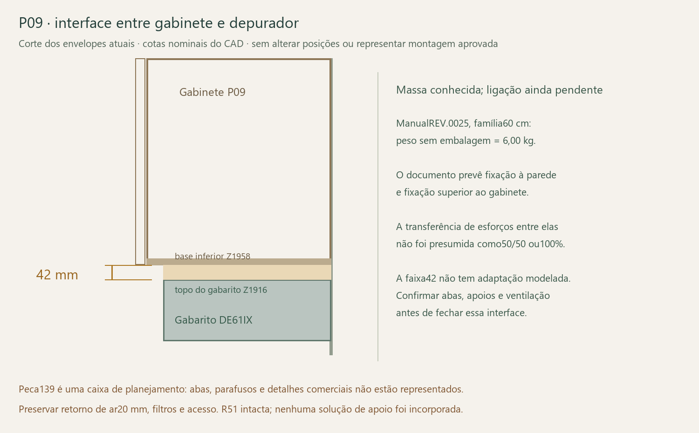

# Suspensão global P09, P11, P12 e P17

25/10/2026 · continuaçãoT02. **Mais quatro caixas têm agora demandas globais de suspensão calculadas com portas abertas e conteúdo parametrizado.** Foi reutilizado o [motor de quatro barras](../Cinematica_offline_2026-10-25/README.md), sem animar ou alterar a R51. Nenhuma geometria de reforço, suspensor ou ancoragem foi adotada por esta etapa.

| Móvel | Base interna, largura | Profundidade da caixa | Altura | Madeira da caixa / folhas |
|---|---:|---:|---:|---|
| P09, acima do depurador | 614 mm | 330 mm | 592 mm | Seis peças / duas portas |
| P11, acima do micro | 661 mm | 330 mm | 610 mm | Seis peças, incluindo prateleira / duas portas |
| P12, acima da geladeira | 765 mm | 330 mm | 584 mm | Seis peças / duas portas |
| P17, aéreo do escritório | 1964 mm | 330 mm | 550 mm | Nove peças / quatro portas |

Volumes e centros da caixa vieram de leitura BREP atual. As portas usam frentes com canecos descontados e os referenciais existentes. As duas chapas do divisor duploP17 continuam separadas. O P09 mantém o divisor de profundidade312 daR48 e não recebe as prateleiras antigas nunca aprovadas.

## Hipóteses e resultados

1404 combinações de densidade650/800/900, portas independentes0/86°, estado45° e extremos amostrados do CG, com conteúdo total0/5/10/20 kg. A distribuição é central ou próxima à frente/extremidades. São **cenários totais por móvel**, não cargas por prateleira ou capacidades autorizadas. No P11, o estudo local10 kg de uma chapa continua condicionado; ele não autoriza aplicar10 kg em todos os níveis.

Para massa das chapas nominais18 foi usada a aproximação de espessura18,3 por fator de volume. Acabamento efetivo, conectores e massas de dobradiças ainda precisam de dados reais. Não se atribuiu a posição da frente a todos os braços metálicos da dobradiça.

O plano de referência da parede é a face traseira nominal. Dois grupos de suspensão recebem a força vertical conforme o centro lateral; o vão entre resultantes varia entre100% e80% da largura da base. O binário usah50% ou80% da altura da caixa; a tração superior pode repartir-se100/0,50/50 ou0/100. Essas posições/partilhas são parâmetros de equilíbrio, sem furos ou produto definido. Não comprovam que a caixa real já transmita a torção necessária entre os lados.

`V(N)=soma(m×g)`; `M(Nm)=soma(m×g×v(mm)/1000)`; `T(N)=1000×M/h(mm)`.

Exemplos comρ900,10 kg de conteúdo próximo à frente, todas as portas86° e h80% da altura:

| Móvel | V total | M para fora da parede | h parametrizado | T superior total |
|---|---:|---:|---:|---:|
| P09, madeira+conteúdo | 367,134 N | 86,759 Nm | 473,6 mm | 183,191 N |
| P11 | 391,711 N | 92,891 Nm | 488,0 mm | 190,351 N |
| P12 | 407,031 N | 98,756 Nm | 467,2 mm | 211,378 N |
| P17 | 796,004 N | 195,594 Nm | 440,0 mm | 444,533 N |

O P09 acima **não inclui o depurador**, cuja transferência de esforços depende da ligação descrita abaixo. A massa de móveis/equipamentos inferiores, como geladeira e micro, não é somada automaticamente ao aéreo.

O P17 merece atenção: o exemplo corresponde a aproximadamente81,17 kg de madeira hipotética+conteúdo antes de ferragens. Não é pesagem; a caixa larga, fundo18, divisórias e quatro portas têm contribuição relevante. Trocar a densidade ou a composição exige recalcular, e um fundo/fecho mais leve teria também outra rigidez.

As48 combinações de h/vão/partilha têm envelopes de cortante, tração e resultante por grupo. Cada máximo de resultante mantém seu caso identificado; não se combinaram máximos incompatíveis. Valores sem majoração, mãos, impacto, resistência local, rigidez real ou ensaio. Grupo não é parafuso; capacidade emkg de catálogo não valida automaticamente V/T simultâneos.

## Depurador P09: dado do fabricante e interface ainda aberta

O [manual SuggarDE61IX/DE62IX arquivado](../../02_Plantas_e_manuais/Manuais/Suggar_DE61IX_DE62IX.pdf),REV.0025,página1, publica **peso sem embalagem6,00 kg para60 cm** e8,01 kg para80 cm. A correspondência das colunas foi conferida na [imagem do manual já arquivada](../Modelo_FreeCAD/02_Revisoes_e_estudos/Equipamentos_R17_2026-10-14/Fontes/Suggar_instalacao.png). Para o DE61IX60, isso representa58,840 N, sem tratar esse dado como pesagem da unidade entregue.

O manual indica primeiro apoio/fixação à parede e depois fixação superior ao gabinete com quatro parafusos4,2×30, figuras5–8. Portanto, **não se presumiu que o armário recebe metade ou todo o peso**. O conjunto tem vínculos redundantes; a partilha, possíveis efeitos de alavanca e a ligação real precisam de desenho/rigidez. Os fixadores citados no manual não são seleção de ancoragem aprovada para uma parede ainda desconhecida.

Há uma pendência nominal concreta: o gabarito`Peca139` termina emZ1916 e a face inferior da baseP09 começa emZ1958, deixando **42 mm entre eles no CAD**. Não há ponte de ligação ou adaptador representado nessa faixa. O gabarito é uma caixa simplificada e não contém abas ou fixações comerciais; o resultado identifica uma interface não demonstrada, sem concluir que o produto real seja inviável.

As posições foram preservadas. Não se removeu a folga, moveu o aparelho ou acrescentou sarrafo/estrutura para fechar a montagem sem comprovação. A abertura de retorno20 mm na largura do armário exigida pelo manual em modo depurador, os filtros e o acesso continuam restrições daR48. Não reinstalar o canal de duto cancelado.

O [registro do depurador](Depurador_dados_e_pendencias.json) distingue massa publicada, dados do gabarito e transferência desconhecida. Para consulta de sensibilidade do conjunto global na parede,6 kg acrescentam58,840 N e um momento que depende do CG. Emv150/300/488 mm, são8,826/17,652/28,714 Nm; essas posições são hipóteses/envelope geométrico de referência, não CG publicado ou carga atribuída a um suspensor do armário. A ligação real pode produzir outros esforços internos.

## Perguntas exatas antes de fechar

1. **Produto/oficinaP09:** como realizar as fixações previstas nas figuras5–8 mantendo as cotas nominais e os42 mm atuais entre gabarito e base? Quais são as abas, superfícies de apoio, direção dos parafusos e esforços transmitidos ao gabinete e à parede? Se for necessária adaptação, obter confirmação do fabricante e estudo separado, preservando ventilação, filtros e distância ao plano de cocção.
2. **Todos os quatro:** qual suspensor/trilho cabe sem afastar a caixa ou reduzir o armazenamento? Fornecer desenho, h e vão reais, pontos na lateral/fundo e capacidade para V/T simultâneos com excentricidades, incluindo retenção contra desengate. A reserva posterior16 requerida pelo SAH215 antes pesquisado continua inexistente.
3. **Caixa:** demonstrar o caminho até os grupos superiores, torção com retenção desigual, resistência das ligações e compressão inferior. No P11, preservar a decisão sem tubos e as condições da memória local. No P17, comprovar também o papel das divisórias e do fundo, sem tratar toda a caixa como rígida por conveniência.
4. **Conteúdo e massa:** identificar massa pretendida por nível, pesar portas/conjunto acabado e separar partes fixas/móveis das ferragens. O cenário20 kg global não aprova20 kg numa chapa nem em cada nicho.
5. **Imóvel:** confirmar substrato, espessura, revestimento e instalações antes de selecionar bucha/profundidade e instalar. Isso não impede fechar agora o produto, a união à caixa e o protótipo.

Nenhuma consulta foi enviada. Sem tubos ou outro quadro metálico para sustentar as chapas, sem compra, usinagem ou carga de uso liberada. Estudos/demandas preservam o modelo completo e as escolhas de armazenamento.

## Evidências e reprodução

[Geometria atual e folga42](Geometria_R51.json) · [1404 casos e48 envelopes](Resultados.json) · [depurador:fontes e pendências](Depurador_dados_e_pendencias.json) · [verificação](Verificacao.json).

Executar`extrair.py` no FreeCAD apenas se a geometria mudar, com portas fechadas. Os próximos cálculos usam`python calcular.py` e`python verificar.py`, sem abrir o CAD. SHA256/CRC daR51, fotografia de cinemática, entradas e manual rastreados; massa constante e equilíbrio conferidos. Zero ensaios físicos. [SuspensãoP04/P15](../P04_P15_suspensao_2026-10-25/README.md) permanece em seu estudo próprio e não foi refeita.
