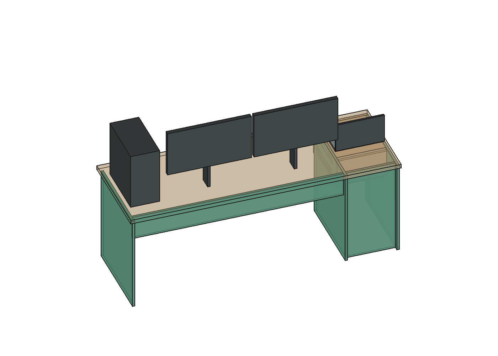

# Bancada com apoios de marcenaria e gaveteiro apoiado ao piso

25/10/2026 · estudo iniciado no bloco noturno de 02:22. **Sem tubos e sem incorporar alterações à R51.** A estrutura tubular anterior está cancelada. Os dois pés escuros de 30 × 30 mm da versão completa eram esquemáticos, sem material/seção definidos; não foram considerados uma sustentação já comprovada.

**Resultado principal:** é possível desenhar um caminho nominal de apoio em marcenaria mantendo o tampo de 2.000 × 700 × 30 mm, as gavetas e a entrada frontal da cadeira. Porém, trocar apenas os pés não encerra a deformação do tampo: o material/composição de 30 mm e a retenção ao restante da mesa precisam ser resolvidos. Não foi liberada carga real de uso.

**Continuação25/10:** [curso das gavetas e estabilidade](../P16_gavetas_estabilidade_2026-10-25/README.md). As caixas varridas de16 peças móveis ficaram separadas em18.480 pares no curso400; telescópio real das guias continua fora desse teste.1296 cenários distinguem bancada ligada e pedestal independente: massa/composição do tampo e juntas positivas são condições de estabilidade. Não repetir a triagem básica; fechar componentes e ligações efetivos.

## Geometria proposta

| Parte | Dimensões e implantação nominal |
|---|---|
| Apoio esquerdo | Painel de 18 × 650 × 720 mm em X2720–2738, Y20–670 |
| Laterais do gaveteiro | As duas laterais atuais passam de 18 × 430 × 240 para 18 × 640 × 720 mm, nas mesmas faces X4300–4318 e X4682–4700, ampliando para trás e até o piso |
| Painel posterior do pedestal | 364 × 18 × 720 mm em Y70–88, atrás do fundo atual das gavetas em Y250–268 |
| Travessa traseira | 1.562 × 18 × 180 mm, em Y70–88 e Z540–720, ligada ao apoio esquerdo e ao pedestal |
| Tampo | Mantém X2700–4700, Y0–700, Z720–750; nenhum bolsão de tubos |

São cinco painéis propostos, dois substituindo as laterais atuais. Massa nominal bruta de 27,833 kg a 800 kg/m³, menos 2,972 kg das duas laterais antigas. Os pés esquemáticos retirados **somente deste estudo** não têm massa conhecida. Não se trata de orçamento ou peso final do móvel.

A distância livre entre apoio esquerdo e pedestal é **1.562 mm**, maior que a faixa central de 800 mm do estudo de uso. A entrada frontal não recebe travessa abaixo do tampo; a travessa fica atrás, em Y70–88. O espaço sob o gaveteiro muda com as novas laterais até o piso, e a aparência fica diferente da mesa de pés finos. **Elias precisa revisar essa alteração antes de incorporação.** A cadeira real, pedais, cabos e eventual armazenamento sob a mesa ainda precisam de envelope de uso próprio.

As partes originais das laterais que contêm as gavetas foram preservadas por inclusão geométrica nos painéis maiores. No estudo, gavetas, guias e equipamentos são contexto estático copiado da R51; seus movimentos continuam na fonte completa, não neste arquivo parcial.

## Caminho de carga e conferência do CAD

Tampo → painéis de apoio/pedestal e travessa traseira → ligações da travessa/painéis → piso. A travessa encontra as laterais por face vertical, portanto precisa de **junta resistente ao cortante**, não apenas encosto. Foram conferidos cinco apoios horizontais sob o tampo e dois encontros verticais da travessa.

Os volumes acrescentados não interferiram com as **1.174 geometrias visíveis restantes** da R51 testadas, excluídas as duas laterais substituídas e os dois pés esquemáticos retirados do estudo. Também não houve sobreposição entre os cinco novos painéis. [Conferência BREP](Conferencia_geometrica.json).

Uma união de estudo coloca dois Confirmat 7 × 50 por extremidade da travessa, a Z612/648 e Y79, com cavilha de posicionamento em Z630. Os parafusos ficam a 72 mm das extremidades superior/inferior da aresta da travessa. A cabeça, piloto, tolerâncias, acesso de ferramenta e resistência ainda não estão comprovados. [Interfaces nominais](Junta_travessa_nominal.csv). Não são operações CNC ou ferragens liberadas.

## Deformação do tampo

O cálculo considera placa de 29,7 mm resistentes e massa de 30,3 mm, com E inicial hipotético de 2.100 MPa. A sensibilidade diferida divide E por dois. Os painéis e a travessa têm modelos equivalentes flexíveis; para contato sem retenção, pontos que exigiam tração foram liberados.

O critério comparativo escolhido foi 1.580/300 = **5,267 mm**, com reserva de 0,20 mm. É referência de projeto, não norma de aprovação de mesa. Valores abaixo incluem a reserva.

| Caso de estudo sobre o tampo | Flecha máxima com reserva |
|---|---:|
| 25 kg distribuídos | 5,726 mm |
| 50 kg distribuídos | 8,007 mm |
| Quatro massas de teste, 15 + 8 + 8 + 3 kg | 6,523 mm |
| 20 kg em 50 × 60 mm junto à frente, no meio | 13,826 mm |
| 50 kg em 50 × 60 mm junto ao extremo direito/frente | 2,939 mm |

As massas de equipamentos e suas posições são cenários, **não pesagens do setup**. Os resultados à direita são menores porque há apoio próximo pelo pedestal. Isso não permite transferir o valor de uma posição para toda a superfície.

O tampo pode perder contato com alguns apoios e levantar em outras regiões quando não há retenção. No caso frontal de 20 kg, o modelo chega a cerca de **8,73 mm de levantamento** em outra região. Uma solução real precisa de fixação que trate esse comportamento, além da flecha para baixo; não foi escolhido um sistema de fixadores para isso.

### Limite comparativo com retenção distribuída

Foi feita uma segunda hipótese, mais favorável, na qual as linhas de apoio também retêm o tampo com a rigidez equivalente adotada. **Não corresponde a parafusos já detalhados.** Essa hipótese fornece:

| Caso | Flecha com reserva | Soma das solicitações de retenção |
|---|---:|---:|
| 25 kg distribuídos | 5,004 mm | 138,8 N |
| 20 kg frontais | 8,966 mm | 299,4 N |
| Massas de teste de 34 kg | 5,485 mm | 179,6 N |

Há forças negativas no pedestal e em alguns pontos. A fixação ao tampo, as uniões do pedestal e o contato ao piso têm de transmitir essas forças, verificar a distribuição de reações e a estabilidade. Não são capacidades por parafuso e não se atribuiu tração admissível ao piso.

O caso frontal ainda ultrapassa a referência mesmo nesse limite. Isso impede encerrar o tampo atual apenas declarando que a ligação é rígida.

### Sensibilidade ao material da chapa

Mantendo o mesmo contorno de 30 mm e contato sem retenção, E inicial equivalente de 6.000 MPa dá 5,469 mm no caso frontal; 8.000 MPa dá 4,312 mm. São **hipóteses isotrópicas de rigidez**, sem seleção de madeira ou produto. O ganho não autoriza simplesmente trocar MDF por qualquer compensado.

Painéis de madeira têm composição e direção de fibras relevantes. A [APA](https://www.apawood.org/engineered-wood-products/plywood-osb/plywood/) explica a construção cruzada e a necessidade de propriedades/capacidades específicas do painel. Um produto candidato precisará fornecer rigidez nas duas direções, cisalhamento, composição, espessuras, comportamento no tempo e acabamento. O aspecto Arenza continua como restrição; uma composição estrutural diferente não é uma troca de cor automaticamente autorizada.

## O que esta etapa define

1. O gaveteiro pode participar de uma solução **com apoios efetivos ao piso**, sem depender apenas de dois pés traseiros. A geometria nominal foi desenhada e conferida.
2. A peça de 30 mm do CAD é apenas uma caixa sólida idealizada. Não se comprovou se o tampo comercial será maciço, laminado, engrossado só nas bordas ou oco. Essa constituição precisa ser fechada antes da capacidade.
3. Retenção e juntas são verificações próprias. O modelo de contacto equivalente requer rigidez de 5 N/mm² por unidade de comprimento na sensibilidade diferida e 500 N/mm por grupo de extremidade da travessa; são requisitos de conjunto, não dados de fabricante.
4. Cargas das gavetas, estabilidade com gavetas abertas, esforços horizontais dos braços/volante, torção, ligação ao piso e nivelamento ainda não estão encerrados. Os pesos das gavetas descem pelo pedestal e não foram adicionados como carga sobre o tampo.

## Referências e próximos passos

A [montagem ALEX da IKEA](https://www.ikea.com/ie/en/assembly_instructions/alex-drawer-unit-white__AA-2242840-5-100.pdf) foi consultada como exemplo de integração de gaveteiro e tampo, sem copiar sua capacidade, fixadores ou dimensões. O princípio de aproveitar um corpo de marcenaria como apoio é uma direção construtiva; a nossa caixa original era suspensa e não se torna pedestal apenas por encostar no tampo.

- [Modelo parcial de estudo](Bancada_marcenaria_pedestal_ESTUDO.FCStd), [manifesto](Manifesto_estudo.json) e [conferência geométrica](Conferencia_geometrica.json).
- [Resultados completos](Resultados.json), [verificação numérica](Verificacao_calculo.json) e [junta nominal da travessa](Junta_travessa_nominal.csv).
- Para reproduzir, `python calcular.py` e `python refinar.py` com NumPy. `criar_estudo.py` cria o arquivo parcial no FreeCAD sem alterar a R51 e recusa substituir documento aberto de mesmo nome.

Próxima etapa: definir constituição, peso e rigidez do tampo mantendo acabamento e espessura/aparência aprovados; detalhar retenção/juntas e acrescentar ferragens reais à conferência de curso/estabilidade já iniciada. Se a alternativa de painéis laterais não for aceita visualmente, continuar outro apoio de marcenaria compatível; não reativar os tubos cancelados. A R51 completa permanece intacta.
