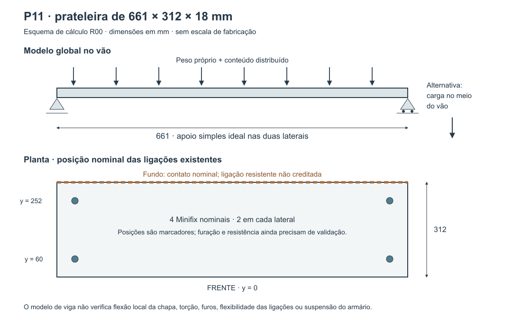

# P11 — carga e flexão da prateleira · R00

24/10/2026 · execução da frente P11 do [plano de cargas e ligações](../Plano_cargas_e_ligacoes_2026-10-24/Plano_R00.md). Base CAD R49, sem alteração de geometria.

**Continuação vigente:** Elias decidiu manter o P11 **sem tubos**. O [cálculo das ligações às laterais e ao fundo R00](../P11_ligacoes_sem_tubos_2026-10-24/Resultado_R00.md) avalia a caixa com uniões traseiras e propõe 10 kg distribuídos, condicionalmente. As contas abaixo permanecem como triagem da chapa apoiada somente nas laterais, não como limite aprovado do móvel. O [estudo de tubos](../Reforco_P11_2026-10-24/Dimensionamento_R00.md) foi preservado apenas como histórico não selecionado.

## Decisão de projeto resultante

**A prateleira de 18 mm sem reforço não deve ser especificada para 20 kg sustentados no vão de 661 mm.** No cenário de referência condicional, 20 kg distribuídos produzem 2,68 mm de flecha imediata; o cenário com multiplicador de deformação 2 chega a 5,35 mm. Se concentrados no meio do vão, os valores globais são 4,07 e 8,14 mm.

Para comparação, o critério adotado neste estudo é **L/300 = 2,20 mm**, inclusive na avaliação diferida. É uma escolha de projeto, não uma norma que aprove o móvel.

**Encaminhamento:** manter os 18 mm como preferência e desenvolver reforço ou apoio adicional para uso sustentado de 10–20 kg. Aumentar o número de Minifix nas laterais, isoladamente, não resolve a flexão do meio do vão. Não contar o mero encosto no fundo como reforço estrutural.

Para uso leve, a hipótese de flecha permite trabalhar com **meta preliminar de 5 kg de conteúdo total bem distribuído**, ou **3 kg de conteúdo total localizado no meio do vão no modelo global**. São cenários alternativos, não somáveis. Essas metas ficam abaixo dos limites matemáticos de 6,46 e 4,04 kg do cenário de referência, mas **não são cargas liberadas do armário**: faltam confirmar a chapa, as ligações e a suspensão; o caso localizado ainda exige verificação de placa/área de contato.

## Geometria reconciliada com a R49

Leitura direta dos parâmetros persistidos de `Document.xml` dentro do FCStd. Não foi necessário abrir/recomputar o modelo. A inspeção é de parâmetros e caixas sem rotação, não um novo ensaio BREP ou de colisão.

| Elemento | Identificação e resultado |
|---|---|
| Móvel | P11, `Modulo010`, armário superior B acima do micro-ondas |
| Prateleira | `Peca339`, `Part::Box`, 661 × 312 × 18 mm; volume nominal 3.712.176 mm³ |
| Laterais | `Peca334` e `Peca335`, 18 × 330 × 610 mm; vão livre nominal 661 mm |
| Fundo | `Peca336`, 661 × 18 × 574 mm; contato nominal com a borda traseira da prateleira |
| Espaço vertical | 258 mm livres abaixo e 298 mm acima da prateleira, conforme posições das caixas na R49 |
| Acabamento documental | Branco TX nas faces internas; referência visual CAD `offwhite`. Não identifica fabricante, linha ou propriedades do substrato |
| Ligações da prateleira | Quatro marcadores Minifix, dois por lateral, profundidades 60 e 252 mm a partir da frente; acesso inferior. Integram os 12 conjuntos nominais da caixa inteira |
| Fundo sem mapa | Prateleira–fundo e os dois encontros fundo–laterais continuam na fila de três contatos do P11 |

O corpo `Peca339` permanece uma caixa nominal: os marcadores não equivalem a furos efetivamente subtraídos ou a juntas resistentes testadas. A seção usada abaixo é bruta. Furos e flexibilidade dos encaixes serão conferidos no detalhamento.

**Integridade:** SHA256 da R49 antes/depois: `0d34ab3de1dc273e2db9d5483d7d5bb79352ebec01200540485d68c9e2b8f41e`. Extração e coordenadas: [Geometria_R49.json](Geometria_R49.json).



[Versão vetorial do esquema](Apoios_P11.svg).

## Materiais e hipóteses

| Cenário | E (MPa) | Densidade (kg/m³) | Espessura resistente (mm) | Uso |
|---|---:|---:|---:|---|
| Reprodução histórica | 2.100 | 750 | 18,0 | Confere as contas antigas; propriedades assumidas |
| Referência de fabricante, condicional | 2.200 | 800 | 17,7 | Base de comparação desta rodada; produto do P11 ainda não confirmado |
| Menor rigidez | 1.600 | 800 | 17,7 | Sensibilidade, sem selecionar um produto |
| Maior rigidez | 3.000 | 800 | 17,7 | Sensibilidade, sem selecionar um produto |

A [ficha Arauco Melamina MDF](https://arauco.com.br/wp-content/uploads/2024/07/ARAUCO-MELAMINA-FICHA-TECNICA.pdf), página 2, informa para 15–18 mm E mínimo de 2.200 MPa, resistência à flexão mínima de 20 MPa, densidade de 651–800 kg/m³ e tolerância de ±0,3 mm para o painel revestido. Isso é **referência condicional**, sem substituir o Branco TX do projeto por uma marca automaticamente. A espessura resistente de 17,7 mm é uma hipótese a confirmar: a tolerância do painel revestido, sozinha, não garante a espessura do núcleo. O acabamento não recebe crédito adicional de rigidez neste cálculo.

Para o peso próprio da referência, usou-se separadamente o envelope de **18,3 mm e 800 kg/m³**, sem diminuir a massa ao diminuir a espessura resistente. É um envelope de hipóteses independentes, não uma chapa com essas duas espessuras simultâneas. A reprodução histórica usa 18 mm tanto para massa como para rigidez. Nas alternativas mais grossas, os pares resistente/massa são 24,7/25,3 e 29,7/30,3 mm, também hipotéticos.

Multiplicadores **1 / 1,5 / 2** representam sensibilidade da flecha ao carregamento sustentado. Aplicou-se o multiplicador ao peso próprio e a todo o conteúdo, tratados como permanentes no cenário. Não há previsão certificada em meses/anos, nem um fator universal de fluência. A [EPF](https://mdf-info.eu/applications/furniture/mdf-shelves-and-storage-units) discute aumento de até 50% em determinadas superfícies; a [CPA histórica, página 3](https://www.compositepanel.org/wp-content/uploads/TB-Shelving.pdf), registra a duplicação como convenção de estudo. O **2 adotado é uma hipótese de avaliação**, não fator de segurança da resistência nem garantia para ambiente úmido.

## Modelo e equações

Viga Euler–Bernoulli com apoios simples ideais nas laterais; L = 661 mm, b = 312 mm, g = 9,80665 m/s². Não se atribuiu engastamento aos Minifix, contribuição vertical ao fundo ou rigidez adicional à parede. O modelo considera apoios verticalmente rígidos: eventual acomodação das ligações não está incluída.

```text
I = b t³ / 12                           [mm⁴]
Z = b t² / 6                            [mm³]
m_próprio = L b t_massa ρ / 10⁹          [kg; t_massa separado de t resistente]
G = m_próprio g; P = m_conteúdo g         [N]

Conteúdo distribuído:
δmáx = 5 (G + P) L³ / (384 E I)
Mmáx = (G + P) L / 8

Conteúdo localizado no meio do vão, peso próprio distribuído:
δmáx = 5 G L³ / (384 E I) + P L³ / (48 E I)
Mmáx = G L / 8 + P L / 4

σflexão = Mmáx / Z
RA = RB = (G + P) / 2                    [casos simétricos]
δ_sensibilidade = F δ_imediata            [F = 1; 1,5; 2]
```

As fórmulas distribuídas coincidem com a [EPF](https://mdf-info.eu/applications/furniture/mdf-shelves-and-storage-units). A implementação também calcula cargas assimétricas em x = L/4 e x = 0,05L, pela solução de carga pontual e equilíbrio, com a posição real da flecha máxima.

**Limite do caso localizado:** a viga usa a largura inteira de 312 mm. Essa simplificação estima a resposta global ao concentrar carga ao longo do vão; não representa automaticamente a área de contato de um pé, pilha estreita ou carga junto à borda frontal. Não prova resistência local, torção ou distribuição entre os quatro conectores. Não inclui impacto, pessoa apoiada ou subida no móvel.

## Resultados principais

Referência condicional E = 2.200 MPa, ρ = 800 kg/m³, t resistente = 17,7 mm, t para massa = 18,3 mm. Peso próprio calculado: **3,019 kg**. Cargas da tabela são **conteúdo adicional**, sem ocultar o peso próprio já somado às contas.

| Conteúdo | Distribuído: flecha imediata | Distribuído: com F = 2 | Central: flecha imediata | Central: com F = 2 |
|---:|---:|---:|---:|---:|
| 5 kg | 0,932 mm | 1,865 mm | 1,281 mm | 2,562 mm |
| 10 kg | 1,514 mm | 3,027 mm | 2,211 mm | 4,423 mm |
| 20 kg | 2,676 mm | 5,353 mm | 4,072 mm | 8,143 mm |

| Conteúdo | Tensão bruta distribuída / central | Reação vertical por lateral, casos simétricos |
|---:|---:|---:|
| 5 kg | 0,399 / 0,648 MPa | 39,32 N |
| 10 kg | 0,648 / 1,145 MPa | 63,84 N |
| 20 kg | 1,145 / 2,140 MPa | 112,87 N |

**Resistência da seção bruta:** usou-se também uma triagem explícita de 25% do MOR de referência, isto é, 5 MPa. A CPA menciona essa prática histórica; ela foi escolhida aqui apenas como comparação, não como tensão admissível normativa. Os 20 kg não atingem essa triagem de flexão bruta, mas excedem o critério de deformação. Isso indica que **a flecha governa este modelo ideal**; não aprova a região dos furos, o MDF recebido, as juntas ou a suspensão. Não converter MOR de catálogo em carga anunciada do móvel.

Reprodução histórica E = 2.100 MPa, ρ = 750 kg/m³, t = 18 mm: peso próprio **2,784 kg**, I = **151.632 mm⁴**. As flechas distribuídas para 5/10/20 kg são **0,901 / 1,481 / 2,639 mm**; centrais **1,249 / 2,175 / 4,028 mm**. Portanto, o antigo 2,64 mm foi reproduzido, mas não é capacidade de uso.

### Limite matemático por deformação, ainda condicional

| Multiplicador F | Conteúdo distribuído que atinge L/300 | Conteúdo central que atinge L/300 |
|---:|---:|---:|
| 1 | 15,93 kg | 9,96 kg |
| 1,5 | 9,61 kg | 6,01 kg |
| 2 | 6,46 kg | 4,04 kg |

São interseções da equação com o critério escolhido, sem margem extra, e não cargas liberadas. Mudanças de E, espessura resistente, umidade ou apoio alteram os limites. Os cenários de menor/maior rigidez estão em [Casos.csv](Casos.csv) e [Resultados.json](Resultados.json).

### Casos mistos: não somar as metas

| Conteúdo total de 5 kg, com peso próprio já incluído no cálculo | Flecha com F = 2 | Comparação com 2,203 mm |
|---|---:|---|
| 3 kg no meio do vão + 2 kg distribuídos | 2,283 mm | Excede |
| 2 kg no meio do vão + 3 kg distribuídos | 2,144 mm | Abaixo, com pouca folga |

Os casos mistos constam de `mixed_load_cases` no JSON e foram conferidos por superposição numérica, contando o peso próprio apenas uma vez. Uma regra de uso não pode dizer “5 kg totais e objetos de até 3 kg” como se essa combinação estivesse atendida.

## Esforços que o desenho das ligações precisa receber

Para 20 kg simétricos, cada lateral recebe **112,87 N** da prateleira com seu peso próprio. Os **56,44 N por conector** seriam apenas uma divisão ideal em carga simétrica na profundidade, sem comprovar que a junta real distribui assim. Não usar esse quociente como capacidade comprovada.

Com os mesmos 20 kg em x = 0,05L, a reação na lateral próxima sobe para **201,13 N**, enquanto a outra recebe **24,61 N**. O arquivo de casos registra ambos os lados; uma única reação média não cobre todas as posições do conteúdo.

Há ainda um caso distinto: conteúdo no meio do vão e na borda frontal y = 0. Considerando, apenas para equilíbrio rígido simétrico, os conectores em y = 60/252 mm e o peso próprio em y = 156 mm, cada lateral teria **136,11 N no conector dianteiro e −23,24 N no traseiro**. O sinal negativo exige retenção no sentido oposto, em vez de somente apoio por gravidade. A resposta elástica real da placa e o funcionamento do Minifix precisam ser demonstrados.

O caminho a resolver é conteúdo → prateleira → encaixes/parafusos nas laterais e eventual reforço/fundo → caixa → suspensão → parede. O cálculo desta prateleira não é o cálculo do peso completo do aéreo, portas e outros compartimentos.

## Comparação das alternativas para uso pesado

**Rigidez mínima para manter a mesma seção hipotética**, com F = 2 e L/300:

| Conteúdo | E necessário, distribuído | E necessário, central |
|---:|---:|---:|
| 10 kg | 3.023 MPa | 4.416 MPa |
| 20 kg | 5.345 MPa | 8.131 MPa |

Para 20 kg distribuídos, isso equivale a cerca de **2,43 vezes o EI** da referência; no caso central, **3,70 vezes**. Não há painel escolhido com esses valores. Se houver perfil de reforço, o seu peso, contato com a chapa, fixação, apoio nas pontas e transferência de carga entram no novo cálculo: não basta somar uma barra sem demonstrar sua participação.

| Alternativa hipotética para 20 kg | Flecha com F = 2: distribuída / central | Consequência |
|---|---:|---|
| Chapa resistente de 24,7 mm; E = 2.100 MPa, ρ = 800 | 2,167 / 3,243 mm | Distribuído fica muito próximo do limite de 2,203 mm; central não atende. Altera espessura, furação, massa e espaço útil |
| Chapa resistente de 29,7 mm; E = 2.100 MPa, ρ = 800 | 1,289 / 1,908 mm | Atende à comparação global, mas exige produto, espaço e ligações compatíveis; não foi selecionada |
| Linha de apoio ideal no meio, dois vãos de 330,5 mm; t = 17,7, E = 2.200, ρ = 800 | 0,625 / 0,974 mm, com todos os 20 kg em uma metade | Limite de cada meio vão = 1,102 mm. O apoio teria de sustentar a profundidade e transferir carga a estrutura resistente; não é uma pequena cantoneira traseira automaticamente equivalente |

A comparação de meio vão usa dois trechos biapoiados independentes, sem crédito de continuidade. Não especifica uma divisória como escolha do usuário. A solução preferencial a desenvolver é **apoio/reforço compatível com os 18 mm e com o espaço de guarda**, verificando também a borda frontal. Nenhuma alternativa foi aplicada ao CAD nesta rodada.

A orientação de apoio traseiro contínuo das tabelas CPA tem condições próprias, incluindo profundidade até 12 polegadas (304,8 mm). Não foi aplicada por regra direta ao P11 de 312 mm e ligação traseira ainda sem mapa.

## Verificação e rastreabilidade

- [Premissas.json](Premissas.json): entradas, origem dos dados, hipóteses e fontes públicas consultadas em 24/10/2026.
- [calcular_p11.py](calcular_p11.py): extrai a base R49 e gera [Geometria_R49.json](Geometria_R49.json), [Resultados.json](Resultados.json) e [Casos.csv](Casos.csv), com **64 casos** (quatro cenários × quatro cargas × quatro distribuições).
- [verificar_p11.py](verificar_p11.py): confere o modelo por matriz de rigidez de viga, **40 elementos e 48 casos**, comparando deslocamentos nodais e reações com a solução analítica; confere mais **dois casos mistos**. Testa também reprodução histórica, equação EPF, equilíbrio, carga pontual sem peso próprio e inversão de L/300.
- [Verificacao_numerica.json](Verificacao_numerica.json): **PASS**, diferença máxima de deslocamento inferior a 1,1 × 10⁻¹⁰ mm. Isso verifica a implementação matemática, não valida a hipótese do material ou ensaia o móvel.
- Revisão independente por segundo agente: valores históricos, envelope de referência, reações e comparações de reforço coincidiram com os resultados calculados.

Reprodução, a partir desta pasta:

```powershell
python calcular_p11.py
python verificar_p11.py  # requer numpy
```

## Estado da pendência e próximo passo

**Concluído nesta rodada:** reconciliação nominal do P11 na R49; cálculo global de flecha imediata, sensibilidade diferida, tensões brutas e reações; reprodução do estudo antigo; limites condicionais por flecha e requisitos para reforço.

**Continua aberto:** identificação e dados da chapa real; composição/espessura resistente; reforço ou apoio para 10–20 kg; verificação local de cargas concentradas, furos e juntas; mapa resistente do fundo; suspensão do aéreo; prova de oficina. A resistência da parede e a passagem de tubos/fios serão conferidas no apartamento.

O próximo trabalho do P11 é detalhar e recalcular o reforço/apoio, antes dos furos dependentes. A frente de cálculo não deve desaparecer das pendências como “carga aprovada” enquanto essas condições estiverem abertas.
