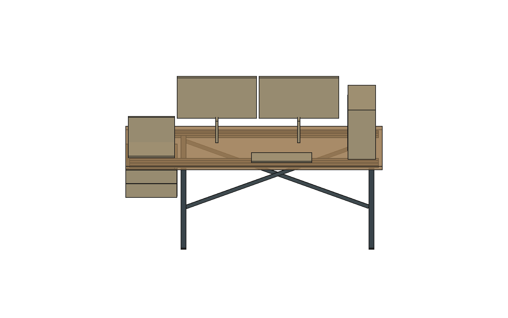

# Bancada — proposta de reforço independente, R02

**CANCELADA como solução ativa em25/10/2026:** Elias não quer tubos sustentando chapas de madeira; qualquer proposta futura exige autorização prévia. A R51 retirou do modelo completo o grupo oculto deste estudo. Este arquivo e os FCStd separados são somente histórico. Os apoios atuais da bancada precisam ser desenvolvidos como marcenaria; a retirada desta alternativa não resolve a sustentação por si.

23/10/2026. [Modelo separado](Bancada_Estrutura_R45_R02_ESTUDO.FCStd) · [Ensaio geométrico](Bancada_geometria_R02.json) · [Flexão](Bancada_flexao_R02.json) · [Script CAD](bancada_estudo_R02.py) · [Script de cálculo](bancada_calcular_R02.py).

A alternativa preserva **tampo externo 2000 × 700 × 30 mm, topo a 750 mm, as duas gavetas e a faixa central sem travessa frontal abaixo do tampo**. É um novo sistema de apoio proposto, separado da R44, não uma estrutura já aprovada. A representação semitransparente e a cor do aço são de leitura técnica; não alteram o acabamento Arenza escolhido.

## Por que não bastava declarar os pés existentes suficientes

Na R44 há dois pés esquemáticos de 30 × 30 mm em X2770–2800 e X4620–4650, ambos Y120–150, próximos da parede. A flexão longitudinal sem creditar parede é alta no cenário de MDF, e esses dois pés alinhados não demonstram estabilidade em profundidade. A futura ancoragem na parede não é conhecida. Também há uma decisão registrada de manter a entrada da cadeira sem travessa frontal que impeça os braços.

Um novo pé frontal à direita na mesma posição do pé antigo cruzaria a caixa das gavetas. A solução estudada coloca o segundo pórtico **antes da caixa**, em X4230–4270, deixando 30 mm até a lateral em X4300. O primeiro fica X2765–2805. Os pés dianteiros ficam Y600–640, os traseiros Y80–120. Resultam **1425 mm livres entre pórticos**, além da faixa central de 800 mm exigida no estudo de uso anterior. Não se presume que a cadeira real atravesse todos os pontos: sua dimensão/ajuste seguem próprios.

## Geometria proposta

| Componente | Definição no estudo |
|---|---|
| Cinco longarinas | Tubo de aço **40 × 20 × 3 mm**, 20 na vertical, comprimento nominal1940; duas atrás e três à frente, todas em Z720–740 |
| Duas travessas laterais embutidas | Mesma seção40 ×20 ×3, comprimento400 entre os grupos de longarinas |
| Quatro pés | Seção quadrada idealizada40 ×40 ×3, altura710 sobre sapatas de10; material, SKU e soldas a fechar |
| Contraventamento | Duas diagonais posteriores e uma em cada pórtico lateral; barras30 ×3 representadas como envelopes de fabricação |
| Sapatas | Quatro interfaces40 ×40 ×10, sem SKU final; não se atribuiu coeficiente de atrito ou regulagem |
| Tampo | Bolsões inferiores de20,5 mm de profundidade e0,25 mm de folga lateral ao tubo nominal. Permanecem9,5 mm de material nominal sobre o reforço; áreas entre bolsões mantêm30 mm |
| Ligações tampo–estrutura | Precisam de abas/retentores dimensionados, sem parafuso atravessando o topo e sem reduzir o vão central. Não modeladas como prontas |

O catálogo oficial Tuper2024, página42, inclui a seção20 ×40 com parede3 mm e massa teórica14,897 kg para a barra de6 m. [Catálogo oficial](https://tuper-prd.s3.sa-east-1.amazonaws.com/uploads/2021/08/Tabela-Tecnica-de-Produtos-Tuper-2024.pdf) · [Página conferida](Fontes/Tuper_p42.png). Isso comprova a existência dimensional da seção, não estoque local, grau de aço do lote, tolerâncias da fabricação, propriedades certificadas do quadro ou capacidade do móvel completo. Não usar a capacidade de um tubo isolado como certificação da mesa.

## Verificações feitas

- **19 elementos do apoio e38 formas de contexto**, incluindo caixa e componentes das gavetas: nenhuma interseção positiva com contexto ou tampo usinado no modelo. Todos os sólidos do estudo passaram no teste geométrico `isValid`.
- Reserva de uso central **800 ×500 ×720 mm**, X3100–3900/Y200–700: nenhuma invasão pelos reforços. O ensaio é uma reserva de espaço, não representação da cadeira/pessoa.
- Envelope externo do tampo permanece2000 ×700 ×30. A superfície de guarda e as peças das gavetas foram copiadas sem redução. O reforço sob o tampo não desce deZ720 no centro.
- Montantes ficam30 mm ao lado da caixa; as diagonais posteriores ficam atrás da região da caixa. A variante de gaveteiro com traseira20 mm mais longa ainda precisa ser conferida pela frente específica, apesar da reserva posterior disponível.

## Flexão: avanço em relação à primeira proposta

Modelo de viga de Euler–Bernoulli com apoios X2785/4250, extremos2730/4670 e balanços incluídos. Aço com E hipotético200.000 N/mm². Momento de inércia retangular ideal reduzido20% como análise de sensibilidade para a seção; isso não é a propriedade certificada do tubo arredondado. Não se creditou a rigidez da madeira à rigidez do aço.

| Cenário hipotético | Flecha vertical máxima |
|---|---:|
| Peso próprio do tampo usinado + longarinas/travessas51,07 kg, mais25 kg distribuídos | 1,22 mm |
| Mesmo peso próprio +50 kg distribuídos | 1,62 mm |
| Equipamentos de teste:15 kg emX2860,8 em3350,8 em3990,3 em4500 | 1,34 mm |
| 50 kg concentrados no extremo direitoX4670, além do peso próprio | 3,03 mm; reação esquerda pequena,47 N |
| 20 kg concentrados emX3650 sobre as três longarinas frontais,60% do peso próprio | 2,17 mm |
| 50 kg no mesmo teste frontal | 4,21 mm |

Na R01 havia só duas longarinas frontais: o último teste dava6,03 mm. A terceira longarina foi acrescentada para reduzir essa sensibilidade sem descer abaixo do tampo. **Não foi atribuída carga admissível de50 kg ao móvel.** O cenário é uma solicitação de comparação, não autorização de uso: distribuição de carga entre tubos, ligações, torção, estabilidade lateral, furação, soldas, sapatas, apoio local da madeira usinada e carregamento dinâmico ainda não estão verificados. O peso estimado da estrutura completa é aproximadamente40 kg antes de acabamentos e ligações, além de25 kg de tampo remanescente: é uma alternativa robusta geometricamente, mas pesada e sujeita a orçamento.

O teste no extremo mostra por que carga distribuída não deve virar capacidade na ponta. A margem de reação esquerda é pequena nesse cenário; não simplificar o quadro removendo massa/apoios sem recalcular a estabilidade.

## O que fecha a especificação sem esperar medidas do apartamento

1. Confirmar cargas de equipamentos e esforço dos braços de monitor/volante; os valores da tabela são cenários, não pesagem do setup.
2. Dimensionar quadro e ligações com grau de aço e seções reais, incluindo flambagem, torção, soldas, estabilidade lateral e ensaio de móvel. As diagonais são propostas construtivas, não detalhamento de solda liberado.
3. Marceneiro conferir a construção do tampo30 mm e os bolsões: uma chapa engrossada com núcleo oco ou duas chapas apenas unidas na borda não equivale ao sólido modelado. Detalhar retentores e bordas, sem comprometer braços dos monitores ou grampo do volante.
4. Escolher sapatas, proteção do piso, acabamento e cotação do conjunto. Nenhuma redução de material deve ser feita usando apenas a flecha ideal.

As medidas reais do apartamento só entram depois para nível, piso, parede/rodapé e tolerâncias de implantação. Esta opção evita depender da resistência desconhecida da parede para o caminho vertical da carga, mas ainda precisa das verificações acima antes de substituir os apoios esquemáticos da R44.
