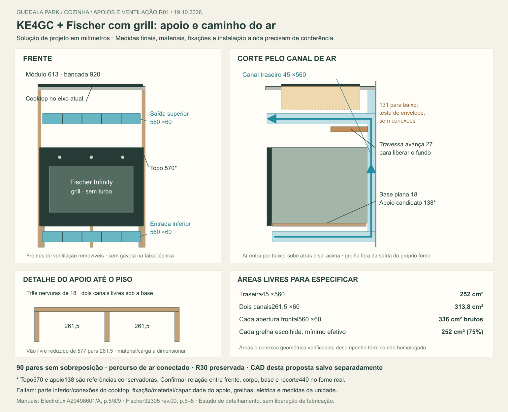

# KE4GC + Fischer — apoios e ventilação R01

**20/10/2026 — grelhas e manutenção R02.** [Detalhamento atual](../Grelhas_manutencao_R02/README.md): duas grelhas candidatas600 ×90 removíveis, com12 rasgos e272,43 cm² de área aberta cada, réguas fora da passagem de ar e gabarito1:1 para cotação. Foram conferidos195 pares sem sobreposição e retirada frontal hipotética600 mm, sem validar calor/carga/cabos/pessoas. A saída superior agora termina na face perfuradaY6402,5; a hipótese antiga sem grelha real é superada nesse detalhe. Desenvolver acesso às conexões pelo gabinete da pia à esquerda, condicionado à hidráulica, área seca e armazenamento. **GN já confirmado por Elias**; não repetir pergunta sobre tipo de gás. R30/R01 preservadas; sem fabricação, compra ou contato externo.

19/10/2026. Desenvolvimento autorizado por Elias: “vamos conferir o cooktop e fechar os apoios e a ventilação do móvel, avança no q der sem as medidas do apartamento”. Solução de projeto para detalhamento; não é liberação de corte, furação ou instalação. Nenhuma nova preferência precisa ser perguntada para continuar.

[CAD separado](Apoios_Ventilacao_R01.FCStd) · [Conferência](Conferencia.json) · [Prancha vetorial](Apoios_ventilacao.svg) · [Estudo anterior](../README.md).

## O que fica definido nesta etapa

Manter KE4GC e Fischer Infinity com grill, sem turbo, preto127 V,28349-64929. Preservar módulo externo613 mm, vão577, bancada920 e vizinhos. Desenvolver **base plana18 mm sobre três nervuras longitudinais18 mm até o piso**, sem transferir o peso às faixas de ajuste do vão. Reservar **entrada inferior, dois canais sob a base, canal traseiro45 ×560 e saída frontal superior**. Sem fundo fechado neste módulo e sem gaveta na faixa técnica acima do forno.

As duas aberturas frontais passam a **560 ×60 mm úteis antes de grelha**, com acabamento removível. A saída anterior de45 mm tinha252 cm² brutos e perderia área ao receber uma grelha; esta R01 a substitui por60 mm. É uma decisão de desenvolvimento, não uma nova exigência publicada pelo fabricante.

## Cooktop conferido no documento correto

Manual Electrolux **A29498601/A, G0046454/001, Mar/25**, arquivo local idêntico ao manual oficial conferido em14/10. Nova leitura visual das páginas impressas5,8 e9 nesta rodada. A página pública atual não acrescentou corte inferior cotado. Não foi obtida confirmação nova da projeção inferior do aparelho.

| Requisito / dado | Aplicação no estudo | Ainda por confirmar |
|---|---|---|
| KE4GC: mesa600 ×450, altura total131, massa9,50 kg; acendimento bivolt | Modelo e posição preservados; peso pertence à bancada, separado do apoio do forno | Altura131 não informa quanto fica abaixo da pedra; conferir caixa, fixações e conexões reais |
| Recorte520 ×390, p.8 | X2960–3480 / Y6490–6880; mantém eixoX3220 | Raio dos cantos, tolerâncias, vedação, fixações e resistência da pedra |
| Frente mínima60 e traseira mínima50, desenho p.8 | Há120 nominais em ambas as direções, considerando a parede e a pedra da R30 | Rodapia/revestimento e profundidade real podem reduzir o resultado |
| Cota lateral185 e afastamento superior800 no desenho p.8 | Registrados para a compatibilização com laterais altas e depurador | Não usar22/35 entre recorte e laterais baixas como substituto da cota185 do desenho. Este estudo não auditou os obstáculos altos nem o depurador |
| Passagens30 no corte **com forno**, p.9 | Corpo conservador49 até parede, canal traseiro45 e canais inferiores60 de altura; frente inferior recuada32 em relação ao envelope frontal do forno | Os três locais do desenho devem permanecer desobstruídos no executivo; não usar a mesma cota30 para todos os detalhes do aparelho |
| Acesso **externo** à tomada e registro com forno, p.8; cabos sem contato com traseira quente, p.7 | Tomadas/registro e conexões fora do percurso reservado de ar e acessíveis sem retirar o forno | Parede/ponto/cabo1 m e comprimento/curvatura do flexível. A folga67 junto à LG não foi adotada como acesso técnico |

A divisória mostrada na p.8 é expressamente destinada à configuração **sem forno**. Não acrescentar um painel fechado abaixo do cooktop copiando essa figura. Ventilação do ambiente/depurador e ventilação do móvel são requisitos distintos.

## Apoio: percurso de carga desenvolvido

Coordenadas da R30 espelhada, emmm; piso de estudoZ0 e paredeY7000. A referência candidata de apoio continuaZ138, para não elevar o envelope do forno nesta rodada.

| Peça | Envelope candidato | Função |
|---|---|---|
| Base plana | L577 ×P535 ×E18; X2938–3515, Y6410–6945, Z120–138 | Apoio contínuo, plano e nivelado. Termina55 antes da parede, preservando integralmente45 ×560 posteriores |
| Nervura esquerda | E18 ×P505 ×A120; X2938–2956, Y6440–6945 | Levar carga da base ao piso |
| Nervura central | E18 ×P505 ×A120; X3217,5–3235,5, mesmoY | Reduzir flexão e fluência da base; manter dois canais inferiores |
| Nervura direita | E18 ×P505 ×A120; X3497–3515, mesmoY | Levar carga ao piso, sem apoiar no módulo da LG |
| Recuo frontal das nervuras | 30 desde a frente da base | Distribuir o ar da entrada para os dois canais; balanço frontal da base limitado30 |
| Contramarcos frontais | Faixa nominal26,5 por lado: lateral existente18 + ajuste8,5; profundidade de estudo100 | Ajustar abertura nominal560 e receber fixação ligada à lateral do móvel, sem usar uma tira8,5 isolada como estrutura |

Vãos livres da base: **261,5 +261,5 mm**, em lugar de577 sem apoio intermediário. As nervuras deixam juntas/niveladores a detalhar dentro desses envelopes; não criar travessa inferior que feche os canais. Base e nervuras devem formar conjunto estável, unido às laterais, com bordas seladas e material adequado à temperatura e umidade de uso. Não se adotou uma resistência genérica de “MDF18” nem capacidade comercial sem documentação.

**Meta de especificação estrutural: conjunto para pelo menos50 kg totais em serviço**, incluindo23,25 kg do forno, base e carga de uso. É meta para o marceneiro dimensionar material, uniões e nivelamento; não capacidade calculada ou ensaiada. Peso na porta aberta, esforços de retirada e estabilidade também precisam ser verificados, sem permitir apoio de pessoas. A nervura central melhora o caminho da carga, mas não substitui essas verificações.

O forno permanece apoiado pela base. Os **dois parafusos do kit**, indicados na p.8 Fischer e nos furos da p.6, prendem o quadro ao móvel; não devem suspender o forno. Posição, comprimento, engajamento e acesso serão definidos pelos furos e materiais reais. Os contramarcos desenhados não representam fixação já dimensionada.

## Ventilação: percurso contínuo e áreas

**Ambiente → abertura inferior → dois canais sob a base → abertura traseira da base → subida atrás do forno → faixa acima do forno → abertura frontal superior → ambiente.**

| Trecho | Geometria livre de estudo | Área / resultado |
|---|---|---|
| Entrada inferior frontal | 560 ×60; Z30–90, faceY6408, recuo32 desde a frente do forno | 336 cm² brutos |
| Canais entre nervuras | 2 ×261,5 ×60; Y6440–6955 | 313,8 cm² somados; nenhum dos dois pode ser fechado |
| Abertura traseira da base / subida | Reserva560 ×45; Y6955–7000, Z30–900 | 252 cm²; largura e profundidade do recorte Fischer preservadas |
| Travessa superior | Y6743–6955, Z660–690 | Recuada27 em relação à R30; termina antes do canal traseiro |
| Passagem e saída superior | 560 ×60; Z705–765 | 336 cm² brutos;15 acima da travessa e24 abaixo do teste conservador do cooktop |
| Grelhas, conceito para ambas as frentes | Abertura útil560 ×60, quatro montantes verticais4, sem tela/lâminas adicionais | Área geométrica ideal326,4 cm². Bordas externas à abertura útil; conferir bordas seguras e manutenção |

Para selecionar uma grelha diferente, especificar **área efetivamente livre mínima252 cm² por abertura**, incluindo moldura, lâminas, tela e fixações. Dentro de uma abertura560 ×60, isso exige pelo menos75% de área livre. Percentual é critério deste projeto para não estreitar a seção traseira exigida; não é vazão homologada nem recomendação publicada do fabricante. Igualdade de áreas não comprova resfriamento; curvas, perdas, recirculação e temperatura precisam da verificação final de instalação. Não acrescentar tela fina nem uma grelha escolhida apenas pela dimensão externa.

Nenhuma mangueira, cabo, tomada, fundo, travessa ou objeto deve ocupar esses volumes. A grelha não deve cobrir a saída de ar **do próprio forno** junto ao painel/porta; essa saída continua livre conforme p.6 Fischer. As peças de acabamento devem permitir inspeção/limpeza e retirada frontal do aparelho, preservando acesso ao kit e às conexões. O desenho não presume que o sistema próprio do forno resolva a ventilação do móvel.

## Cotas conservadoras e o que ainda não deve virar corte

Topo externo conservador do forno emZ570; bancadaZ920. Separação ao ponto inferior instalado do cooktop: **350 −d**. Exigência Fischer200, portanto d≤150; com10 de tolerância de estudo, d≤140. O cenário131 inteiros abaixo da bancada continua dando219, ou209 após essa tolerância. Não é medição do aparelho; conexão pode ultrapassar o corpo.

O manual Fischer desenha frente447, corpo432, recorte440 e cotas auxiliares5/10/15. O estudo anterior alinhou os topos dos envelopes por conservadorismo, sem estabelecer o datum dos pés. **Z138 é referência ajustável de desenvolvimento, não apoio oficialmente cotado.** Conferir relação base–frente–corpo no exemplar/manual específico antes de fixar altura e fabricar o recorte440. Se a montagem exigir mudar a base, recalcular também entrada inferior e planos frontais; não mover o forno para cima por conveniência. Profundidade544 no manual e547 no nicho Rev.03 segue conservadoramente547.

## Verificação feita e fechamento restante

FreeCAD1.1.4: **90 pares de sólidos sem interseção positiva**; volumes de ar unidos em **um único sólido conectado**, sem cruzar apoio, nervuras, travessa, referências ou cenário131. Triagem adicional de38 peças nativas `Peca*` na região, excluindo forno/travessa antigos, sem conflito nos novos sólidos ou no percurso. Fonte R30 preservada com SHA-256 `ee6f8aabb64009fcc3453896fdbed724c416bf622eb3ff0346d887ec44df8bf2`. São testes de geometria idealizada, não de calor/resistência; porta aberta não foi revalidada nesta R01.

| Pode avançar agora | Dado que fecha o executivo |
|---|---|
| Arquitetura do apoio em três nervuras, base plana e contramarcos ligados às laterais | Marceneiro especificar material, ligações, nivelamento, estabilidade e capacidade50 kg; conferir furos do kit |
| Entradas/saídas, canal traseiro e travessa fora da reserva | Grelha real com área livre documentada; montagem dos aparelhos sem obstruções e verificação térmica conforme fabricantes |
| Recorte520 ×390 e posição do KE4GC; cenário vertical conservador | Corte inferior/inspeção de produto: corpo, fixações, gás e cabo; datums de montagem Fischer. **Esses dados podem ser obtidos antes de medir o apartamento** |
| Acesso separado das conexões e reserva livre de ar | Projeto/pontos elétricos da unidade, circuito127 V do forno2061 W/16,22 A, aterramento, gás disponível e registro; cooktop em tomada própria |
| Preservar bancada e largura do módulo | Medição da unidade, prumo/piso, parede/rodapia, laterais altas/depurador, pedra/emenda junto à LG; então ajustar cotas finais |

Esta R01 substitui as hipóteses anteriores de apoio sem nervuras e saída45, apenas neste estudo separado. A R30 geral e o PDF de orçamento continuam com a referência antiga de forno e precisam incorporar a solução na próxima consolidação, identificando as pendências restantes. Não se declara um executivo pronto sem os dados listados.

## Fontes

- [Manual Electrolux arquivado](../../../../02_Plantas_e_manuais/Manuais/Electrolux_KE4GR_KE4GC_Manual_250405XATF.pdf), páginas impressas5,7,8,9; SHA-256 `28d7713e68810bcc7b0c42889dc3bd99aff2ad5ba5bba5be410901f47926fbf3`. [Procedência e comparação com download oficial de14/10](../../../Modelo_FreeCAD/02_Revisoes_e_estudos/Revisao_fontes_coccao_R23_2026-10-14/Comparacao_binaria.json). [Página oficial do KE4GC](https://content.electrolux.com.br/brasil/electrolux/poke/v1/experience/ke4gc/index.html), reconsultada19/10 sem novo datum inferior.
- [Manual Fischer32305 rev.00](../Fontes/Fischer_Grill_manual_oficial.pdf), p.5–8; [procedência](../Fontes/Fontes.json), [manual público](https://www.fischer.com.br/media/amasty/amfile/attach/1Ylh32XinLgwiPPH6MpsxPXsGttypjOb.pdf), [produto escolhido](https://www.fischer.com.br/forno-eletrico-fischer-infinity-de-embutir-50l-com-grill/p). Página reconsultada19/10 confirma nicho560 ×440 ×580 e massa23,25 kg; sem transpor dimensões de outros modelos.
- [Script da conferência](conferir.py) e [gerador da prancha](prancha.py). Rede Firecrawl indisponível nesta rodada; consulta pública de páginas feita por ferramenta web, sem contato com fabricantes.
