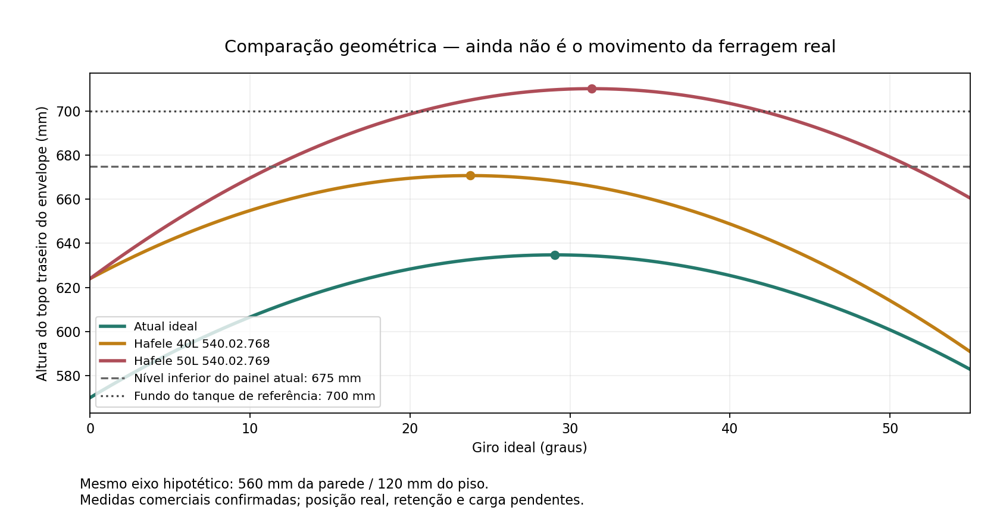

# Estudo do movimento real do cesto — R39

20/10/2026. Apartamento salvo em `Guedala_Park_R39_Estudo_Cesto.FCStd`. R38 preservada por SHA256. Esta revisão acrescenta estudo e comparação no FreeCAD; não altera peças nem instala uma ferragem ainda não comprovada.

## Resultado

O giro atual de 55° funciona geometricamente, mas continua sendo um pivô ideal. Para um conjunto real, as dobradiças da frente definem o eixo; o articulador Duo acompanha e controla a abertura. Os pinos Ø10 e blocos atuais são gabaritos, não ferragens compráveis ou dimensionadas. Não converter os 55° em limite físico por simples alteração de propriedade.

A alternativa mais interessante encontrada para aprofundar é a **Häfele 540.02.768, 40 litros**, por ter profundidade de 222 mm. Contudo, não é uma substituição direta: requer altura de instalação de 600 mm, contra 577 mm nominais entre o topo da base (98) e o painel superior (675). A diferença de 23 mm é uma triagem dimensional; o desenho completo de instalação ainda precisa demonstrar o volume exigido e sua relação com o painel/tanque. Não subir o painel ou baixar a base automaticamente.

O recipiente comercial é plástico. A escolha de Elias continua sendo **saco removível e lavável**, com acesso ao sifão pela retirada do conjunto. Não há comprovação de que o saco atual, a pega e a extração caibam no kit comercial.

## Medidas e comparação

| Item | Atual, ideal | Häfele 40 L | Häfele 50 L |
|---|---:|---:|---:|
| Código | Sem ferragem selecionada | 540.02.768 | 540.02.769 |
| L × P × A, mm | 450 × 250 × 450 | 438 × 222 × 504 | 400 × 307 × 504 |
| Altura mínima de instalação, mm | Não definida | 600 | 650 |
| Vão frontal atual, mm | 577 | 577 | 577 |
| Diferença nominal de altura, mm | — | 23 | 73 |
| Pico superior com o eixo **hipotético atual**, mm | 634,78 | 670,73 | 710,14 |
| Ângulo desse pico hipotético | 29,05° | 23,77° | 31,35° |
| Distância vertical ao nível inferior do painel675, mm | 40,22 | 4,27 | −35,14 |

Os dois últimos resultados comerciais são **cálculos de sensibilidade, não movimentos reais da ferragem**. Mantêm artificialmente o eixo atual a560 mm da parede e120 mm do piso. Uma diferença vertical negativa não prova colisão3D por si só. O tanque atual também é um volume de referência, com fundo700, não um produto medido. O modelo50L perde a margem superior e requer mais profundidade: não adotado diretamente. O catálogo consultado identifica50L como540.02.769; não foi presumida equivalência comercial com540.02.765, consultada anteriormente.

## O que a documentação demonstra

O [manual brasileiro da tulha](https://www.hafele.com.br/INTERSHOP/static/WFS/Haefele-HBR-Site/-/Haefele/pt_BR/pim/documents/ins-doc-05048062.pdf) e o [catálogo brasileiro](https://www.hafele.com.br/INTERSHOP/static/WFS/Haefele-HBR-Site/-/Haefele-HBR/pt_BR/opentext/assets/HBR/ff14_hbr_pt_06_009_A.PDF) confirmam os envelopes e os vãos mínimos. O kit inclui cesto, armação, Duo e fixações. O texto foi obtido via serviço de leitura; o download direto do manual foi bloqueado pelo site. As cotas avulsas de furação extraídas do PDF não foram aplicadas: sem a figura legível não se pode determinar suas referências com segurança.

O [catálogo oficial Duo Standard/Forte](https://files.hafele.co.uk/catalogfiles/www/15DSH260-261.pdf), páginas260–261, foi baixado e inspecionado visualmente. Mostra montagens superiores75/90/110° e inferiores90°, suportes, ajuste por chave e versões distintas. Isso **não confirma**55° para a tulha40L, nem identifica qual variante do Duo vem no kit atual. O manual hospedado pela Hardware Hut é do **Duo Forte**; sua tabela extraída tem erros de leitura e não foi usada para dimensionar carga.

As tabelas de massa de porta do catálogo não autorizam somar roupa+armação+frente e escolher uma ferragem pelo total emkg. A distribuição e o braço do peso mudam no giro. A sensibilidade históricaR15 já mostrou inversão do momento gravitacional entre fechado e aberto, dependente da carga. É necessário definir carga de uso e retenção positiva no limite, além de controlar o giro cheio e vazio. Não foi selecionado pistão ou amortecedor por estimativa.

## Compra no Brasil

- [Unicompen, código540.02.768](https://www.unicompen.com.br/ferragens-para-moveis/tulhas-e-lixeiras/540-02-768-hkit-tulha-roupas-40l-plastica-branca-c-duo-hafele): anúncio encontrado, mas a própria página avisa que a loja está em implantação e os itens são testes. Não conta como compra confirmada.
- [MadeiraMadeira/GMAD, kit40L](https://www.madeiramadeira.com.br/kit-tulha-roupas-b-l-40l-branco-c-artic-duo-132250844.html): produto indisponível na consulta.
- [Leo Madeiras, tulha40L](https://www.leomadeiras.com.br/tulha-fixacao-duo-branco-59x52x30mm-40-litros-hafele/p): resultado encontrado, mas a leitura retornou403. Estoque, código e especificação não confirmados.

Portanto, existe referência de distribuição nacional, mas **compra fácil e estoque atual ainda não estão demonstrados**. Não houve contato com fornecedor, pedido ou compra.

## Conferência do FreeCAD

Ensaio de0/10/20/29,05/40/50/55°, mais75/90° somente para sensibilidade. Armação, frente, saco e pinos foram comparados com71 obstáculos, incluindo apoios do cesto adicionados apósR15. Não houve interseções acima de0,1mm³ nessas nove poses. Contatos intencionais de pinos com blocos foram excluídos. Isso é uma amostragem do conjunto ideal; não valida abertura contínua, mãos, corpo, folgas de montagem, deflexão, ferragem real ou extração de um saco comercial. A frente chega a79,87mm do piso em55° e50mm em90°.

Após o teste, os cinco controles foram restaurados a zero e as assinaturas geométricas dos móveis conferidas. O arquivo inclui `ComparacaoCestoR39` e `MovimentoRealCestoR39`. Evidências e fontes estão nesta pasta. A reabertura e a preservação das formas são registradas em `Reabertura_R39.json`.

## Para fechar o mecanismo

Obter desenho atual do kit40L que identifique dobradiças, eixo, suportes, furação e limite de abertura; verificar retenção e carga com frente e roupa; compatibilizar tanque/sifão reais e saco removível. Com esses dados, reproduzir a trajetória verdadeira, conferir retirada diária e liberação para manutenção. Até lá, manter a solução atual como estudo geométrico e não liberar corte, furação ou compra.

Reabertura final: nenhum objeto com erro, cinco controles em zero, R38 com hash preservado. Dos1239 arquivos de formas,1171 permaneceram idênticos;68 foram reserializados após reabrir/salvar. Nesses68, volume, área, caixa envolvente, contagens topológicas e validade não apresentaram divergências nas tolerâncias registradas. Essa comparação não é prova de identidade booleana de todas as superfícies.
