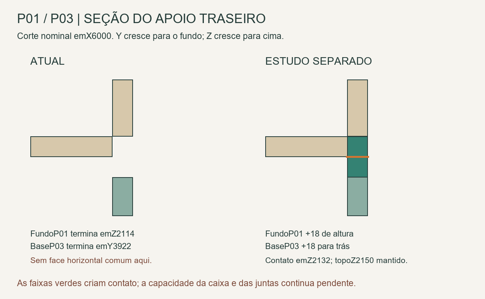

# P01/P03 — caminho traseiro das caixas superiores

25/10/2026. **Criar contato traseiro melhora o caminho de carga, mas não encerra o cálculo do maleiro.** O estudo separado demonstra duas alterações de chapa sem reduzir os vãos; seis modelos de placa mostram que não se deve aprovar a base apenas por esse novo contato.

FonteR51 preservada. Reutiliza o [inventário de massas e oito contatos superiores](../P01_massas_equilibrio_2026-10-25/README.md), sem repetir a análise global nem introduzir tubos.

## Geometria proposta, ainda separada

| Peça | Atual | Estudo |
|---|---|---|
| FundoP01, Peca208 | Altura2096, Z18–2114 | Altura2114, Z18–2132 |
| BaseP03, Peca262 | Profundidade632, Y3290–3922 | Profundidade650, Y3290–3940 |

Apenas aumentar a altura do fundoP01 deixaria sua face superior atrás da baseP03. A base também precisa alcançar essa face: são18 mm para trás, sob a espessura do fundoP03, sem elevar sua face superiorZ2150. O fundoP03 continua começando emZ2150. P01/P03 mantêm dimensões externas e o espaço interno livre; não se adicionou uma travessa dentro do vão. Acréscimo nominal total0,850 kg a800 kg/m³.

[Modelo parcial FreeCAD](P01_P03_apoio_traseiro_ESTUDO.FCStd). [Vista frontal](P01_P03_estudo.png), com portasP01 ausentes só deste arquivo parcial para leitura; portas e movimentos completos permanecem naR51. O calço18 do [socoR01](../P01_apoios_ao_piso_2026-10-25/README.md) aparece como contexto de estudo.

Quatro interfaces horizontais foram conferidas emBREP: fundoP01–baseP03 emZ2132(23652mm²), fundoP01–baseP02 emZ2132(11376mm²), baseP03–fundoP03 emZ2150(23652mm²) e fundoP01–calço18 emZ18(35352mm²). As faixas acrescentadas não interferem nos1176 sólidos visíveis restantes da pose atual. [Conferência geométrica](Conferencia_geometrica.json). Contato nominal não comprova apoio nivelado, resistência ou ação conjunta das chapas.

## O que os cálculos dizem

[calcular.py](calcular.py) reaproveita a placaRitz existente. Placa17,7 resistente/18,3 de massa, E1100 MPa eν0,30, todos parâmetros de estudo. Inclui o peso próprio da base e **o restante da madeira nominalP03 uniformizado sobre ela**, mais conteúdo. Essa uniformização é um orçamento de triagem, não a distribuição efetiva das paredes, portas ou ligações e não um envelope comprovadamente conservador.

Quatro posições laterais esquerdas usam juntas verticais hipotéticasK500N/mm; a divisória centralP01 fornece contato só por compressão emu982. O modelo proposto acrescenta19 posições traseiras de compressão sobre referência inferior ideal. Não se atribuiu rigidez comprovada à caixaP01, piso, travessa frontal1964 ou ação do topo/fundoP03 como caixa estrutural. Esses caminhos precisam de cálculo próprio.

| Conteúdo adicional hipotético, total | Sem crédito traseiro, base632 | Com contato traseiro ideal, base650 |
|---|---:|---:|
| 10kg distribuídos | 10,823mm | 6,889mm |
| 20kg distribuídos | 12,964mm | 8,228mm |
| 20kg na faixa frontal60 | 15,961mm | 11,824mm |

Valores lineares já incluem reserva0,20mm. Todos excedem a referência interna982/300=3,273mm. As grandes deformações relativas à espessura comprometem a hipótese de pequena deformação: **não são previsão da flecha do móvel real, carga de uso ou prova de que a caixa atual falhará**. Mostram que esse modelo reduzido não serve para liberar a base18. Topo, fundo, laterais e suas juntas podem criar outros caminhos; não foram presumidos como rígidos para fazer a conta passar.

O contato unilateral retira apoios que exigiriam tração e reinsere os que penetrariam a referência. Foram conferidas reação não negativa dos contatos, ausência de penetração nos retirados, equilíbrio de forças/momentos e seis convergências16/20, diferença máxima0,091%. As juntas laterais positivas são distintas de contatos e podem exigir retenção. Esse conjunto de verificações valida a solução numérica adotada, não as propriedades físicas ausentes.

## Próxima ação concreta

**Formato de fabricação, conferência posterior:** o [quantitativo das propostas](../Quantitativos_estudos_2026-10-25/README.md) identifica que o fundoP01 inteiro, tanto atual como proposto, não cabe em2750×1850. Confirmar painel em formato maior e acabamento real; a existência de formato maior numa ficha de linha não garante padrão/estoque. Se for necessária emenda, projetá-la e recalcular os caminhos antes de adotar a geometria monolítica do estudo.

1. Modelar a caixaP03 com topo, fundo e laterais e suas ligações efetivas, acoplada à divisória/laterais/fundoP01 e à travessa frontal. A base18 não deve ganhar carga liberada por comparação com a placa isolada ou pela simples presença de parafusos.
2. Produto/oficina: que junta prende cada aresta da base/tampo/fundoP03 e como transmite cisalhamento, tração e momento? Qual a curva força–deslocamento do grupo nas orientações reais? O cantoP02 transfere que resultantes para esse conjunto?
3. Se o material contribuir para a solução, obter propriedades direcionais e constituição da chapa real. Não selecionar qualquer compensado por um módulo isotrópico genérico, nem usar a mesma densidade para fechar massa e resistência.
4. Demonstrar compressão/apoio contínuo até o calço e piso, retenção contra deslocamento e montagem. O novo contato não resolve automaticamente distorção da caixa, acabamento ou antitombamento.
5. Só depois de demonstrar o conjunto, revisar a proposta com Elias e integrar uma revisão completa com fichas/quantitativos e massas atualizadas. O inventário global anterior continua calculado com o fundo/base atuais; não somar estudos silenciosamente.

Não se criaram furos, não houve mudança no modelo completo e nenhum ensaio físico foi executado. [Resultados](Resultados.json) e [verificação](Verificacao.json) permitem continuar sem reconstruir as etapas concluídas. O arquivoCAD é um estudo de caminho geométrico; não uma alternativa estrutural aprovada.
