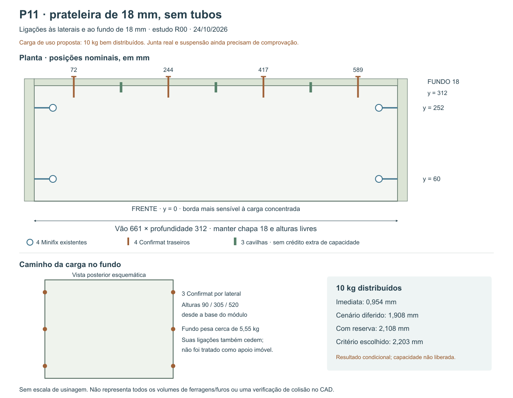

# P11 sem tubos — ligações da prateleira às laterais e ao fundo

24/10/2026 · R00 · base nominal R49, sem alterar o FCStd. **Decisão de Elias: manter o P11 sem tubos**, com chapa nominal de 18 mm e fundo de 18 mm.

## Resultado e situação

**Carga de uso proposta: 10 kg de conteúdo bem distribuído.** No modelo com a ligação traseira abaixo, a estimativa é **0,954 mm imediata**, **1,908 mm no cenário diferido** e **2,108 mm incluindo reserva adicional de 0,20 mm**, frente ao critério escolhido de **2,203 mm (661/300)**.

**A capacidade real ainda não está liberada.** A rigidez e resistência das juntas usadas na conta são requisitos a comprovar, não valores de catálogo do Minifix/Confirmat em nossa chapa. A margem de 0,095 mm é pequena. Material, furos, abertura das juntas, excentricidades, montagem e suspensão precisam de verificação aplicável ou prova da montagem real. Não aumentar o limite por comparação direta com um móvel comercial.

A alternativa de tubos foi retirada da solução selecionada. Nenhuma peça sob a prateleira, divisória, aumento de espessura ou perda de altura útil foi incluída nesta proposta.



## Ligação nominal dimensionada

Datum: x = 0 na borda esquerda do vão; y = 0 na frente da prateleira; z = 0 na face inferior da prateleira. O vão é **661 × 312 mm**; a espessura nominal é 18 mm.

| União | Proposta e posição nominal |
|---|---|
| Prateleira–laterais | Manter os **4 Minifix 15 Häfele 262.26.034 + pino S100 262.28.920**, dois por extremidade, a y = **60/252 mm**. São os quatro já previstos para esta peça, dentro dos 12 conjuntos da caixa; não somar quatro novos. Acesso inferior às caixas B34 |
| Prateleira–fundo | **4 Confirmat 7 × 50**, pela face traseira do fundo, em x = **72/244/417/589 mm**, eixo a z = +9 mm, no meio da espessura nominal da prateleira |
| Posicionamento na traseira | **3 cavilhas Ø8 × 30**, em x = **158/330,5/503 mm**, eixo z = +9 mm; nominalmente 10 mm no fundo e 20 mm na prateleira. Sem crédito adicional de rigidez/resistência na conta |
| Fundo–laterais | **3 Confirmat 7 × 50 em cada lateral**, seis no total, no eixo médio do fundo. Alturas a **90/305/520 mm da base do módulo**, equivalentes a 72/287/502 mm desde a borda inferior do fundo. Grupo completo de cada lado precisa de comprovação própria |

Quantidade nova deste estudo: **10 Confirmat e 3 cavilhas**. Os quatro Minifix da prateleira permanecem existentes. Conferir os quantitativos anteriores e evitar duplicação na futura consolidação. [Mapa por união e coordenada](Mapa_ligacoes_nominais.csv).

A referência dimensional de Confirmat é [GTV WK-CF0750-01](https://gtv.com.pl/en/produkt/WK-CF0750-01/), aço, 7 × 50. A página confirma dimensões/aplicação, mas não capacidade ou rigidez. Outra marca exige conferir a geometria e repetir a prova correspondente.

## Geometria e fabricação que precisam ser respeitadas

- A [EPF](https://mdf-info.eu/using-mdf/fixing/screwing) recomenda pelo menos **70 mm dos cantos para parafusos que entram na aresta do MDF**; os extremos traseiros foram colocados a 72 mm. Os extremos fundo–laterais também ficam a 72 mm dos cantos do fundo.
- O Confirmat de 50 mm atravessando 18 mm projeta geometricamente **32 mm na peça receptora**. Isso não garante 32 mm de rosca efetiva: ponta e cabeça entram na verificação do produto.
- Definir a broca escalonada pelo parafuso real. A orientação genérica EPF de piloto usa o **diâmetro do núcleo**, não 85–95% do diâmetro externo de 7 mm. Não liberar um piloto universal sem medir a ferragem e conferir sua instrução.
- Centralizar Ø7 na aresta de 17,7 mm deixa aproximadamente **5,35 mm** de material de cada lado; Ø8 deixa **4,85 mm**. O eixo nominal de 9 mm exige ajuste à espessura real e controle da ferramenta.
- As cabeças traseiras precisam ficar rentes para preservar a posição do fundo em relação à parede. As cabeças dos grupos fundo–laterais ficam nas faces externas das laterais, também rentes, antes de encostar os módulos vizinhos.
- **Ponto crítico:** o eixo do grupo fundo–lateral fica a **9 mm da aresta traseira da lateral**. Uma cabeça de Ø10, por exemplo, deixaria apenas 4 mm nominais de ligamento até a borda. O diâmetro real, escareamento, acabamento, fissuração e retenção precisam de validação. A recomendação EPF para parafuso ancorado na face não aprova automaticamente este furo de passagem com cabeça.
- Controlar profundidade e ponta dos furos cegos das cavilhas, com folga axial compatível. Não atravessar o fundo nem provocar abertura ao fechar a caixa. Não contar cola de montagem ou cavilhas como uma capacidade extra sem especificação e prova.
- Conferência geométrica nominal: os quatro eixos traseiros não cruzam as caixas Minifix B34 nem os seis parafusos fundo–laterais. Isso é uma triagem de coordenadas, **não um teste BREP de ferragens, ferramenta e todos os furos**.

Os parafusos traseiros e das laterais são montados antes de instalar o aéreo na parede e fechar o conjunto com os módulos adjacentes. Provar ordem de montagem e possibilidade de manutenção.

## Modelo estrutural utilizado

Foi calculada uma **placa de Kirchhoff por Ritz**, com frente livre, quatro uniões pontuais laterais e quatro traseiras. As juntas transmitem força vertical com acomodação; **não foi atribuído engastamento rotacional**. Quatro parafusos traseiros não foram transformados em um apoio contínuo fictício.

O fundo também pode se deformar e se acomodar nas suas ligações às laterais. Para não tratá-lo como apoio imóvel no espaço, foi incluída uma faixa analítica em seu plano, de 100 mm de altura, com flexão, cisalhamento e dois grupos de apoio flexíveis. **Não se corta uma faixa física no fundo:** a peça permanece inteira, de 661 × 574 × 18 mm. A faixa é uma hipótese conservadora de participação a validar; o modelo não é uma análise tridimensional completa da caixa.

Todo o peso próprio do fundo é aplicado nesse caminho, **sem crédito do seu encosto na base ou da parede**. As reações dos grupos incluem esse peso, sem contar as reações traseiras duas vezes. A sustentação final da caixa continua sendo outra etapa.

Equações do sistema:

```text
Uplaca = D/2 ∫[wxx² + wyy² + 2ν wxx wyy + 2(1−ν) wxy²] dA
D = E t³ / [12(1−ν²)]

K u + Aᵀ R = F
A u − C R = v₀

C = acomodação das juntas + flexibilidade do fundo/grupos
v₀ = acomodação causada pelo peso próprio do fundo
R positivo: apoio empurra a prateleira para cima
R negativo: ligação precisa retê-la para baixo
```

Referência primária para placas/energia/Ritz: [MIT 2.080 — Lecture 7](https://ocw.mit.edu/courses/2-080j-structural-mechanics-fall-2013/f8fd2ad49d100766335b4e129a8a4791_MIT2_080JF13_Lecture7.pdf). Os controles de quatro bordas apoiadas usados na validação não foram adotados como condição do P11.

## Hipóteses explícitas

| Entrada | Valor/situação |
|---|---|
| MDF | E instantâneo 2.200 MPa; espessura resistente 17,7 mm; ν = 0,30 como hipótese isotrópica; confirmar chapa/composição |
| Peso próprio da prateleira | 3,019 kg, usando 18,3 mm para massa e 800 kg/m³ |
| Peso próprio do fundo | 5,555 kg, usando 18,3 mm e 800 kg/m³ |
| Rigidez vertical inicial de cada ligação da prateleira | **1.000 N/mm requerida**, ainda sem comprovação no conjunto real |
| Rigidez vertical inicial de cada grupo fundo–lateral | **1.000 N/mm requerida para o grupo**, sem multiplicar por três o valor de um parafuso |
| Cenário diferido | Dividir E e todas as rigidezes por 2: E = 1.100 MPa e K = 500 N/mm. Sensibilidade, sem prazo/garantia de fluência do produto |
| Reserva adicional | 0,20 mm para desvios/acomodação adicionais; não substitui verificação de resistência local ou falha da ferragem |
| Critério comparativo | Flecha máxima + reserva ≤ 661/300 = **2,203 mm**; escolha de projeto, não norma de aprovação do móvel |

Não converter rigidez **rotacional** de um artigo em rigidez vertical. O [estudo primário de Langová/Joščák](https://agro.icm.edu.pl/agro/element/bwmeta1.element.agro-bb633cdb-f5f6-4027-82cf-3fbdeb5b5670/c/76-84.pdf.pdf) ensaia juntas e materiais distintos, com momento de ruptura e rigidez angular; não comprova os 1.000 N/mm ou uma carga admissível dos nossos conectores.

## Carga distribuída e região limitante

As cargas são **conteúdo adicional**. Peso próprio da chapa e do fundo já entram no modelo. A flecha máxima ocorre no meio da **borda frontal**, e não no centro geométrico da prateleira.

| Conteúdo distribuído | Imediata | Cenário diferido | Diferida + reserva | Comparação |
|---:|---:|---:|---:|---|
| 5 kg | 0,601 mm | 1,203 mm | 1,403 mm | Abaixo do critério |
| **10 kg** | **0,954 mm** | **1,908 mm** | **2,108 mm** | Abaixo, com margem pequena |
| 15 kg | 1,307 mm | 2,614 mm | 2,814 mm | Excede |
| 20 kg | 1,660 mm | 3,319 mm | 3,519 mm | Excede |

O cruzamento matemático do critério ocorre em aproximadamente **10,67 kg distribuídos**, com estas entradas. Arredondou-se a proposta para 10 kg; esse arredondamento não transforma as hipóteses em uma capacidade ensaiada.

## Cargas localizadas e mistas

Contato localizado de **50 × 60 mm**, conforme definido no modelo. Casos abaixo são alternativos, não somáveis:

| Conteúdo total e posição | Flecha diferida | Com reserva |
|---|---:|---:|
| 6 kg no centro, x = 330,5 / y = 156 mm | 1,777 mm | 1,977 mm |
| 3 kg no meio da frente, x = 330,5 / y = 30 mm | 1,708 mm | 1,908 mm |
| 3 kg perto da lateral/frente, x = 25 / y = 30 mm | 0,715 mm | 0,915 mm |

No caso perto da lateral a flecha é menor, mas a reação no conector próximo pode ser maior. A distribuição das forças foi calculada; não se dividiu a carga por oito.

Os cruzamentos matemáticos com reserva são aproximadamente **7,06 kg no centro** e **3,73 kg junto à frente**. As propostas de 6/3 kg foram mantidas abaixo deles, ainda condicionais.

**Não interpretar “10 kg totais e uma pilha de até 3 kg na frente” como atendido.** O caso misto de 7 kg distribuídos + 3 kg concentrados na frente excede o critério. O arquivo de resultados inclui essa superposição, com peso próprio contado uma única vez. Contatos menores, impacto, pessoas e ambiente úmido anormal não estão cobertos.

## Solicitações e requisitos das juntas

Para **10 kg distribuídos**, as reações da prateleira são:

| Ligação | Reação vertical de serviço |
|---|---:|
| Minifix dianteiro, cada lado, y = 60 | +39,03 N |
| Minifix traseiro, cada lado, y = 252 | +2,06 N |
| Confirmat traseiro x = 72 e 589 | **−4,94 N cada** |
| Confirmat traseiro x = 244 e 417 | +27,69 N cada |
| Grupo completo fundo–lateral, com peso do fundo | +49,99 N em cada lado |

O sinal negativo exige retenção, não só apoio por gravidade. Nos casos de uso propostos, a maior solicitação absoluta é 39,93 N em um Minifix, 27,69 N em um Confirmat traseiro e 49,99 N em um grupo fundo–lateral.

Com majoração de estudo de 2, especificar como **requisitos mínimos a demonstrar**, e não capacidades já aprovadas:

- **100 N reversíveis** por ligação lateral Minifix e por Confirmat traseiro;
- **150 N por grupo fundo–lateral completo**, sem somar cegamente três resistências individuais;
- rigidez vertical inicial **≥ 1.000 N/mm** por ligação/grupo nos modos solicitados, incluindo folga e acomodação.

Não basta verificar cisalhamento puro: a rotação da prateleira pode abrir a junta e causar tração axial/efeito de alavanca nos parafusos. A introdução da reação pela face frontal do fundo também tem cerca de **9 mm de excentricidade** até seu plano médio. O modelo do fundo em seu plano não verifica essa flexão local fora do plano. Esses efeitos devem aparecer na prova da união real, com a geometria e o sentido da carga, não no ensaio de um parafuso isolado sem o painel.

A tensão global da placa foi examinada afastada pelo menos 30 mm dos pontos de ligação. Os picos nos apoios pontuais são singulares e não servem para aprovar furos, caixas Minifix ou esmagamento. Tampouco MOR de catálogo é resistência à retenção de parafuso.

## O que falta para liberar a carga

1. Confirmar o MDF, espessura resistente, geometria da ferragem e furação real. Ajustar o cálculo se os dados não cumprirem as hipóteses.
2. Comprovar rigidez e resistência das uniões na **mesma composição real**, incluindo Minifix com embutimento adotado, Confirmat, espessura, piloto, fita e torque. Testar deslocamento relativo e retenção nos dois sentidos; reproduzir abertura/alavanca e o detalhe da cabeça junto à aresta.
3. Ensaiar o grupo fundo–lateral completo, sua acomodação e o caminho até a caixa. Não substituir a rigidez do grupo por “três vezes a do parafuso”.
4. Compatibilizar furos, ferragens, ferramentas e sequência no CAD, sem alterar os 18 mm ou introduzir tubos. O [mapa nominal](Mapa_ligacoes_nominais.csv) ainda não é furação executada.
5. Provar o conjunto com os casos distribuído/localizado/misto pertinentes, registrando deslocamentos, acomodação e descarga. Um teste curto não garante anos de fluência.
6. Dimensionar a suspensão do P11 completo e sua interface com o móvel. Substrato/instalações ocultas e ancoragem definitiva continuam dependentes do apartamento.

Um rasgo no fundo para criar apoio contínuo foi considerado como comparação, mas **não foi selecionado**. Exigiria outra geometria de corte e outro modelo de apoio. Não é necessário alterar a profundidade da peça nesta proposta de quatro uniões traseiras.

## Verificação reproduzível

[Premissas.json](Premissas.json), [placa_ritz.py](placa_ritz.py) e [calcular.py](calcular.py) geram [Resultados.json](Resultados.json), [Resumo_cargas.csv](Resumo_cargas.csv), [Reacoes_propostas.csv](Reacoes_propostas.csv) e o mapa nominal. O estudo foi revisado por agentes independentes de placa e ligações.

[Verificacao.json](Verificacao.json): **PASS**. Inclui controle de placa contra Navier, controle de viga, conformidade do fundo por trabalho virtual, solver independente de molas, equilíbrio de forças/momentos em 48 casos, conservação de pesos e convergência grau 18 → 22. No caso de 10 kg distribuídos, a diferença de flecha por refinamento foi **0,000364 mm**. Esses testes validam o método implementado, não as propriedades da junta física.

```powershell
python calcular.py
python verificar.py
```

**Estado:** P11 sem tubos confirmado; mapa de ligação e carga de uso proposta calculados condicionalmente. **Fabricação/capacidade ainda não liberadas; CAD R49 intacto.**
