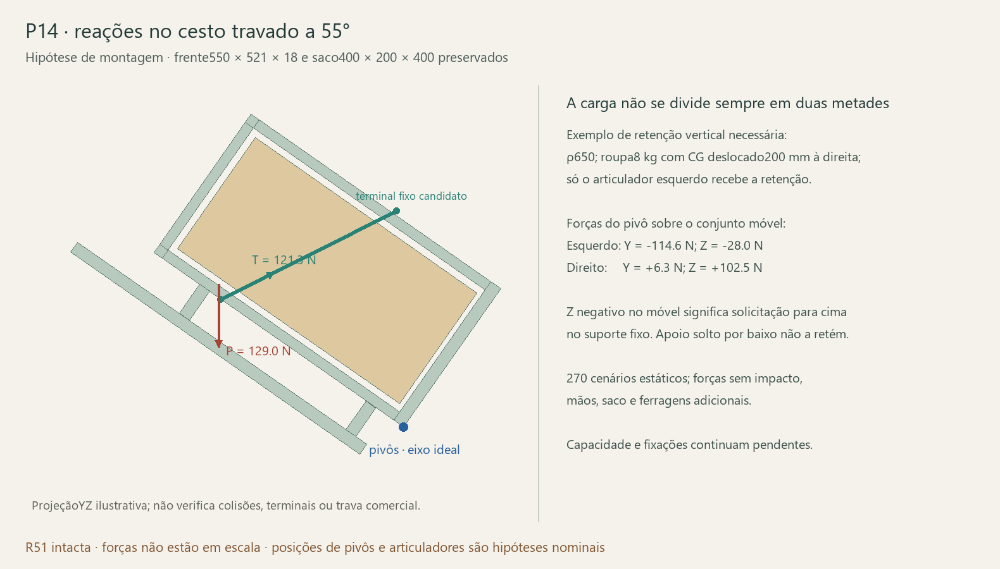

# Cesto P14 — reações dos pivôs, fixações e operação

25/10/2026 · continuação do plano. **Concluída a estática nominal em três dimensões na parada55° e a energia gravitacional durante a abertura.** O torque de38,73 Nm e a tração de133,29 N anteriores foram reproduzidos; o avanço é calcular os pivôs e as interfaces sem presumir divisão igual entre os lados. Nenhuma peça ou movimento da R51 foi alterado.

## Base preservada e limites

Mantidos frente550×521×18, saco400×200×400,13 peças da armação, eixo idealY6440/Z120 e abertura55°. Os centros de gravidade agora vêm dos sólidos BREP atuais. Os volumes conferem com o [estudo anterior da armação](../Consolidacao_R45_2026-10-23/Portas_e_articulacoes/Cesto_selecao_e_esforcos.md): frente5,157900 L e armação2,769192 L.

Aρ900 hipotético, frente+armação somam7,134 kg; com8 kg de roupa,15,134 kg antes de saco, pega e ferragens adicionais. Densidades650/800/900 são sensibilidades, sem material real confirmado. O corpo do saco é envelope, não32 kg de madeira nem peso real do tecido.

Reutilizada a [posição candidata dos articuladores simples](../Banco_cesto_simples_2026-10-23/Conferencia/Resultado.md). A distância291 mm ao abrir vem de duas barras145,5; **não é curso de trava confirmado pelo Bigfer**. Nesta condição idealizada, a força da biela alinhada atua no planoYZ com componentes unitárias aproximadamente+0,893Y/+0,449Z e braço290,54 mm. Terminais e sua flexão/excentricidade continuam ausentes. Não aplicar essa força axial ao articulador dobrado durante todo o percurso.

Os planos de reação dos pivôs são hipóteses a partir dos pinos ideais: X4320/4790, com sensibilidades4310/4800 e4330/4780. São espaçamentos470/490/450 mm, respectivamente, sem afirmar que a bucha e o suporte comerciais apoiem nesses planos. Os articuladores foram avaliados com100% num lado,50/50 e100% no outro. Não se usa repartição ideal como única condição.

A armação foi tratada como corpo rígido para fechar o equilíbrio. A torção, a deformação e a rigidez das ligações que permitiriam transmitir esses esforços entre os lados ainda precisam de verificação própria.

## Cargas na parada55°

| Cenário aρ900 | Peso conhecido | Momento de abertura | Tração total requerida dos articuladores |
|---|---:|---:|---:|
| Vazio, frente+armação | 69,96 N | 12,538 Nm | 43,153 N |
| Roupa8 kg no centro | 148,42 N | 21,372 Nm | 73,561 N |
| Roupa8 kg no extremo teórico de maior momento | 148,42 N | 38,725 Nm | 133,288 N |

“Extremo teórico” coloca o centro de massa nos limites do envelope do saco. É uma sensibilidade conservada dos cálculos anteriores, não demonstração de que8 kg de roupa consigam se concentrar fisicamente num canto. A posição lateral do conteúdo é variada separadamente porque altera os pivôs mesmo sem mudar o torque de abertura.

Na combinação simétrica central, os pivôs recebem aproximadamente **Y−32,86/Z+57,69 N por lado**, resultante66,39 N. Isso já difere de simplesmente dividir o peso total por dois: os articuladores exercem forças horizontais e verticais.

Nos270 cenários calculados, a maior resultante num pivô é **134,01 N**, com um articulador recebendo tudo e roupa excêntrica. Não representa capacidade do parafusoØ10, da bucha ou da madeira. O cenário extremo de um pivô não precisa coincidir com o de maior arrancamento ou maior tração.

**Aparece retenção vertical obrigatória:** numa sensibilidade aρ650, com roupa deslocada200 mm para um lado e somente o articulador oposto atuando, um pivô precisa aplicar **28,01 N para baixo no conjunto móvel**. O conjunto, portanto, puxa o suporte fixo para cima. Um apoio apoiado apenas por gravidade na base não fecha esse caminho. Parafusos/juntas e retenção mecânica precisam transmitir o sinal reverso, além de forças horizontais e do controle axial do pivô.

## Interfaces à lateral de madeira

As faces internas das laterais atuais estão emX4278 e4832. O centro da reserva de cada articulador fica26 mm para dentro dessas faces. Se o grupo resistente da lateral estiver alinhado emY/Z, essa excentricidadeX gera momento resultante de até **3,466 Nm** na interface do articulador, além da força133,288 N. O terminal real pode acrescentar outras excentricidades; não se projetou um suporte comercial fictício para absorvê-las.

Nos pivôs, os planos testados ficam32/42/52 mm para dentro das mesmas faces. A maior combinação desta sensibilidade dá aproximadamente **6,969 Nm** na interface à lateral. Os blocos52×40×44 do CAD são reservas, sem material, bucha ou ligação dimensionados. Não considerar seu volume desenhado uma ligação pronta. A base pode receber compressão vertical quando houver contato, mas não elimina a retenção contra levantamento nem a força horizontal.

Os vetores de reação e momentos emY/Z de cada lado estão em [Resultados.json](Resultados.json). São solicitações estáticas não majoradas da montagem hipotética. Não dividir por uma quantidade arbitrária de parafusos, não comparar com “20 kg” de anúncio e não usar como resistência admissível. Componentes do pivô/articulação têm função própria; nenhuma estrutura tubular sustentando chapas foi proposta.

## Operação entre0 e55°

Foi calculado o potencial gravitacional do conjunto conhecido, sem mola, atrito ou amortecimento. Em cada trajetória, a roupa é uma massa ideal com centro fixo em relação à armação; não se simulou acomodação/migração do tecido. O ângulo de torque zero é um equilíbrio **instável**: acima dele a gravidade favorece abrir; abaixo favorece fechar. Não é uma posição de retenção segura.

| Cenário aρ900 | Ângulo de torque zero | Energia gravitacional disponível desse ponto até55° | Maior força tangencial ideal no topo |
|---|---:|---:|---:|
| Vazio | 0,70° | 6,430 J | 22,62 N |
| Roupa8 kg central | 16,81° | 7,399 J | 38,55 N |
| Extremo teórico de maior momento | 2,52° | 19,087 J | 69,86 N |

A pega é somente o ponto teórico central alto da frente, raio554,37 mm; pega real, direção da mão e acesso alteram a operação. Os valores não provam conforto ou alcance. A energia é a diferença de potencial com início praticamente sem velocidade; mãos, atrito, componentes ausentes, acomodação da roupa e velocidade inicial mudam a energia efetiva. Os19,087 J são um resultado dos casos idealizados, não limite garantido de impacto do conjunto completo. Não foi convertido19 J numa força de impacto sem conhecer curso de parada e rigidez/amortecimento.

Uma trava que segura a posição aberta não comprova controle da descida até ela. Isso precisa entrar no protótipo e na consulta do fabricante, preservando a direção manual já aprovada. Nenhum novo mecanismo ou redução do saco foi adotado.

## Dados exatos ainda faltantes

1. **Bigfer:** confirmar os eixos entre terminais ao travar/liberar, capacidade e sentido de esforço na montagem55°, retenção contra fechamento e comportamento durante o percurso. Perguntar se há orientação de energia/velocidade de chegada; não supor que a trava absorva impacto.
2. **Pivô completo/oficina:** fornecer planos reais de reação das buchas, posição dos apoios, retenção axial, folgas e espessuras. Demonstrar caminho da força horizontal e da força vertical reversa até as laterais/base, incluindo as excentricidades. O OMPCR candidato40,25 mm sozinho não resolve a largura52 mm.
3. **Ligação móvel:** distribuir os esforços dos terminais nos montantes gabarito15 mm sem reduzir saco, passagem ou manutenção. Corpo, conexões e proteção contra corrosão precisam de material e desenho reais.
4. **Massas adicionais:** pesar saco/alças, pega e partes móveis; informar seus centros ou trajetórias. [Registro pendente](Componentes_pendentes.json) deixa desconhecidos como`null`. Não preencher zero nem girar as barras articuladas como se fossem rígidas com a frente. Preencher esse registro não atualiza automaticamente o cálculo: o modelo deve incorporar a cinemática/massa correta.
5. **Ensaio:** complementarC01–C04 do [roteiroP20/P14](../P20_assento_fechado_2026-10-25/Roteiro_banco_cesto.md) com apoio assimétrico, retenção vertical dos suportes, operação e chegada ao fim do curso. Sem executar prova física nem usar pessoa como carga nesta etapa.

São dependências de produto/oficina, não das medidas do apartamento. A instalação final e o piso real serão conferidos no levantamento. A R51 completa e seus controles permanecem intactos; estudo de cálculo separado, sem capacidade de uso liberada.

## Reprodução e verificação

[Geometria BREP](Geometria_R51.json) · [cálculo](calcular.py) · [resultados](Resultados.json) · [verificador](verificar.py) · [verificação salva](Verificacao.json).

Executar`extrair.py` no FreeCAD com a R51 aberta e o cesto em0°/sem retirada, sem mover controles. Depois`python calcular.py`, `python verificar.py` e `python desenhar.py`. Verificados270 equilíbrios,270 espelhamentos e30 trajetórias/trabalho-energia; torque/braço anteriores reproduzidos, hash/CRC da fonte preservados. Zero ensaios físicos; fabricante ainda não validou trava ou capacidade. Ao mudar componentes, apoios ou cotas, repetir o modelo com os dados efetivos.
