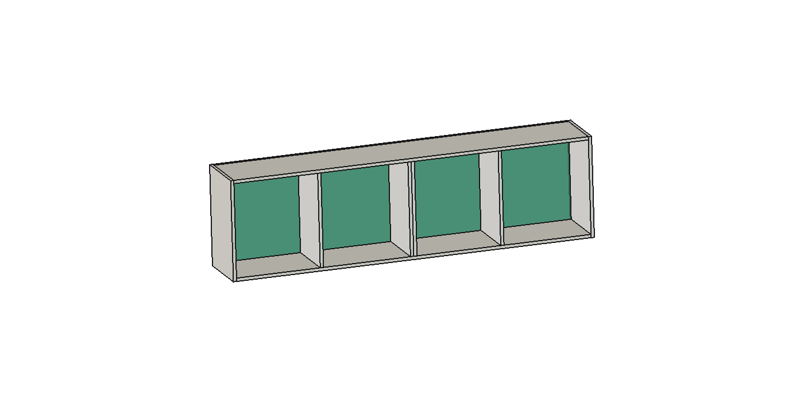

# P17 — base, fundo e ligações de marcenaria

Estudo nominal separado, 25/10/2026. **O fundo e as divisórias precisam de ligações positivas para participar do caminho da carga.** A placa18 mantida dá resultados condicionais favoráveis quando esses caminhos são creditados; não há comprovação de juntas, caixa completa ou carga de uso.

Fonte: R51 completa preservada, SHA256 `ab5323bb12f8eca40b25bdfe4eadc8a3221c82b0646f354cd1f2832acfb27c16`. Reutiliza a [geometria e demanda global do P17](../Aereos_suspensao_P09_P11_P12_P17_2026-10-25/README.md) e a placa Ritz existente. Não usa tubos ou quadros metálicos.

## Proposta geométrica

[Abrir estudo parcial FreeCAD](P17_fundo_inteiro_ligacoes_ESTUDO.FCStd). São nove peças: oito formas copiadas e somente o fundo substituído. O fundo18 passa de514 para550 de altura, preenchendo as faixas atrás da base e do tampo. Largura1964, profundidade da base312 e altura externa550 preservadas. As quatro divisórias permanecem nas mesmas posições; o conjunto central continua sendo duas chapas18, sem crédito de composição monolítica.

**16 contatos de face conferidos:** quatro base–divisória, quatro tampo–divisória, quatro fundo–divisória, dois fundo–lateral e dois fundo–base/tampo. Acréscimos sem interferência volumétrica nos sólidos visíveis da pose atual. Portas/ferragens estão ausentes somente deste arquivo parcial; continuam completas na R51. Não é um novo ensaio dos movimentos.

Os58 eixos ocultos são posições de interface para discutir montagem, não furos CNC nem58 ferragens adicionais. Estão em [Conferencia_geometrica.json](Conferencia_geometrica.json), com coordenadas do estudo, do módulo e globais nominais. Reconciliar com o mapa existente antes de quantificar. Cabeças/acesso pela base e pelo tampo podem afetar acabamento: revisar antes de incorporar. Não cortar ou furar pela imagem.

## Cálculo e significado

[Resultados completos](Resultados.json), reproduzíveis com `python calcular.py` e NumPy. UnidadesN/mm/MPa/kg. Base1964×312×18; espessura resistente17,7 e de massa18,3; densidade hipotética800; E inicial2200 reduzido pela metade para sensibilidade ao efeito diferido, ν0,30. Não é propriedade certificada de uma chapa escolhida.

As divisórias têm centros u473/973/991/1473. Conteúdo distribuído significa o total dividido igualmente entre os quatro vãos úteis; o frontal ocupa uma faixa60 de profundidade em cada vão. Não são20 kg por vão.

| Caminho creditado | Conteúdo hipotético | Flecha máxima + reserva0,20 mm |
|---|---|---:|
| Divisórias e fundo ligados | 10 kg distribuídos no total | 0,644 mm |
| Divisórias e fundo ligados | 20 kg distribuídos no total | 0,863 mm |
| Divisórias e fundo ligados | 20 kg na faixa frontal, total | 1,336 mm |
| Divisórias e fundo ligados | 10 kg somente no segundo vão | 1,108 mm |

Referência interna de triagem:500/300=1,667 mm, pelo maior espaçamento entre eixos de apoios. Não é limite normativo nem aprovação do conjunto. Reserva0,20 representa a deformação adicional admissível **a comprovar** na referência superior/caixa/suspensão; não é medida realizada.

Cada divisória tem dois caminhos axiais, nas profundidades72 e240, entre duas juntas em série e a chapa vertical514. O fundo tem12 caminhos verticais com faixa resistente analítica100, altura entre eixos532. Essas faixas não são cortes físicos. Peso próprio da base entra como carga de placa; pesos das divisórias e do fundo entram no deslocamento inicial dos caminhos. Reações superiores incluem esses pesos. Tampo, portas e laterais não são uma segunda carga sobre esta placa: pertencem ao modelo global.

**Requisito hipotético por posição:** K inicial500 N/mm em cada junta inferior e superior, reduzido a250 na sensibilidade. Duas posições por divisória significam grupo inferior1000 e grupo superior1000 iniciais, antes de considerar a série; não significam um caminho equivalente1000. Laterais usam um caminho completo requerido500 inicial por posição. Não se atribui essa rigidez a qualquer Confirmat/Minifix por nome.

No frontal20, E inicial1600 com K inicial500 dá1,555 mm. Reduzir K para250 dá1,871 mm com E2200, ou2,101 mm com E1600: excede a referência. Duplicar K para1000 dá1,057 mm com E2200. Reduzir a faixa analítica traseira100 para50 altera o caso E1600/K500 para1,555 mm, sem substituir prova de espalhamento, ligações e cisalhamento reais.

Há reações negativas de até cerca6,7 N nas posições de placa dos casos completos calculados: o modelo exige retenção, não só contato por gravidade. Forças superiores por posição ficam registradas no JSON, chegando a cerca82,9 N nos casos completos desta rodada; não são capacidade do parafuso nem a demanda global do aéreo. As ligações também participam de esforços horizontais e torção, fora deste submodelo.

As referências sem crédito das divisórias dão respostas lineares muito grandes: somente laterais193 mm no caso10 kg, ou laterais+fundo22 mm no caso20 kg. **Estão fora da hipótese de pequena deformação; servem para rejeitar esses modelos de apoio, não para prever a flecha real ou afirmar que o móvel atual cairá.** O modelo atual pode mobilizar caminhos não demonstrados; eles não foram presumidos.

O fundo inteiro acrescenta1,035 kg a800 kg/m³, ou1,164 kg a900. A demanda global anterior usa o fundo atual514. Se a proposta for incorporada, atualizar massas e suspensão; não misturar o novo fundo com a capacidade de um suspensor ainda não escolhido.

Essas massas usam18,3 de espessura para cálculo. O BREP nominal18 acrescenta1,018kg a800; a diferença é de hipótese, não perda de detalhe. [Quantitativo conferido dos arquivos gravados](../Quantitativos_estudos_2026-10-25/README.md), separado da lista-base e do orçamento.

## Condições para avançar sem o apartamento

1. Oficina/produto: qual ligação realiza cada caminho inferior/superior, em chapa18 efetiva, com rigidez, tração/cisalhamento combinados, esmagamento e bordas demonstrados? Confirmat7×50 é candidato de estudo. Confirmar piloto, cabeça, profundidade, torque, acesso e acabamento; não copiar uma resistência genérica.
2. Prova de junta: registrar curva força–deslocamento por posição ou grupo, orientação e lotes do painel. Comparar com K requerido, sem confundir resistência máxima com rigidez. Os dois caminhos precisam da mesma referência de deslocamento.
3. Caixa completa: demonstrar a deformação do tampo/uniões/suspensão e distorção do fundo sob esforços simultâneos. A reserva0,20 não pode ser atribuída a parede desconhecida. Medir também rotações e deslizamentos, sem ajustar o resultado ao modelo.
4. Ensaio de conjunto: usar carga distribuída e frontal compatível com um protocolo acordado, registrar carga real, posição, tempo, temperatura/umidade, flecha instantânea/residual e danos. Estes casos numéricos não são autorização para ensaio humano improvisado ou carga de uso.
5. Elias: revisar acabamento/acesso das cabeças antes da integração. Depois, atualizar ficha, quantitativos e demanda global. Ancoragem no imóvel depende do substrato real após as chaves.

Nenhum ensaio físico foi executado. [Verificações](Verificacao.json): seis convergências16/20, equilíbrio de forças/momentos, restrições, integridade dos arquivos, contatos e fonte preservada. Equilíbrio e convergência verificam a solução do modelo adotado; não validam suas hipóteses físicas.

Rotinas: [calcular.py](calcular.py), [criar_estudo.py](criar_estudo.py) no FreeCAD e [verificar.py](verificar.py). O criador recusa sobrescrever arquivo existente; não execute sobre a sessão de trabalho sem ler suas guardas. Não altera ou anima a R51.
