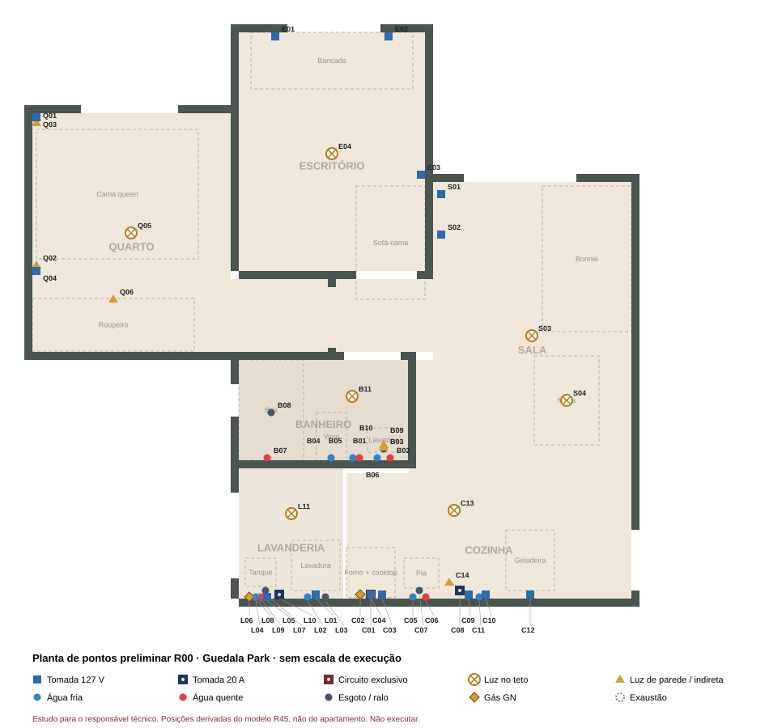

# Planta de pontos preliminar — R00

24/10/2026. **Estudo para o responsável técnico, não é projeto executivo.** Reúne todos os pontos de elétrica, iluminação, água, esgoto, gás e exaustão que o projeto de interiores precisa, a partir das escolhas de aparelhos e da geometria R45.

- **Desenho:** [Planta_pontos_R00.svg](Planta_pontos_R00.svg). Abre no navegador; passe o mouse sobre um ponto para ver a descrição.
- **Para atualizar:** editar a lista `P` em [gerar_planta_pontos.py](gerar_planta_pontos.py) e rodar `python gerar_planta_pontos.py`. A tabela abaixo é regenerada.

## Limites

- As posições vêm dos aparelhos no modelo 3D, não do apartamento. Os pontos existentes da construtora só serão conhecidos na entrega. Use o [roteiro do dia das chaves](../../04_Visita_ao_apartamento/Roteiro_dia_das_chaves_R01.md) para marcar a posição real de cada código.
- As alturas são referências usuais para o tipo de aparelho e devem ser conferidas nos manuais.
- Circuitos, bitolas, disjuntores, carga total da unidade, traçado de água quente e gás e exaustão do E21 são trabalho do(a) responsável técnico(a).
- A carga elétrica relevante inclui o forno (16,2 A, circuito exclusivo), a torre de 20 A, a tomada de 20 A da lavanderia, a lavadora, a geladeira e o micro-ondas. Ela precisa ser conferida no quadro da unidade.
- Ar-condicionado não está incluído; depende da consulta ao condomínio (Convenção, art. 58).

## Pontos

<!-- TABELA -->

| Código | Tipo | Ponto | Altura de referência | Situação |
|---|---|---|---|---|
| C01 | Circuito exclusivo | Forno Fischer 127 V · 2061 W / 16,2 A · circuito exclusivo | 30 cm | Aparelho escolhido; circuito a dimensionar |
| C02 | Gás GN | Gás GN do cooktop KE4GC | 50 cm | GN confirmado; posição real a levantar |
| C03 | Tomada 127 V | Ignição do cooktop | 50 cm | A confirmar no manual |
| C04 | Tomada 127 V | Depurador DE61IX · 127 V | 200 cm | Aparelho escolhido |
| C05 | Água fria | Água fria da pia | 55 cm | Existente; conferir posição |
| C06 | Água quente | Água quente da pia | 55 cm | Não confirmada no memorial |
| C07 | Esgoto / ralo | Esgoto da pia | 45 cm | Existente; conferir posição |
| C08 | Tomada 20 A | Torre automática de tomadas 20 A na bancada (área seca) | 92 cm | Posição a definir |
| C09 | Tomada 127 V | Micro-ondas ME23P · 127 V | 190 cm | Aparelho escolhido |
| C10 | Tomada 127 V | Purificador PE12G | 110 cm | Aparelho escolhido |
| C11 | Água fria | Água fria do purificador | 110 cm | Derivação a confirmar |
| C12 | Tomada 127 V | Geladeira IB6S | 200 cm | Aparelho escolhido |
| C13 | Luz no teto | Plafon quadrado branco 3000 K | teto | Formato aprovado; posição de estudo |
| C14 | Luz de parede / indireta | Luz regulável da bancada 3000 K, sob os aéreos | 150 cm | Comando independente com regulagem |
| L01 | Tomada 127 V | Lavadora LG VC4 · 127 V | 110 cm | Aparelho escolhido |
| L02 | Água fria | Água fria da lavadora | 90 cm | Existente; conferir posição |
| L03 | Esgoto / ralo | Esgoto da lavadora | 80 cm | Existente; conferir posição |
| L04 | Água fria | Água fria do tanque | 60 cm | Conferir posição |
| L05 | Esgoto / ralo | Esgoto do tanque | 40 cm | Conferir posição |
| L06 | Gás GN | Gás GN do aquecedor Rinnai E21 | 140 cm | Aparelho escolhido; instalação a projetar |
| L07 | Tomada 127 V | Aquecedor E21 · alimentação elétrica | 150 cm | Conferir no manual |
| L08 | Exaustão | Exaustão do aquecedor E21 | 215 cm | Duto e saída a projetar |
| L09 | Água quente | Saída de água quente do E21 → banheiro e cozinha | 140 cm | Percurso oculto em estudo |
| L10 | Tomada 20 A | Tomada fixa 20 A para air fryer e cafeteira | 100 cm | Posição a definir |
| L11 | Luz no teto | Plafon branco 3000 K, fora da sombra do varal | teto | Posição a testar |
| B01 | Água fria | Água fria do lavatório | 55 cm | Existente; conferir |
| B02 | Água quente | Água quente do lavatório | 55 cm | Novo ramal; percurso em estudo |
| B03 | Esgoto / ralo | Esgoto do lavatório | 45 cm | Existente; conferir |
| B04 | Água fria | Água fria do vaso | 20 cm | Existente |
| B05 | Água fria | Ducha higiênica · fria | 60 cm | Posição ilustrativa |
| B06 | Água quente | Ducha higiênica · quente | 60 cm | Novo ramal; E21 exige 3,9 L/min para ligar |
| B07 | Água quente | Chuveiro / misturador Livo (quente e fria) | 120 cm | Ponto existente; conferir |
| B08 | Esgoto / ralo | Ralo do box | 0 cm | Existente |
| B09 | Luz de parede / indireta | Luz frontal do espelho 4000 K | 190 cm | Comando próprio |
| B10 | Luz de parede / indireta | Luz indireta 3000 K (faixa no canto do teto) | 230 cm | Comando próprio; infraestrutura a validar |
| B11 | Luz no teto | Luz geral do banheiro | teto | Modelo a definir |
| S01 | Tomada 127 V | Régua no compartimento ventilado: TV, PS5, soundbar | 30 cm | Posição de estudo |
| S02 | Tomada 127 V | TV 50″ atrás do painel | 120 cm | Altura a conferir |
| S03 | Luz no teto | Luz geral da sala | teto | Modelo a definir |
| S04 | Luz no teto | Luz sobre a mesa Berlin | teto | Modelo a definir |
| E01 | Tomada 127 V | Bancada · notebook | 85 cm | Quantidade a definir |
| E02 | Tomada 127 V | Bancada · PC CH360, monitores | 85 cm | Quantidade a definir |
| E03 | Tomada 127 V | TV 43″ existente | 100 cm | Conferir |
| E04 | Luz no teto | Luz geral do escritório | teto | Modelo a definir |
| Q01 | Luz de parede / indireta | Arandela branca compacta · lado 1 | 110 cm | Comando independente |
| Q02 | Luz de parede / indireta | Arandela branca compacta · lado 2 | 110 cm | Comando independente |
| Q03 | Tomada 127 V | Tomada de cabeceira · lado 1 | 60 cm | Conferir |
| Q04 | Tomada 127 V | Tomada de cabeceira · lado 2 | 60 cm | Conferir |
| Q05 | Luz no teto | Plafon branco discreto 3000 K regulável | teto | Escolhido |
| Q06 | Luz de parede / indireta | LED indireto nos aéreos | 213 cm | Perfil e fonte a definir |
