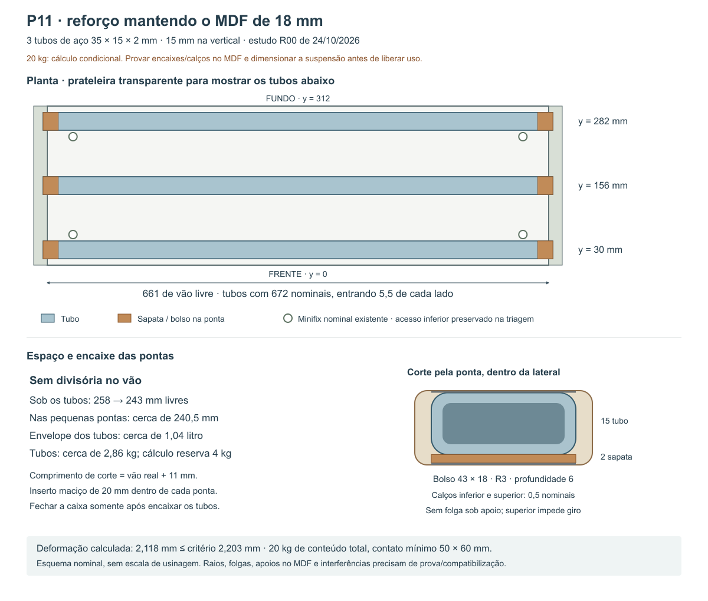

# P11 — reforço para 20 kg mantendo a chapa de 18 mm

24/10/2026 · estudo R00 sobre a geometria nominal R49. Continuação do [cálculo da prateleira sem reforço](../Calculo_P11_2026-10-24/Resultado.md).

**Decisão de Elias em 24/10/2026: manter o P11 sem tubos.** Este documento passa a ser estudo histórico, fora da solução selecionada e sem cortes no CAD. A [pesquisa de soluções comerciais](../../03_Referencias/Pesquisa_armario_microondas_2026-10-24/Pesquisa.md) levou à nova frente de [ligações da prateleira às laterais e ao fundo de18mm](../P11_ligacoes_sem_tubos_2026-10-24/Premissas.json).

## Solução dimensionada

**Três tubos de aço 35 × 15 × 2 mm, com 15 mm na vertical, sob a prateleira existente.** Comprimento nominal de cada tubo: **672 mm**, com pontas apoiadas em seis pequenos bolsos internos nas laterais. Não rebaixar a prateleira de 18 mm, não inserir divisória e não colocar parafusos/porcas nas faces externas.

No modelo conservador especificado abaixo, a deformação combinada estimada para **20 kg de conteúdo total** fica em **2,118 mm**, frente ao critério escolhido de **2,203 mm**. Esse resultado dimensiona o reforço e define seus requisitos; a liberação da carga no móvel ainda depende de comprovar o apoio fresado no MDF e compatibilizar a suspensão. Não é capacidade certificada por existir um desenho.



## Espaço ocupado e comparação

| Item | Resultado nominal |
|---|---|
| Chapa existente | 661 × 312 × 18 mm, sem rebaixo ou mudança de posição |
| Tubos | 3 peças de 672 × 35 × 15 mm; parede de 2 mm |
| Posição na profundidade | Centros a **30 / 156 / 282 mm da frente** da prateleira |
| Apoios nas laterais | 3 bolsos por lateral, 6 no total; entrada nominal de 5,5 mm de cada ponta |
| Altura sob os tubos | De 258 para **243 mm** no compartimento inferior |
| Altura local nas sapatas/calços | Aproximadamente **240,5 mm**, restrita às pequenas regiões das pontas |
| Entre os tubos | A face inferior original continua na altura de 258 mm; os objetos precisam caber respeitando os perfis |
| Volume de envelope dos tubos dentro do vão | **1,041 litro**, cerca de 2% dos 53,2 litros do compartimento inferior; sapatas acrescentam aproximadamente 0,01 litro |
| Peso teórico dos três tubos | **2,858 kg**, antes de sapatas, insertos e acabamento |
| Massa metálica usada nas contas | **4,0 kg**, incluindo reserva para os acessórios; não somar novamente essa reserva ao peso calculado |

O [catálogo Tuper 2024, página impressa 41](https://tuper-prd.s3.sa-east-1.amazonaws.com/uploads/2021/08/Tabela-Tecnica-de-Produtos-Tuper-2024.pdf) lista 15 × 35 × 2 mm e massa teórica de 8,505 kg por barra de 6 m. Isso confirma a seção comercial, não estoque, preço ou grau do lote.

Uma alternativa nominal com três barras maciças de **38,1 × 12,7 mm**, seção da família de [barras chatas ArcelorMittal](https://brasil.arcelormittal.com/pdf/produtos-solucoes/catalogos/catalogo-barras-laminadas.pdf), economizaria apenas **2,3 mm de altura** e pesaria aproximadamente **7,66 kg só nos perfis**, contra 2,86 kg nos tubos. Não foi escolhida: o pequeno ganho de altura acrescentaria quase 5 kg ao aéreo. Não se afirma mínimo matemático absoluto entre todos os materiais; esta é a solução de baixo volume e peso selecionada nesta rodada.

Tubos de 10 mm de altura comparados não atenderam à mesma abordagem de carga localizada. Os de parede 1,5 mm têm menor reserva às tolerâncias. A [comparação nominal](Comparacao_perfis.csv) não libera automaticamente as alternativas.

## Requisitos do metal e da chapa

- Aço com **E ≥ 200.000 MPa**, **fy declarado ≥ 200 MPa**, **I efetivo para flexão vertical ≥ 4.800 mm⁴** e **J de torção ≥ 10.000 mm⁴**. São requisitos de aceitação. A inscrição “metalon 35 × 15 × 2” não garante sozinha esses valores.
- Conferir espessura real, dimensões, raios dos cantos, solda longitudinal e empenamento. Uma sensibilidade com B = 34,8, H = 14,8, t = 1,75 mm e raio externo de 3t resulta em **I = 4.950,94 mm⁴**, acima do mínimo exigido. Isso não transforma essas hipóteses em tolerâncias certificadas do fabricante.
- Não usar o I de um retângulo de cantos vivos como propriedade exata do tubo. A fórmula com cantos arredondados foi conferida por integração numérica da seção.
- MDF: referência condicional **E ≥ 2.200 MPa**, espessura resistente **≥ 17,7 mm**, resistência à flexão de referência **≥ 20 MPa**. Peso próprio usa 18,3 mm e 800 kg/m³, conservando a separação entre massa e rigidez do estudo anterior. Confirmar produto e composição.
- Proteção anticorrosiva e acabamento branco fosco como proposta para o interior; espessura do revestimento entra no ajuste. Não compensar folga com espuma, fita macia ou cunha de MDF.

Referência geral de propriedades do aço: [SCI/SteelConstruction](https://steelconstruction.info/topics/design/steel-material-properties/). Referência condicional da chapa: [Arauco Melamina MDF](https://arauco.com.br/wp-content/uploads/2024/07/ARAUCO-MELAMINA-FICHA-TECNICA.pdf). A ficha do painel não informa a resistência deste encaixe fresado.

## Apoio das pontas — detalhe nominal

Usar como datum **z = 0 na face inferior da prateleira**; y = 0 na frente; x = 0 na face interna da lateral esquerda, crescendo no vão de 661 mm. As coordenadas do estudo são de montagem, não um programa de usinagem aprovado.

1. **Seis bolsos de 43 mm em y × 18 mm em z × 6 mm de profundidade em x**, com cantos internos **R3**, nas faces internas de `Peca335` e `Peca334`. Centros em y = 30 / 156 / 282 mm.
2. Soleira dos bolsos em **z = −17,5 mm** e teto em **z = +0,5 mm**. O perfil nominal ocupa z = −15 a 0; a sapata de 2 mm ocupa z = −17 a −15. A folga não pode ficar sob o perfil sem compensação.
3. **Seis sapatas de aço de 35 × 20 × 2 mm** sob as pontas. Cada uma entra nominalmente 5,5 mm no bolso e avança 14,5 mm para dentro do vão. A largura de 35 cabe na soleira reta de **37 mm** deixada pelo bolso de 43 mm com R3; não se adotou um bolso de 37 mm com soleira menor que a sapata.
4. **Seis insertos maciços internos de aço**, extensão de 20 mm, pré-forma aproximada de 30 × 10 × 20 mm, ajustados ao interior real do tubo com chanfros e calços rígidos. Sua função é impedir o amassamento local da parede na ponta. A dimensão final depende do raio e rebarba do perfil adquirido; não forçar um bloco quadrado incompatível com os cantos.
5. Calços metálicos inferiores de **0,5 mm nominais** na soleira e superiores de **0,5 mm nominais** entre o tubo e o teto do bolso, com área nominal de 35 × 5 mm. Ajustar ao metal e acabamento medidos. Os superiores fazem o **anti-giro** da ponta; não atribuir rigidez torsional a um bolso folgado.
6. Limitar folga vertical residual a **0,05 mm** e acomodação total a **0,20 mm sob carga de serviço**, incluindo calços, giro inicial, marcação do MDF e ajuste. O perfil deve encostar na chapa em todo o comprimento antes de receber o conteúdo. Não cabe uma folga de 1 mm no orçamento de deformação.
7. Garantir **embutimento efetivo mínimo de 5 mm por ponta**. O comprimento de corte é **vão real medido + 11 mm**; 672 mm é nominal. Centralizar e conferir os dois lados. Não usar tolerâncias de corte/caixa que deixem uma das entradas menor que 5 mm.

Com lateral nominal de 18 mm, o bolso deixa 12 mm nominais de material até a face externa. Considerando lateral de 17,7 mm e profundidade de corte de 6,2 mm, a espessura remanescente pode cair a **11,5 mm**. Não atravessar, não aprofundar para corrigir erro e não considerar essa região como lateral intacta de 18 mm na verificação final.

O apoio vertical é **tubo → inserto/sapata → calço rígido → soleira do bolso → lateral**. Soldas/pontos de união servem para reter peças do conjunto; não se presumiu capacidade estrutural de uma solda de oficina sem detalhamento. Os Minifix existentes mantêm a prateleira na caixa; sua capacidade não foi somada ao reforço.

## Verificação de carga e deformação

Considerar **20 kg totais**, distribuídos ou localizados sobre contato de pelo menos **50 mm no sentido do vão × 60 mm na profundidade**, com o centro a pelo menos 30 mm da frente/fundo. Contatos menores, pessoas ou impactos não estão cobertos. Não interpretar como 20 kg por perfil ou por trecho entre tubos.

**Global:** cada tubo é calculado sozinho para todos os 20 kg concentrados no meio, mais o peso de toda a prateleira e de todos os metais distribuído. Não se divide por três e não se soma EI do MDF ao metal. Usou-se vão de cálculo conservador de **672 mm**, maior que a distância real entre centros dos apoios. O peso próprio de referência da chapa é 3,019 kg; com os metais, o peso morto levado por um tubo nesta hipótese é 7,019 kg.

**Local:** a chapa também flete transversalmente entre tubos. Usou-se faixa longitudinal de 50 mm, vão transversal de **126 mm entre centros**, todos os 20 kg na faixa e E efetivo de **1.100 MPa** (2.200/2), preservando a sensibilidade à deformação sustentada. Não se conta o peso morto duas vezes para estimar reações; a pequena parcela de peso próprio na flecha local é conservadoramente repetida ao somar as deformações.

| Parcela | Estimativa |
|---|---:|
| Flexão global de um único tubo, com a carga total e todos os pesos próprios | **1,575 mm** |
| Flexão local sustentada da chapa entre tubos | **0,323 mm** |
| Reserva de acomodação total dos apoios | **0,200 mm** |
| Reserva para torção elástica, com pontas ajustadas contra giro | **0,020 mm** |
| **Soma conservadora** | **2,118 mm** |
| Critério de projeto 661/300 | **2,203 mm** |
| Margem restante nesta soma | **0,086 mm** |

Essa margem exige cumprir as entradas e os ajustes; não autoriza engrossar tinta, afrouxar calços, usar tubo inferior ou reduzir a faixa de contato. A soma combina máximos que não precisam ocorrer simultaneamente, mas não substitui ensaio da montagem.

A torção elástica estimada é menor que a reserva de 0,020 mm, incluindo conservadoramente conteúdo e peso morto excêntricos no único perfil. O resultado só vale se houver reação de torção nas pontas, por isso o ajuste superior anti-giro integra a solução. A fluência foi aplicada ao MDF local; não se duplicou arbitrariamente a flecha elástica do aço.

## Resistência e solicitações dos apoios

O tubo apresenta tensão de flexão de serviço de **61,33 MPa**. Uma triagem com cargas metálicas majoradas por 2, incluindo a torção aproximada, fica abaixo de **160 MPa**, valor correspondente a fy mínimo de 200 MPa dividido por 1,25. Esses fatores são escolhas explícitas deste estudo, sem declaração de atendimento a uma norma completa. A verificação local das pontas inclui os insertos e prova física; não está encerrada pela tensão da região central do tubo.

A reação de serviço em um único apoio é limitada conservadoramente por **264,97 N**, sem dividir por seis. Com embutimento efetivo de 5 mm e largura efetiva de 35 mm, a pressão média exigida no MDF chega a **1,51 MPa**. A proposta de prova local de **600 N** exige **3,43 MPa** na mesma área, além de verificar rasgo, esmagamento, delaminação e a parede externa remanescente.

**Esses valores são demandas, não resistências garantidas do MDF.** MOR de 20 MPa não prova resistência à compressão/rasgo do bolso. A liberação dessa interface fica condicionada a dado aplicável do painel/ligação ou ensaio da amostra exata.

O conjunto transmite até aproximadamente **27,02 kg de massa equivalente** (conteúdo + chapa + reserva metálica) à caixa, nesta frente. A suspensão do P11 precisa receber esse caso, além de portas, restante da carcaça e demais conteúdos; a presente conta não é a verificação do armário inteiro na parede.

## Compatibilidade e montagem

- Há folga nominal entre os bolsos e os pilotos Ø5 dos Minifix a y = 60/252 mm e z = +9 mm. As sapatas avançam 14,5 mm no vão, enquanto os alojamentos das caixas começam a 26,5 mm das pontas: **12 mm de separação nominal**. Preservar acesso inferior às quatro caixas, incluindo a ferramenta real.
- As dobradiças têm eixos documentais a 79/529 mm a partir da base das portas, afastados da cota da prateleira. Essa triagem por datums não é teste BREP do volume completo: verificar calços, parafusos e ferramenta no próximo desenho.
- Montar antes de fechar a segunda lateral: encaixes/calços nas pontas, tubos e sapatas, prateleira e Minifix; fechar a caixa com sequência comprovada. Os bolsos fechados exigem desmontar uma lateral para retirar os tubos. Não são perfis soltos removíveis pela frente após a montagem.
- Nenhum corte no FCStd R49 foi executado nesta rodada. As operações nominais estão em [Bolsos_nominais.csv](Bolsos_nominais.csv); peças e ferragens estão em [Pecas_reforco.csv](Pecas_reforco.csv).

## Prova de oficina e fechamento

Antes dos furos/cortes definitivos, produzir amostra na **mesma chapa, acabamento, bolsos R3, sapatas, insertos e calços**. A referência de ensaio proposta é:

1. Medir contato contínuo e coplanaridade dos três tubos com a chapa; registrar ajuste e folga residual. Nenhuma espuma no apoio.
2. Em corpo de prova apoiado e instrumentado pela oficina, aplicar o caso de **270 N de serviço** no apoio e verificar acomodação total ≤0,20 mm, incluindo giro. Não é ensaio suspenso no armário instalado.
3. Fazer prova local de **600 N**, com permanência e registro definidos no procedimento da oficina, inclusive carga excêntrica na profundidade. Conferir deformação permanente, esmagamento, rasgo, insertos e anti-giro. Esse alvo é critério de projeto proposto, não carga de uso nem norma de certificação.
4. No protótipo completo, conferir 20 kg distribuídos, concentrados entre os tubos e próximos às pontas, usando a área mínima especificada. Registrar deslocamento inicial, durante carga sustentada e após descarga. Um ensaio curto não certifica anos de fluência.
5. Conferir e desenhar o caminho das laterais à suspensão. Separar validação do móvel da verificação de substrato, tubos e fios no apartamento.

**Estado:** seção metálica e arranjo nominal dimensionados; interface fresada/ajuste, montagem e suspensão ainda condicionam a liberação dos 20 kg. O próximo desenho deve reproduzir os raios, insertos e calços, sem transformar bolsos em caixas ideais sem folga.

## Arquivos e verificação

[Premissas.json](Premissas.json) → [dimensionar.py](dimensionar.py) → [Resultados.json](Resultados.json), [Pecas_reforco.csv](Pecas_reforco.csv), [Bolsos_nominais.csv](Bolsos_nominais.csv) e [Comparacao_perfis.csv](Comparacao_perfis.csv).

[Verificacao.json](Verificacao.json): **PASS**. Vigas metálica e transversal conferidas por elementos finitos; seção arredondada conferida por quadratura; contornos R3, folgas Minifix e SHA256 da R49 conferidos nominalmente. Isso não equivale a colisão BREP ou ensaio físico. Revisão independente por segundo agente ajudou a corrigir vão de cálculo, cantos fresados e anti-giro.

```powershell
python dimensionar.py
python dimensionar.py --verificar  # requer numpy
```
