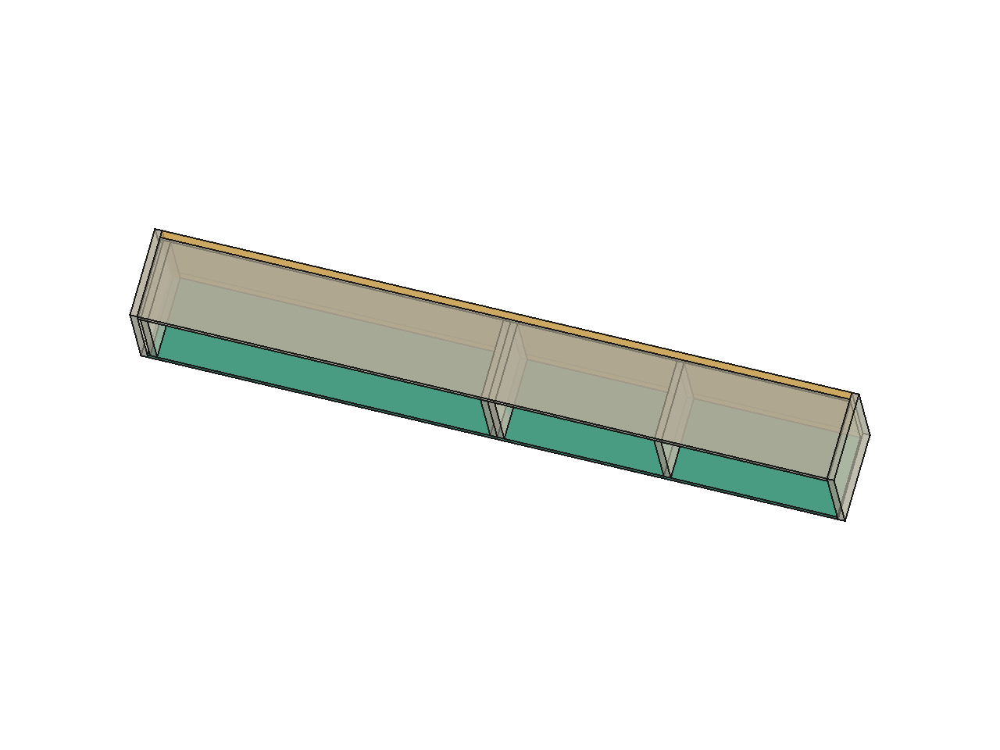
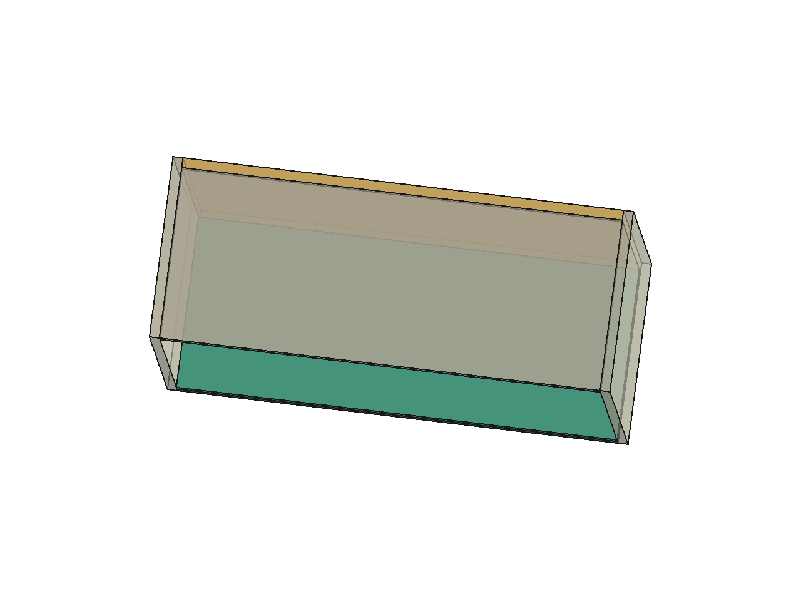

# Ligações e reforços de marcenaria sem tubos

25/10/2026 · continuação do plano até31/10, após a decisão de Elias de **não usar tubos sustentando chapas de madeira**. Qualquer proposta futura assim depende de autorização prévia. [Decisão registrada](../Cargas_e_ligacoes_R50_2026-10-25/Decisao_sem_tubos.md).

**Foram desenvolvidos dois estudos separados:** P04 com fundo inteiro e uniões positivas, e P15 com comparação de espessuras/composição da base. A [R51 completa](../Revisao_sem_tubos_R51_2026-10-25/README.md) retirou apenas a alternativa tubular oculta antiga; os estudos abaixo ainda não foram incorporados à caixa principal.

**Continuação25/10, suspensão global:** [P04/P15:caixa inteira, portas abertas e parede](../P04_P15_suspensao_2026-10-25/README.md).660 casos incluem massa dos reforços e seis folhas com a cinemática de quatro barras existente;72 envelopes de resultantes. Não escolhe bucha ou suspensor nem comprova a capacidade da parede. O projeto local das juntas e o sistema real de suspensão continuam necessários.

## O que os reforços fazem

O apoio direto recebe o peso da chapa por contato. Uma ligação ao fundo distribui parte dessa carga para o restante da caixa. Uma borda de madeira ou uma chapa composta aumenta a rigidez da seção. São funções diferentes: aumentar parafusos não torna automaticamente a chapa mais rígida, e engrossar uma borda só por aparência não garante ação estrutural.

A [pesquisa em outros projetos e fabricantes](Pesquisa_solucoes.md) reúne exemplos WOOD/Woodsmith, ensaios de estantes da Purdue, orientação CPA e um produto IKEA de18 mm com25 kg publicados. Esses exemplos orientam as soluções; suas capacidades não foram copiadas para nossos móveis.

## P04 com fundo inteiro e divisórias ligadas

O fundo18 passa de272 para **308 mm de altura**, preenchendo os encontros com base e tampo. Largura externa, profundidade, altura, divisórias e espaços úteis permanecem iguais. A base continua18 mm.

A proposta usa ligações pela parte inferior da base e superior do tampo, no eixo das quatro chapas de divisórias. São dois pontos por grupo, a y72/140 mm; o peso da base passa pela união inferior, pela divisória e pela união superior/fundo até a sustentação da caixa. A divisória dupla36 continua representada por duas chapas18; não foi tratada como peça monolítica.

Os encontros com o fundo recebem uma malha nominal de fixação, com posições em [Eixos_ligacoes_estudo.csv](Eixos_ligacoes_estudo.csv). Os marcadores não são furação CNC nem ferragens executivas. Piloto, cabeça, acabamento aparente, ferramenta, tolerâncias e fixação nos dois lados ainda precisam de conferência. A base/tampo recebem16 posições verticais de estudo no total; os grupos nas extremidades e no fundo completam o caminho. Reconciliar com o mapa de cotação anterior antes de contar novos conectores.

Para conteúdo de **5 +2,5 +2,5 kg nos três trechos**, peso próprio da base, das quatro divisórias e do fundo, a flecha nominal diferida com reserva é **1,523 mm**, frente à referência atual de **2,898 mm** pelo maior espaçamento individual869,5/300. O primeiro ciclo usou878,5/300=2,928 ao representar o divisor duplo pelo centro do grupo; a continuação mantém as duas chapas separadas e passa a usar o critério mais estrito. A flecha não mudou. O maior esforço por ponto das uniões internas nesse caso é cerca de **25,6 N**. Algumas uniões laterais/traseiras têm reação negativa; precisam de retenção, não de simples apoio por encosto.

O cálculo usa duas posiçõesy por divisória. **Em cada posição**, as juntas inferior e superior têm requisito hipotético inicial1000 N/mm cada: em série,500 inicial e250 na sensibilidade diferida. Assim, cada grupo inferior/superior de dois pontos corresponde a2000 iniciais; o caminho completo da divisória em paralelo é1000 inicial/500 diferido. O texto anterior dizia1000 por grupo de dois e não correspondia aos oito ramos calculados; foi corrigido sem alterar a matriz ou as reações. Nenhum valor é propriedade de produto ou capacidade multiplicada por parafusos. O fundo usa referências equivalentes próprias; acoplamentos com os caminhos das divisórias e deformação da caixa/suspensão precisam de comprovação conjunta, sem somar rigidezes físicas compartilhadas como se fossem independentes.

## P15 com base composta e fundo ligado

O fundo original544 começa acima da base e termina abaixo do tampo. No estudo ele alcança os dois encontros, criando faces onde a ligação traseira pode atuar. O vão de799 mm continua sem divisória intermediária.

Foram comparadas base18, base25 e composição18+18. Na composição36, **o topo interno da base permanece na mesma cota**; a camada adicional fica abaixo, e as laterais/fundo descem18 mm. O armazenamento mantém altura e profundidade. O móvel fica18 mm mais baixo por fora, com faixa inferior mais espessa: essa alteração visual permanece somente no estudo.

As juntas laterais/rear têm rigidez inicial requerida de1.000 N/mm, reduzida a500 na sensibilidade diferida. O fundo participa como uma faixa analítica de100 mm de altura em seu plano, com flexão, cisalhamento, acomodação dos grupos laterais e peso de todo o fundo. Não se corta essa faixa no painel. É uma hipótese equivalente a comprovar, sem crédito de engastamento rotacional.

| Base e hipótese de material |20 kg distribuídos |15 kg distribuídos +5 kg em50×60 mm junto à frente |
|---|---:|---:|
|18 mm, E inicial2.200 MPa |4,936 mm |6,679 mm |
|25 mm, E inicial2.100 MPa |2,614 mm |3,342 mm |
|18+18 integralmente solidários, E inicial2.200 MPa |1,421 mm |1,705 mm |
|18+18 integralmente solidários, E inicial1.600 MPa |— |2,073 mm |
|18+18 sem ação composta entre camadas, E inicial2.200 MPa |— |4,286 mm |

Valores = flecha na sensibilidade diferida mais reserva0,20 mm. Referência escolhida:799/300 = **2,663 mm**. Incluídos peso próprio da base e acomodação devida ao fundo. A massa usada para duas camadas é calculada com18,3 mm por camada e densidade800 kg/m³; espessura resistente mínima17,7 por camada.

**A composição36 tem potencial nas hipóteses calculadas; duas chapas apenas sobrepostas não atendem ao caso misto.** O processo de composição precisa transferir cisalhamento entre camadas: preparação de superfícies, substrato, adesivo, prensagem, cura, umidade e ensaio são parte do projeto. Uma cola anunciada para melamina não comprova, por si, uma placa composta estrutural. Não foi escolhido adesivo ou liberado o tampo composto.

No caso misto com E2.200, as quatro uniões laterais da base recebem aproximadamente **89,7 /22,7 /89,7 /22,7 N**. Os seis pontos traseiros têm valores entre−18,6 e25,5 N; os dois grupos fundo–laterais recebem55,7 N cada, incluindo o peso do fundo. Esses valores são solicitações desse caso estático, sem majoração; não substituem envelopes de posições, resistência ou prova das juntas.

A base25 passa apenas por margem de0,049 mm no caso distribuído de referência e falha no caso misto. Com E1.600 ela também falha no distribuído. Por isso não foi tratada como solução encerrada.

Também foi verificado o limite de confiar somente na rigidez rotacional dos dois encontros laterais. Para18 mm/E2.200, o modelo requer aproximadamente **5.526 N·m/rad por grupo**, momento de14,4 N·m e um binário equivalente de cerca de1.601 N com braço de9 mm. Esses números não foram atribuídos ao Minifix. Com E1.600, nem o engaste perfeito nas duas laterais atende ao critério desse modelo sem apoio traseiro. Isso explica por que a contribuição da junta deve ser demonstrada, em vez de assumir engaste.

## Situação da bancada

A alternativa tubular antiga, inteiramente oculta, foi retirada da R51. Os dois apoios30×30×720 ativos são sólidos esquemáticos sem material especificado; a solução de marcenaria ainda precisa definir apoios em profundidade, estabilidade, ligações e rigidez do tampo para equipamentos e esforços dos braços/volante.

Avanço02:22–02:45: [estudo separado da bancada de marcenaria](../Bancada_marcenaria_2026-10-25/README.md), com cinco painéis, gaveteiro apoiado ao piso e entrada central preservada. Sete contatos e14 verificações; tampo/retencão e estabilidade ainda condicionados, com alteração visual para revisão antes de incorporar.

Não se retiraram esses apoios ativos deixando o tampo sem sustentação. O estudo de substituição começa por localizar apoios de madeira fora do gaveteiro e do envelope de cadeira e por verificar o tampo inteiro. Profundidade700, acabamento Arenza, gavetas e entrada da cadeira permanecem como restrições. A geometria tubular com bolsões no tampo não será reaproveitada como se o tampo sem tubos devesse manter esses recortes.

## Arquivos e conferências

- [Estudos FreeCAD P15/P04](P15_P04_estudos_sem_tubos.FCStd): peças necessárias à leitura dos apoios e74 marcadores nominais, ocultos na vista normal. Portas, ferragens e demais detalhes continuam na R51 completa.
- [Resultados reproduzíveis](Resultados.json) e [15 verificações numéricas](Verificacao_numerica.json): equilíbrio, compatibilidade, convergência e controle da integração de cargas.
- [14 contatos de face conferidos](Conferencia_geometrica.json) no FreeCAD: encontro base/fundo/tampo e divisórias. Não é ensaio de resistência.
- [Pesquisa com fontes](Pesquisa_solucoes.md) e [posição dos eixos nominais](Eixos_ligacoes_estudo.csv).
- [Roteiro de ensaios e requisitos](Roteiro_ensaios_e_requisitos.md) · [registro a preencher, ensaios não executados](Registro_ensaios.csv).
- [Auditoria P04: eixos, referência e ponto/grupo](P04_auditoria_referencias.json), baseada em [extração nativa R51](P04_eixos_conferidos_R51.json). A referência anterior por centro do grupo permanece identificada no primeiro ciclo; o critério vigente desta continuação é869,5/300.

Reproduzir: `python calcular.py` com Python/NumPy. O script verifica o SHA256 da R51, não a modifica e reutiliza o método Ritz local conferido. O ensaio de convergência passou para P04, P15/25 e composição36 no caso misto adverso. As rigidezes das juntas são requisitos condicionais; esta análise não certifica o comportamento tridimensional de toda a caixa. As coordenadas dos marcadores são locais do estudo, com P04 deslocado+1.200 mm emX apenas para exposição; não são coordenadas globais da R51.

## Continuação

**P15, composição parcial25/10:** [novo modelo contínuo de deslizamento](../P15_composicao_parcial_2026-10-25/README.md),16 respostas, limites independentes e cinco conferências principais. Quantifica a dependência da interface sem atribuir rigidez a cola comercial. TitebondMelamine fica excluída dessa sustentação pela limitação expressa do fabricante; a composição continua sem adesivo/processo escolhido e sem liberação de uso.

Avanço do bloco noturno02:06: [P01 agora tem estudo do apoio ao piso](../P01_apoios_ao_piso_2026-10-25/README.md), com soco de marcenaria e submodelo prateleira–caixa–soco. É separado e condicionado; revisar aparência e montagem antes de incorporar.

1. Especificar e ensaiar a composição da base P15; estudar redução de espessura com dados reais da chapa e juntas, sem tubos. Resolver acesso dos Minifix na camada superior e conferir aparência da faixa externa antes de incorporar.
2. Completar os grupos P04: cabeça/piloto, acesso, efeito de furos na dupla36 e resistência à tração das uniões; demonstrar a sustentação da caixa.
3. Prosseguir na bancada com solução de marcenaria e concluir a caixa P01, mecanismos P20/P14 e demais lotes do plano.

As duas propostas continuam condicionadas e separadas do arquivo completo. Nenhuma capacidade real, usinagem, compra, contratação ou publicação foi liberada.
