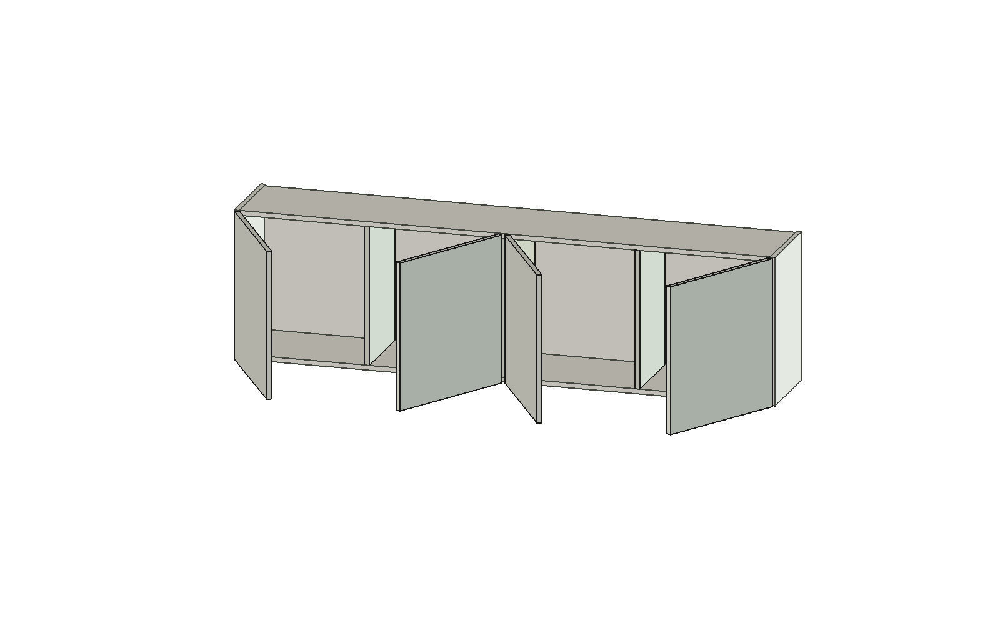
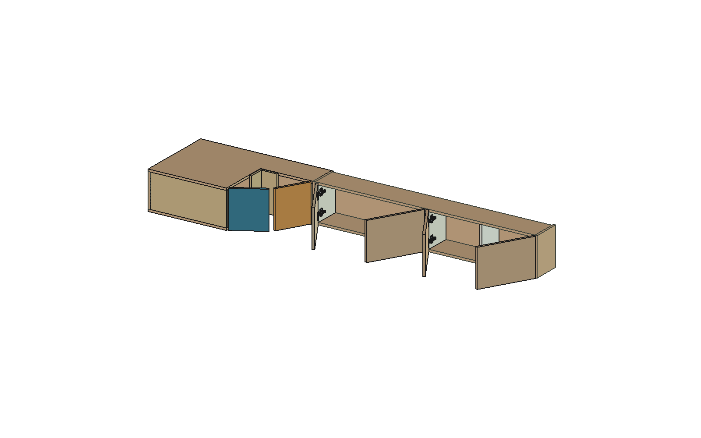
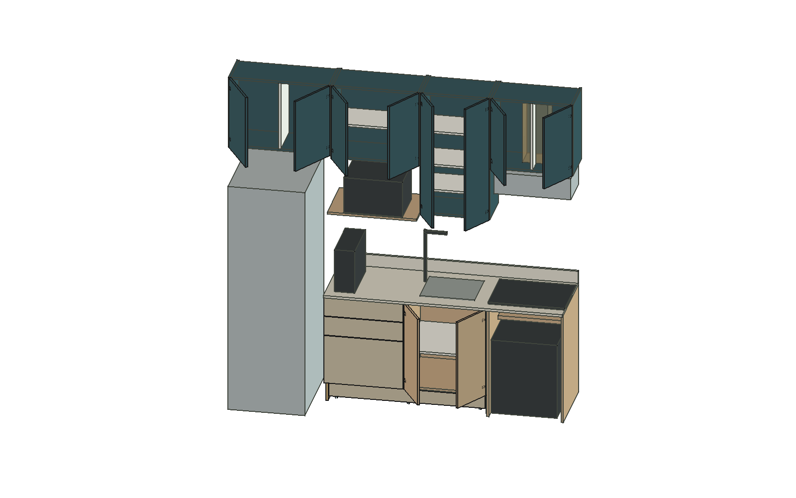
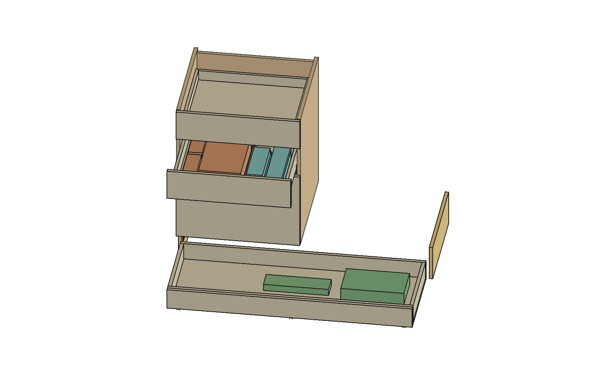
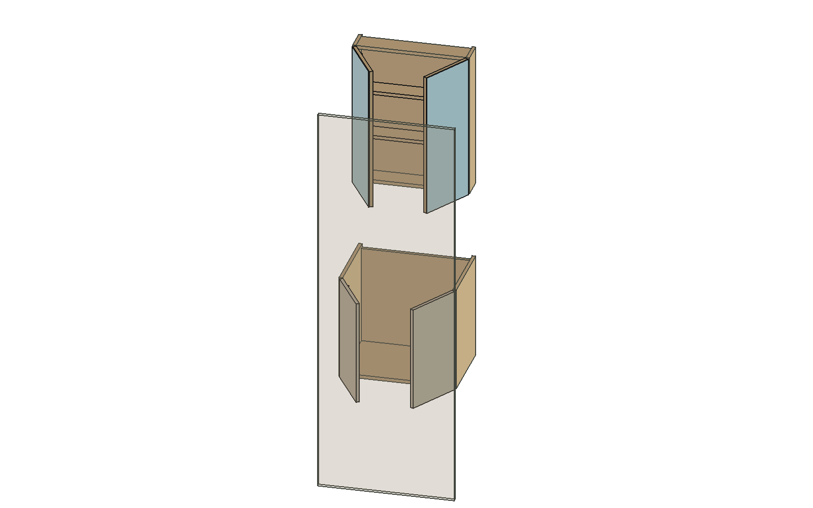
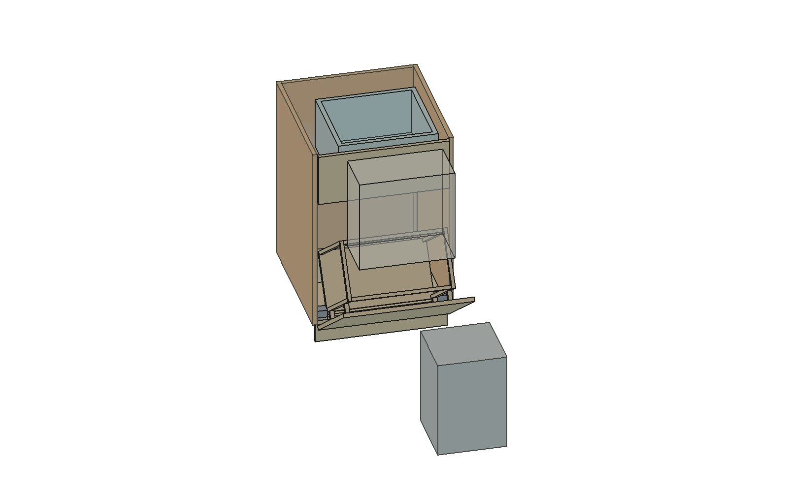
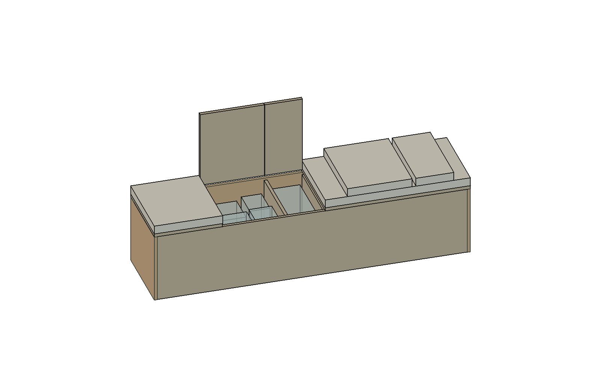
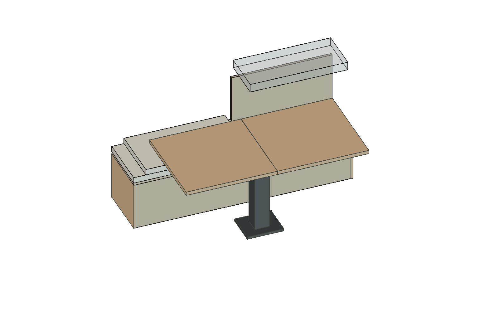

# Vistas dos acessos — R22

[Apartamento atual](../Visibilidade/Visibilidade_R22_README.md) · [Guia dos controles](../Controles/Guia_controles_R21.md)

Imagens nativas do FreeCAD na orientação espelhada. Mostram poses ilustrativas já previstas nas revisões; não acrescentam aprovação de movimentos, ferragens ou execução. Seleção de contexto e transparência são de apresentação. Os controles do apartamento atual permanecem no estado salvo, sem essas poses.

## Escritório — quatro portas alternadas

Quatro folhas em60 graus; apoios compartilhados propostos. Vista de uso, não auditoria nova de ferragens ou montagem executiva.

## Cabeceira e canto simples

Cabeceira e vizinha em60 graus; cantoA/B em60. Alternância na orientação espelhada, sem mecanismo79T8500. Limite mecânico real pendente.

## Cozinha — portas comuns e nichos

Pares de portas em60 graus; equipamentos mantidos. A imagem não resolve as divergências de instalação/ventilação registradas naR17.

## Gavetas e armazenamento baixo

G2 em300 mm e baixa em530 mm. Bandejas455/programa preservados. Baixa sobre rodas-gabarito; translações ideais não comprovam telescópio, piso, carga ou retirada real.

## Banheiro — acesso com entrada fechada

Quatro portas em60 graus, entrada ideal0 fechada e translucida somente nesta vista para revelar gabinetes. Folha/eixo/macaneta nao medidos; vidro, adesivo, ferragens e hidraulica reais pendentes.

## Cesto — abertura e saco removível

Giro55 graus, saco445 mm/endireitado55. Loop20L permanece no seu lugar habitual. Não mostra manutenção da armação como livre; ela bate na lixeira em300/400.

## Banco — bebidas e balde

Tampas2/3 em90 graus, almofadas estacionadas sobre setor da folha fechado. Devolver antes de acessar folha. Eixos/apoios/retencões reais pendentes.

## Banco — proposta para retirada da folha

Tres setores fechados e cobertos pela almofada do ultimo; tampa4 em90, folha inteira recuada24 mm e elevada970. Mesa e pedestal preservados. Rotina nova proposta, sem validacao de pessoa, pega ou instalacao na mesa.

As peças azuis/cinzentas e volumes transparentes incluem referências CAD e gabaritos; as cores não especificam acabamentos ou materiais executivos. No banheiro, a entrada fechada foi deixada translúcida somente na vista. No cesto, a Loop20L permanece em seu lugar. A folha da mesa não foi reduzida; é o volume inteiro800×350×70.

Pendências de fixação, carga, tolerância, batentes e instalação permanecem no [registro consolidado](../Apartamento_espelhado/Pendencias_apartamento_R20.md).
