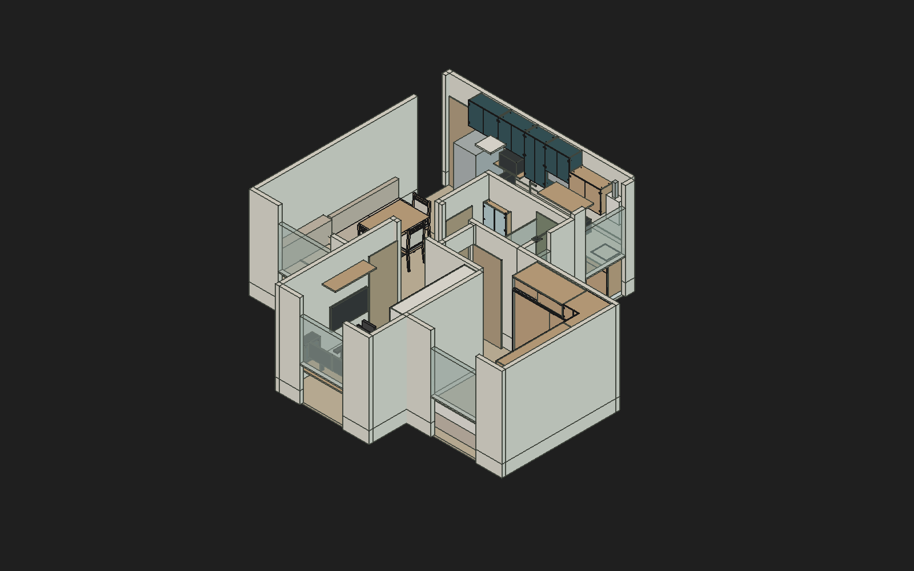

# Guedala Park — R52 corrigida

25/10/2026. **[Abrir o modelo completo R52](Guedala_Park_R52_Corrigido.FCStd)** · [site interativo local](../ferramentas/site/Guedala_Park_Interativo.html) · [verificação do arquivo e preservação](Verificacao_R52.json).

A R52 corrige posições, referências visuais, controles e metadados da revisão integral. A R51 original permanece intacta. As seis cópias externas das gavetas foram **removidas definitivamente**, conforme pedido posterior de Elias; as gavetas reais dos móveis permanecem presentes e funcionais.

## Alterações no FreeCAD

| Item | Correção |
|---|---|
| TV do escritório | `Peca131.LocalY` passa de 1280 para 1180 mm. Envelope global Y1180–2150, com **50 mm de folga nominal** até a folha da porta aberta, que começa em Y2200. Dimensões da TV e porta preservadas. |
| Lavanderia | Tanque antigo `Peca358` e as duas frentes alternativas500 voltam a ficar ocultos. Frente521, tanque atual, armazenamento e movimentos preservados. |
| Mesa | Berlin110/170×80 continua vigente. Mesa sob medida150/180 e cadeiras anteriores voltam a ficar ocultas como histórico. Fechada: uma cadeira em cada ponta e uma lateral; aberta: três laterais. O cenário aberto antigo que colide com o sofá permanece oculto. |
| Controles do banheiro | Os dois comandos antigos de giro saem de “CONTROLES ATUAIS” para um grupo histórico. O acesso corrente aponta para `BC43_Controle`, com `CursoEsquerda` e `CursoDireita` em mm. |
| Gaveta superior P16 | `Gaveta009.AlturaParedeSobreFundo` corrigida de53 para47 mm, acompanhando a geometria R49. O vão útil54 é outra grandeza e foi preservado. |
| Ferragens declaradas | Quatro gavetas P01 passam a declarar FGVTN500 selecionada e STEP Blum como referência; as duas P16 declaram MOVENTO400. Nenhuma ferragem foi substituída geometricamente ou liberada por equivalência presumida. |
| Banco P20 | Lista de ferragens conciliada com piano e articuladores com trava. Batentes/chapas derivados do eixo histórico Southco saem da lista ativa; a necessidade de limitar a abertura permanece condicionada a produto, apoio, geometria e fixação reais. |
| Cópias externas | Apagadas seis instâncias `App::Link`: `AcessoControleR21` e `AcessoControleR001` a `005`. Eram atalhos que também renderizavam cópias fora do apartamento. Os objetos reais `Gaveta` a `Gaveta005` foram preservados. Dois índices sem geometria mantêm referências às peças reais nos controles. |

Total final: **5.832 objetos**, **7.702 expressões**, **1.487 formas nativas não vazias**. Foram mantidos todos os objetos físicos originais; as seis exclusões são somente instâncias dos atalhos. Cinco objetos de organização/acesso foram acrescentados. Entre as peças físicas mantidas, **somente a TV mudou de posição**. Cores e demais propriedades visuais comparadas foram preservadas.

SHA256 final: `941da02d367c5f6ce2992f72985f86c3aceba23f899a4c394cf3569f19d7b4da` ·19.801.403 bytes. [Alterações registradas](Alteracoes_R52.json).

## Validação após salvar e reabrir

- Arquivo final reaberto no FreeCAD; **todas as1.487 formas nativas válidas**, sem erro de objeto registrado. O diagnóstico de cópias transformadas não foi confundido com defeito das formas originais.
- **106 cenários de movimento**, incluindo cursos nominais400/500 das dez gavetas, portas45/86°, correr do banheiro até268/233, canto, cesto, retirada do saco, banco, varal270/860 e manutenção do forno até600. Todos retornam às posições iniciais verificadas, sem salvar os ensaios.
- Roupeiro: gavetas até500 com a folha correspondente deslocada600, sem novos comuns. Abrir a gaveta com a folha fechada continua uma operação incompatível, detectada pelos testes; o modelo não possui intertravamento automático.
- Banco: tampas ensaiadas até90°, inclusive juntas, com as almofadas retiradas. Abrir com as almofadas presentes continua produzindo o contato esperado; retirar a almofada é parte da sequência de uso.
- TV/porta: comum BREP zero na posição salva. Mais **74 poses de giro** da folha modelada, considerando os dois cantos do extremo como hipóteses de eixo, sem comum positivo. Menor distância calculada50 mm. Eixo/batente e suporte reais ainda requerem conferência física.
- Varredura da posição salva:735 comuns positivos entre1.133 formas ativas com sólidos. São contatos internos, fixadores, reservas, marcadores e representações; **não são735 defeitos**. Nove pares da auditoria R51 foram eliminados, sem par novo na comparação de posições nativas. Colisões de operação deliberadamente incompatível foram separadas das sequências corretas.

[Posições e metadados](Verificacao_posicoes_R52.json) · [resumo dos movimentos](Verificacao_movimentos_R52.json) · [casos completos](Movimentos_R52.json) · [auditoria estática](Auditoria_estatica_R52.json).

O teste de movimentos exclui pares já sobrepostos na posição inicial, contatos internos entre ferragens da própria dobradiça e pares com movimento rígido relativo idêntico, cujo comum não muda. É amostragem de posições nominais, sem varredura contínua de todas as combinações. Não certifica produtos, montagem, carga ou conforto de uso.

## Fichas, site e documentos da publicação R52/R18

- Ficha P20 e levantamento regenerados, retirando a cadeia histórica Southco da especificação operacional. Verificador ampliado para conferir também montagem, referências e campos de levantamento.
- Site local com Berlin110/170 e três cadeiras em ambos os cenários; aberta em uso com afastamento ilustrativo já existente. “Em uso” fica indisponível na mesa fechada, sem inventar deslocamento que atravesse o sofá.
- Escorredor deixa a bancada antes da transferência da air fryer, seguindo a guarda limpa/seca já registrada. Cafeteira fica explicitamente com espaço/dimensões a definir; nenhum bloco ou encaixe foi inventado.
- Controle da bandeja lateral cancelada removido. Tampas do banco continuam corretamente representadas, sem prometer animação ainda inexistente no site.
- O painel legado de cenários permanece oculto pela interface anterior; as transições foram verificadas porAPI/eventosDOM. A ajuda visível não promete botões ocultos. HTML conferido em computador/celular, sem errosJavaScript ou transbordamento horizontal.
- Entradas/atalho e índice apontamR52. Os130 links históricos ausentes foram reconciliados: modelos encontrados apontam à recuperação efetiva; backups não localizados são identificados sem prometer arquivos inexistentes.
- Caderno de especificações usa a revisão CAD como fonte do cabeçalho e preserva a nota completa de cafeteira sem medidas.

**Correção de interpretação da revisão anterior:** o arranjo2+1 é o vigente para a Berlin fechada, conforme decisão de22/10. Três cadeiras na lateral correspondem à Berlin aberta. O texto antigo150/180 não deve prevalecer sobre essa decisão. A R52 e os documentos preservam essa distinção.

A publicação R52/R18 foi autorizada, com fichas R14 e pacote R18. Os geradores já usam a configuração corrente R52; o pacote R17 anterior permanece selado. [Estado do envio e conferência remota](../Estado_atual.md). Propostas estruturais e alternativa300mm do micro continuam separadas; esta publicação não as incorpora aoCAD.

## Pendências técnicas mantidas

As correções não inventaram os dados necessários para fechar: formato/fornecimento do fundoP01, divergência100/300mm do micro-ondas/F104, interface guia–fundoP16, ferragens reais, ligações, suspensão, massa e estabilidade dos apoios e capacidade do banco. Os estudos de marcenaria continuam separados; **não foram reintroduzidos tubos sustentando chapas**. Não cortar madeira para simplesmente zerar uma pequena interseção deSTEP nem declarar capacidade a partir de um gabarito.

## Originais e rastreabilidade

R51 original: SHA256`ab5323bb12f8eca40b25bdfe4eadc8a3221c82b0646f354cd1f2832acfb27c16`, preservado. Fontes e documentos alterados possuem cópias byte a byte anteriores à edição, com hashes, em `outputs/correcao-r52-2026-10-25/originais`, na raiz do workspace. [Manifesto consolidado](Preservacao_originais.json).

Este README resume as correções documentais, de fabricação e do site. As evidências publicáveis estão nos [dados do arquivo](Verificacao_R52.json), [posições](Verificacao_posicoes_R52.json), [movimentos](Verificacao_movimentos_R52.json) e [condições de operação](Condicoes_operacao_R52.json). Relatórios de trabalho e backups externos não são destinos de navegação desta publicação. As gravações intermediárias/diagnósticos da criação são preservados nesta pasta; prevalece o hash final acima. Os criadores têm guardas para não sobrescrever uma candidata já alterada e não devem ser executados como rotina de consulta.

Para salvar edições futuras, usar o helper de gravação otimizada, escolhendo um novo destino/revisão. Não sobrescreverR51 ou estudos históricos.
