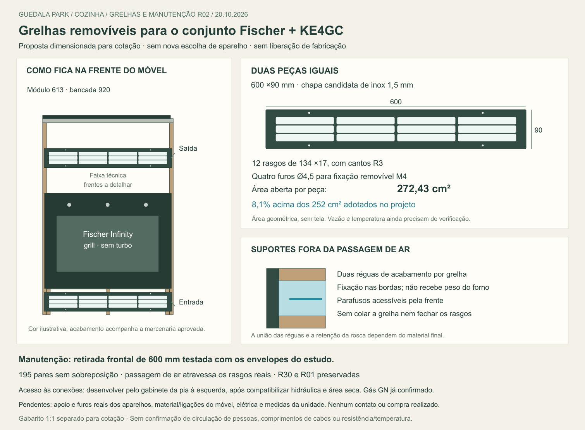

# Grelhas removíveis e manutenção — R02

20/10/2026. Elias autorizou continuar: “podemos seguir mais”. Detalhamento localizado sobre a R01, sem medidas de campo, compra ou envio a fornecedores. Fischer com grill e KE4GC preservados. Esta revisão desenvolve as grelhas e seus suportes; não substitui o dimensionamento estrutural do apoio do forno.

[Modelo CAD separado](Grelhas_Manutencao_R02.FCStd) · [Conferência geométrica e áreas](Conferencia.json) · [Gabarito vetorial 1:1 para cotação](Gabarito_cotacao_grelha_1a1.svg) · [Prancha vetorial](Grelhas_manutencao.svg) · [Apoio e percurso de ar R01](../Apoios_ventilacao/README.md).

## Solução desenvolvida

**Duas grelhas iguais, sob medida, removíveis por quatro parafusos cada.** Dimensão externa candidata600 ×90 mm, cobrindo a abertura de560 ×60 sem reduzir a largura do módulo613. Uma fica abaixo do forno, outra acima. Acabamento e cor devem acompanhar a marcenaria já escolhida; a representação escura da prancha não aprova uma nova cor.

| Item | Especificação candidata para cotação |
|---|---|
| Quantidade | 2 peças iguais |
| Material | Chapa inox304, espessura1,5 mm, como referência de fabricação; fornecedor confirmar planicidade, resistência dos filetes e acabamento compatível com uso junto ao forno |
| Dimensões externas | 600 ×90; cantos externosR2, bordas rebarbadas e sem arestas cortantes |
| Ventilação | 12 rasgos retangulares com cantosR3, cada um134 ×17; quatro colunas e três linhas |
| Coordenadas dos rasgos | Origem no canto inferior esquerdo da grelha. X inicial23,163,303,443; Z inicial17,36,5,56 |
| Filetes entre rasgos | 6 na horizontal e2,5 na vertical; fornecedor verificar rigidez/manuseio sem deformar |
| Fixação | Quatro furosØ4,5, centrosX100/500 e Z7,5/82,5; propostaM4 com porca retida ou sistema equivalente desmontável, sem depender de parafuso repetidamente retirado da madeira |
| Suporte ao móvel | Duas réguas candidatas577 ×18 ×18 por grelha, ligadas às laterais, fora da abertura de ar; ligação e retenção da rosca a detalhar |
| Guarnição/tela | Nenhuma tela fina ou guarnição invadindo os rasgos considerada no cálculo. Se acrescentada, recalcular área efetiva e perdas |

O gabarito1:1 contém apenas contornos de corte e furos, emmilímetros. **É base de cotação e revisão, sem liberação de corte.** A dimensão externa da peça comercial não substitui a área aberta. Uma alternativa pronta poderá ser aceita se couber na mesma interface e comprovar a área efetiva necessária; não foi escolhido produto comercial nem apurado preço.

## Área aberta calculada e conferida no CAD

Cada rasgo com cantosR3 tem área `134 ×17 − (4−π) ×3²`. Doze rasgos resultam em **272,43 cm² por grelha**, conferidos também pelo volume geométrico dos recortes dividido pela espessura. Os furos dos parafusos não entram como ventilação.

O mínimo adotado no projeto continua252 cm², correspondente à faixa traseira45 ×560 da R01. A grelha proposta fica **8,1% acima desse critério geométrico**. Num cenário ilustrativo em que cada rasgo perde0,2 mm em largura e altura, ainda resultam268,81 cm². Esse cenário não é tolerância de fabricação aprovada; não cobre tinta, tela, espuma, sujeira, perdas de pressão ou temperatura. Exigir da peça efetivamente entregue pelo menos252 cm² livres.

Área equivalente não comprova desempenho térmico. Permanecem o percurso traseiro, as entradas e as saídas indicadas pelos fabricantes. A grelha do móvel não pode cobrir a saída própria do Fischer junto à porta/painel.

## Implantação e fixação dos acabamentos

| Elemento | Posição candidata no estudo espelhado, emmm |
|---|---|
| Grelhas, largura | X2926,5–3526,5: margem6,5 por lado dentro do módulo externo613 |
| Grelha inferior | Z15–105; faceY6406,5, fundoY6408. Rasgos entreZ32 e88, dentro da aberturaZ30–90 |
| Réguas inferiores | Z12–30 e90–108; Y6408–6426, fora dos canais de ar |
| Grelha superior | Z690–780; faceY6402,5, fundoY6404. Rasgos entreZ707 e763, dentro da aberturaZ705–765 |
| Réguas superiores | Z687–705 e765–783; Y6404–6422 |
| Saída superior | Frente recuada24,5 em relação ao envelope frontal do fornoY6378; passagem da R01 agora termina na face perfurada real |
| Folga até o teste conservador do cooktop | Réguas superiores terminam6 abaixo do envelopeZ789; grelha termina9 abaixo. Não inclui conexões reais |

As réguas do acabamento se ligam às laterais do próprio módulo; não à máquina de lavar, à pedra ou ao chassi dos aparelhos. Os furosM4 ficam nas bordas fora dos60 de abertura, sem acrescentar barra atravessando o ar. Não foram escolhidos insertos, porcas cativas nem parafusos comerciais: dependem do material das réguas e da espessura final. Não declarar essas ligações dimensionadas apenas porque os envelopes cabem.

Os contramarcos do forno e os dois parafusos do kit Fischer continuam conforme a R01, a conferir nos furos reais. **Fixação das grelhas, fixação do forno e apoio do peso são três funções separadas.** A grelha não escora o forno; o kit do aparelho não suspende sua massa; os apoios não devem fechar os canais inferiores.

## Retirada e acesso às conexões

Foi testado um deslocamento frontal hipotético de600 mm, com volumes separados da frente e do chassi conservadores. Não surgiu interseção com base, apoios, contramarcos, grelhas, réguas ou as peças nativas verificadas na região. Esse teste mostra que o acabamento proposto não cria uma trava geométrica à retirada. Não confirma acesso de pessoas, apoio auxiliar, puxador/dobradiças, comprimento de cabos, curvatura de flexível, percurso de entrega ou medidas da unidade.

O planejamento de manutenção deve permitir alcançar os registros/tomadas, desligar os aparelhos e soltar as fixações conforme os fabricantes **antes** de deslocar o forno, usando apoio adequado durante sua retirada. Não é necessário retirar a bancada para soltar as grelhas ou acessar o kit frontal. Essa é intenção de montagem a conferir, sem instrução para trabalhar em equipamento energizado ou gás conectado.

A inspeção da R30 identificou **o gabinete da pia imediatamente à esquerda**, entreX2270 e2920, com duas portas e uma prateleira de estudo a recortar para hidráulica. A direção de desenvolvimento do acesso é por esse gabinete, externamente ao nicho do forno, sujeito à compatibilização com cuba, sifão, prateleira e área seca. Isso é proposta técnica, não aprovação de nova perda de armazenamento. Nenhum furo, janela técnica ou posição de tomada/registro foi fixado nesta rodada. Não presumir que a folga67 junto à LG seja um acesso de manutenção.

**GN já confirmado por Elias**, conforme o quadro de infraestrutura do projeto. Encerrar a pergunta sobre o tipo de gás; ainda conferir o ponto, registro e capacidade da instalação. A configuração de fábrica do KE4GC e eventual adaptação paraGN devem ser tratadas conforme a etiqueta e a rede autorizada, sem interpretar “bigás” da loja como conversão automática. O forno escolhido é elétrico e não exige um segundo ramal de gás para forno.

## Verificação e fontes

- **195 pares de sólidos** conferidos, sem sobreposição positiva no escopo. Réguas, chapas e seus rasgos foram modelados.
- O ar atravessa os rasgos reais, entra nos canais inferiores e alcança a saída superior: resultado geométrico em **um único sólido conectado**, sem interseção com as peças testadas ou com o envelope131 do cooktop. Não é simulação de fluxo/calor.
- Triagem de38 peças nativas `Peca*`, regiãoX2850–3650 / Y5700–7020 / Z0–920, excluindo forno e travessa históricos. Sem conflitos com novas grelhas/réguas, ar ou retirada. Não audita outros nomes, detalhes ausentes ou todos os movimentos.
- R30 geral e CAD da R01 preservados por comparação de hashes antes/depois. O arquivo desta revisão é separado; o modelo geral ainda precisa da consolidação que substituirá a referência antiga do forno.
- [Script da conferência](conferir.py) e [gerador dos desenhos](desenhos.py). A área analítica foi comparada ao resultado do núcleo geométrico, além das verificações de interferência.
- [Dados GN e infraestrutura já registrados](../../Medidas_e_folgas.md#dados-de-infraestrutura-para-o-aquecedor). Nenhuma preferência de gás foi reaberta.
- Consulta pública limitada em20/10: [KE4GC oficial](https://loja.electrolux.com.br/cooktop-4-bocas-electrolux-gas-experience-mesa-vidro-tripla-chama-e-grade-de-ferro-fundido-ke4gc/p), [manual Electrolux na biblioteca oficial](https://api.electrolux-medialibrary.com/asset/1fc5d741-d94e-4db1-b564-bde514cdb7f8/E4RM3Q/250405XATF/PDF/250405XATF.pdf) e [Fischer escolhido](https://www.fischer.com.br/forno-eletrico-fischer-infinity-de-embutir-50l-com-grill/p). Não foi encontrado corte inferior adicional do KE4GC nem novo esclarecimento dos datums Fischer. Não transpor manualKE4GP ou dimensões externas repetidas no campo “nicho” comercial. Rede Firecrawl não disponível; consulta feita por ferramenta web, sem contato com fornecedores.

## Pendências que realmente restam

| Responsável / dado | O que libera |
|---|---|
| Fornecedor do corte e marceneiro | Confirmar chapa, filetes, acabamento, área efetiva, retençãoM4 e união das réguas; apresentar custo das duas grelhas e ferragens |
| Marceneiro / responsável pelo móvel | Material, uniões, nivelamento e estabilidade do apoio para a meta de carga total50 kg da R01; não houve cálculo de capacidade nesta R02 |
| Fabricante ou aparelho físico | Projeção inferior e conexão do KE4GC; relação apoio–frente–corpo, recorte440 e furos do kit Fischer |
| Projeto da unidade / instalador | Circuito do forno127 V, proteção/aterramento e ponto acessível; gásGN e rota externa ao nicho, fora da traseira quente e do percurso reservado de ar |
| Conferência da unidade e hidráulica | Cotas reais, acesso pela pia sem conflito, circulação de manutenção, pedra/emenda junto à LG e obstáculos superiores |

As duas primeiras linhas e a documentação dos aparelhos podem avançar antes da visita. Não há nova escolha de eletrodoméstico ou medida do apartamento solicitada a Elias nesta etapa. O material está preparado para revisão/cotação, sem envio e sem autorização implícita de fabricar.
