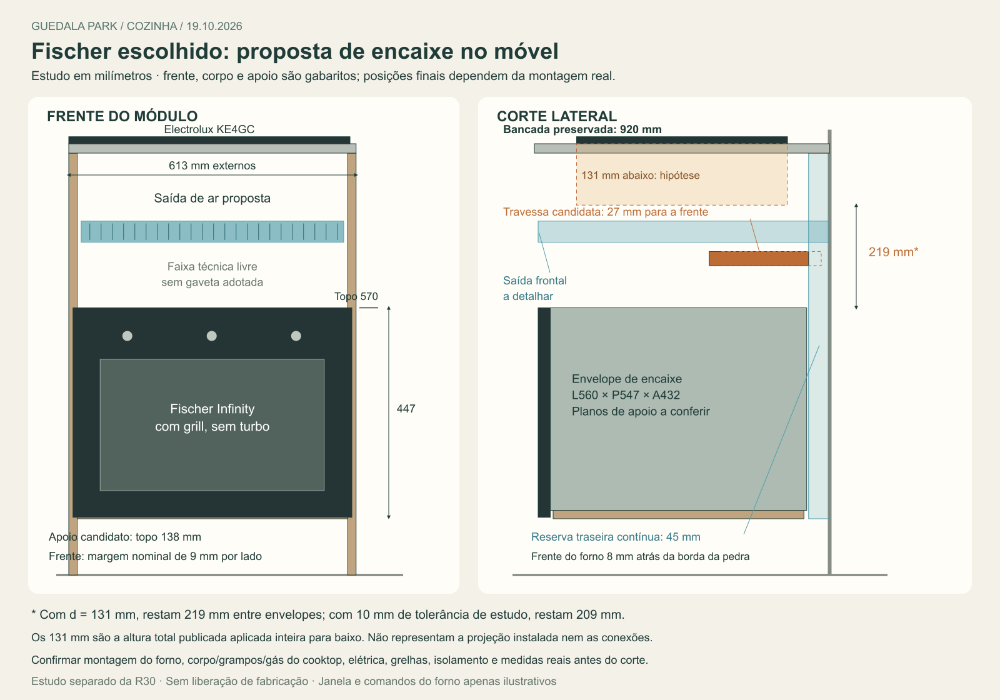

# Fischer com grill escolhido — encaixe com o KE4GC

**20/10/2026 — grelhas e manutenção R02.** [Detalhamento atual](Grelhas_manutencao/README.md): duas grelhas candidatas600 ×90 removíveis, com12 rasgos e272,43 cm² de área aberta cada, réguas fora da passagem de ar e gabarito1:1 para cotação. Foram conferidos195 pares sem sobreposição e retirada frontal hipotética600 mm, sem validar calor/carga/cabos/pessoas. A saída superior agora termina na face perfuradaY6402,5; a hipótese antiga sem grelha real é superada nesse detalhe. Desenvolver acesso às conexões pelo gabinete da pia à esquerda, condicionado à hidráulica, área seca e armazenamento. **GN já confirmado por Elias**; não repetir pergunta sobre tipo de gás. R30/R01 preservadas; sem fabricação, compra ou contato externo.

**19/10/2026 — apoios e ventilação desenvolvidos em R01.** [Solução atual](Apoios_ventilacao/README.md): base plana sobre três nervuras até o piso, vãos livres261,5 mm, entrada inferior e saída superior560 ×60, canal traseiro45 ×560, travessa fora do caminho do ar. KE4GC preservado com recorte520 ×390. Foram conferidos90 pares sem sobreposição e um percurso de ar conectado no estudo; isso não comprova resistência ou resfriamento. Material/ligações/capacidade do apoio, datums dos aparelhos, grelha efetiva, instalações e medidas de campo continuam para o executivo. Fonte R30 preservada; escolha dos aparelhos encerrada.

19/10/2026 · Proposta localizada sobre a R30 · Sem liberação de fabricação.

**Decisão de Elias:** “ok, vamos seguir com o Fischer com grill sem turbo, confere como fica no móvel com o cooktop e o q falta pra fechar”. Adotar **Fischer Infinity 50 L com grill, sem turbo, preto 127 V, 28349-64929**, em substituição à referência Venax para o desenvolvimento do projeto. Cooktop Electrolux KE4GC preservado. Não houve compra, contratação, envio a fornecedores ou escolha de outra tensão. A posição do forno e as peças abaixo são propostas técnicas desta rodada; não foram aprovadas pelo usuário como cotas executivas.

[Prancha vetorial](Fischer_no_movel.svg) · [Estudo FreeCAD separado](Estudo_Fischer_Grill_R30.FCStd) · [Conferência geométrica](Conferencia_Fischer.json) · [Inspeção da fonte](Inspecao_R30.json) · [Procedência dos documentos](Fontes/Fontes.json).

## Resultado

O forno é compatível **em largura nominal** com o módulo externo de 613 mm. O vão existente de 577 permite estudar uma abertura de 560 com faixas nominais de 8,5 por lado. A frente máxima de desenho de 595 fica com 9 mm por lado até o limite externo do módulo. Essas faixas são reservas geométricas, sem material, furação ou recobrimento executivo determinados.

Uma posição candidata com **topo externo conservador em Z570 mm**, sob a bancada mantida em Z920, oferece margem vertical maior que a montagem antiga. Há uma proposta geométrica contínua de reserva de ar e de correção da travessa, sem ampliar o módulo ou reduzir o armazenamento vizinho. O conjunto ainda depende das ligações, das medidas reais e da confirmação dos planos de apoio do produto.

## Documento oficial encontrado nesta rodada

Foi localizada a [página de consumo Fischer do modelo 28349](https://www.fischer.com.br/forno-eletrico-fischer-infinity-de-embutir-50l-com-grill/p), com links públicos de manual e nicho. O [manual oficial consultado](Fontes/Fischer_Grill_manual_oficial.pdf) é **32305 rev.00**; capa e páginas 5, 7 e 8 conferidas visualmente. A p.5 identifica expressamente o SKU preto127 V **28349-64929**. Isso encerra a pendência anterior de não ter lido a edição32305 disponibilizada pelo fabricante, sem afirmar validade para qualquer alteração futura do produto fornecido.

- P.5: exterior A445 × L594 × P573, cavidade A260 × L440 × P440, massa23,25 kg, potência2061 W e corrente16,22 A em127 V.
- P.7: tomada recomendada20 A em127 V, aterramento, fiação compatível, acesso à conexão e ausência de ligação conjunta com outros aparelhos na mesma tomada. O circuito da unidade não foi validado.
- P.8: recorte560 ×440, apoio535 com abertura posterior45 ×560, altura do corpo desenhada432, frente595 ×447. Exige200 mm do fundo do cooktop até o corpo externo do forno; mostra também220 mm desde o fundo do tampo.
- [Desenho oficial de nicho Rev.03](Fontes/Fischer_nicho_oficial.jpg): confirma560/440, apoio535 e faixa45, mas apresenta547 em uma profundidade do corpo versus544 no manual. O modelo usa547 como envelope conservador; não declara resolvida essa diferença. A figura de fixação contém detalhes ilustrativos que não foram usados para atribuir turbo ao produto escolhido.

A diferença entre dimensões de tabela, frente/corpo desenhados e recorte permanece relevante ao corte das chapas. Não converter a caixa simplificada deste estudo em posição final dos pés, parafusos ou flange.

## Proposta de encaixe

Coordenadas em milímetros, no apartamento espelhado. Y cresce da frente para a parede; parede de referênciaY7000. Cotas reais da unidade ainda não levantadas.

| Elemento | Proposta ou estado conferido | Limite |
|---|---|---|
| Largura externa do módulo | 613 preservados | Sem deslocar laterais ou outros módulos |
| Abertura nominal em largura | 560 dentro do vão577 | 8,5 por lado a detalhar, incluindo fixação e tolerâncias |
| Frente do forno | Gabarito595 ×447, Z123–570 | Dimensões conservadoras de desenho; posição relativa ao apoio é hipótese |
| Envelope de encaixe | L560 ×P547 ×A432; Z138–570 | L560 é recorte, não largura física medida do chassi; planos relativos por confirmar |
| Apoio candidato | Chapa de estudo18, topoZ138; largura577 e profundidade535 | Material, pés reais do forno, ligações e deformação sob massa23,25kg precisam ser dimensionados |
| Plano frontal de referência | 6 mm à frente das laterais; frente do envelopeY6378 | Continua8 mm atrás da borda da pedraY6370; projeção de puxador e plano real por conferir |
| Fundo do envelope | Y6951 | 49 até a parede, sendo4 antes da faixa de ar reservada |
| Travessa | Mesmo envelope577 ×212 ×30 e Z660–690; Y6743–6955 | Avança27 mm em relação à atualY6770–6982; fixações e funções estruturais ainda por conferir |
| Eixos | FornoX3226,5, cooktopX3220 | Diferença6,5 preservada; não mover recorte só por simetria |

O apoio de 18 mm é hipótese geométrica, não espessura homologada. A carga deve chegar às laterais do módulo por ligações dimensionadas. As faixas8,5 não foram consideradas apoios suficientes para o forno.

## Separação até o cooktop

Se `d` for a distância da superfície da bancada ao ponto inferior relevante do cooktop instalado, a separação conservadora na proposta é:

**920 − d − 570 = 350 − d mm.**

Para manter200, `d ≤150 mm`. Com cenário de10 mm acumulados de bancada mais baixa/forno mais alto, `d ≤140 mm`. Essa tolerância é análise de estudo, não exigência adicional do fabricante. Do fundo do tampoZ900 ao topo570 há330, acima dos220 mostrados no esquema Fischer.

| d hipotético | Separação | Após10 de tolerância | Saldo sobre200, após tolerância |
|---:|---:|---:|---:|
| 40 | 310 | 300 | 100 |
| 60 | 290 | 280 | 80 |
| 80 | 270 | 260 | 60 |
| 100 | 250 | 240 | 40 |
| 120 | 230 | 220 | 20 |
| 131 | 219 | 209 | 9 |

**131 não é d confirmado.** É a altura total publicada do KE4GC aplicada inteira para baixo como teste conservador do corpo. O aparelho inclui partes acima da bancada, mas grampos, conexão e tubo podem criar outras interferências. Continuam necessários o desenho ou levantamento do conjunto inferior real. A posição570 aumenta90 mm a separação em relação ao topo660 do antigo envelope na R30, sem afirmar que todas essas cotas já estão executivas.

## Ventilação e travessa

Foi reservada uma faixa traseira de **560 de largura ×45 de profundidade**, Y6955–7000, subindo do entorno do apoio até a região superior. A travessa atual invade27 mm dessa faixa: interseção volumétrica de453600 mm³. Na proposta, a travessa termina emY6955 e a interseção com a reserva é zero.

Também foi reservado um caminho até uma saída frontal acima do forno, entreZ710 e755, com45 de altura. Esse volume se comunica com a faixa traseira e não cruza a travessa, os novos sólidos nem o envelope hipotético do cooktop131. A passagem fica20 acima da travessa e34 abaixo desse envelope hipotético. A faixa de saída tem área bruta252 cm²; a área livre com grelha, perdas, materiais e desempenho térmico **não foram validados**. Não ocupar essas reservas com gás, cabos, tomada ou objetos.

O manual continua exigindo o recorte45 ×560 na parte posterior da base e montagem conforme seu desenho. Uma faixa de ar livre ou igualdade de áreas brutas não substitui percurso, entradas, saídas e requisitos de ambos os aparelhos. A ventilação interna do forno não elimina a ventilação do móvel.

## O que foi verificado

- A R30 foi aberta pelo motor FreeCAD1.1.4 em modo sem interface; oito formas nativas foram copiadas e espelhadas no estudo. O hash da fonte foi preservado: `ee6f8aabb64009fcc3453896fdbed724c416bf622eb3ff0346d887ec44df8bf2`.
- **51 pares** de sólidos propostos/referências foram verificados por interseção volumétrica, sem sobreposições positivas. São contatos e envelopes idealizados; não é homologação dos produtos.
- Houve triagem adicional dos objetos nativos `Peca*` na região indicada no JSON. Não houve pares com sobreposição de caixas exigindo booleana adicional. Isso não equivale a testar todos os objetos do apartamento ou todas as posições.
- Um volume envolvente contínuo da frente inteira595 ×447 ×26 em giro hipotético0–90° reservou447 à frente. Não encontrou interseção positiva com os `Peca*` da região; eixo real, porta/puxador, pessoa e acesso de manutenção permanecem fora da validação.
- O recorte de estudo do KE4GC520 ×390 permanece no eixo atual:22 e35 até as faces internas das laterais;120 até frente/fundo da pedra. Não são folgas de grampo nem resistência de pedra confirmadas. Não houve corte na bancada original.

O estudoFCStd é um documento separado de envelopes. Não contém recursos internos, pés, fixações, bornes, gás e cinemática oficial dos aparelhos. O modelo geral e o pacote de orçamento R30 ainda representam o Venax; sua atualização deve incorporar esta decisão com as pendências explicitadas.

## O que falta para fechar

| Prioridade | Fechamento | Evidência necessária |
|---|---|---|
| 1 | Circuito elétrico127 V para2061 W/16,22 A | Projeto e quadro de cargas da unidade/final06, identificação do circuito/ponto, condutores, proteção, aterramento e uso simultâneo; não basta a tomada ter20 A |
| 2 | Corte inferior do KE4GC | Corpo abaixo da pedra, grampos, entrada de gás/flexível e cabo instalados. Confirmar afastamentos e caminho de ar do manual Electrolux |
| 3 | Montagem física do Fischer | Referência de base/pés, flange e recorte440, furação, 544 versus547 de profundidade; conferir SKU/manual do exemplar fornecido |
| 4 | Executivo do módulo e ventilação | Material e ligações do apoio para23,25 kg, travessa, faixas laterais, entradas/saída frontal/grelha, proteção térmica, instalação e retirada para manutenção |
| 5 | Obra e encontro com lavanderia | Medidas reais, parede, elétrica/gás, apoio/recorte/raios da pedra, emenda e isolamento junto à LG. Os67 até a lateral e13 sob a pedra da lavanderia continuam geométricos, não soluções instaladas |

**Direção para continuar:** desenvolver esse módulo com Fischer e KE4GC, preservar largura/bancada/vizinhos e manter a faixa superior como área técnica. Não prometer gaveta nova nem transferir a proteção/ventilação a um painel fechado sem detalhamento. A escolha do forno está encerrada; essas pendências são técnicas, não motivo para repetir a escolha do aparelho.

## Fontes e reprodutibilidade

- [Página Fischer do modelo escolhido](https://www.fischer.com.br/forno-eletrico-fischer-infinity-de-embutir-50l-com-grill/p), consulta19/10/2026; [manual público32305 rev.00](https://www.fischer.com.br/media/amasty/amfile/attach/1Ylh32XinLgwiPPH6MpsxPXsGttypjOb.pdf); [nicho públicoRev.03](https://www.fischer.com.br/media/amasty/amfile/attach/a875KU20WuJQrCZ1BE1VI9Oi8EzoWxNt.jpg).
- [Manual Electrolux arquivado](../../../09_Referencias/Plantas_e_manuais/Manuais/Electrolux_KE4GR_KE4GC_Manual_250405XATF.pdf); [leitura e limites já registrados](../../../02_Modelo_3D/Componentes/Coccao/Revisao_documental.md). Não foi obtida uma nova cota inferior nesta rodada.
- [Manual da unidade e regras já conferidos](../README.md#instalações-e-documentos-da-unidade): não comprovam o circuito disponível; forno elétrico não foi presumido proibido nem eletricamente viável.
- [Inspeção somente de leitura](inspecionar_R30.py), [estudo e verificações](conferir_fischer.py), [gerador da prancha](gerar_prancha.py). O primeiro e o segundo exigem a instalação local de FreeCAD registrada; o gerador produzSVG a partir das cotas verificadas. RenderizaçãoPNG usaSharp do ambiente local.
