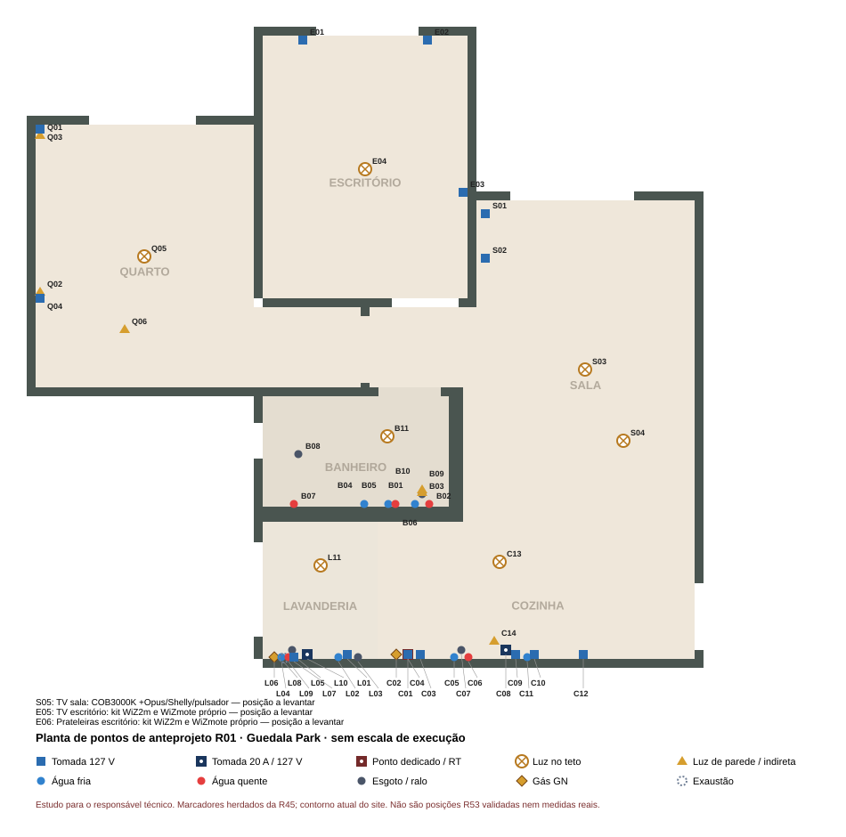

# Planta de pontos de anteprojeto — R01

27/10/2026. **Revisão documental dos50 códigos R00, mais3 grupos de iluminação omitidos:53 funções.** Não é projeto executivo; não define circuitos nem confirma coordenadas de instalação. O arquivo SVG mantém o nome legado para preservar links; sua identificação interna é R01.

[Desenho SVG](Planta_pontos_R00.svg) · [gerador](gerar_planta_pontos.py). Rodar `python -B 03_Ambientes/Planta_pontos/gerar_planta_pontos.py` na raiz. A tabela após o marcador é gerada; a auditoria abaixo é manual.

## Fontes e limites

- [Equipamentos e manuais](../Equipamentos/README.md), [CSV](../Equipamentos/Lista_equipamentos.csv), [escolha PE11X,09/09](../Cozinha/Equipamentos_e_instalacao.md#purificador-de-água--electrolux-pe11x-cinzaprata-escolhido), [iluminação27/10](../Iluminacao/Lista_curta_luminarias_e_madeira.md) e [armários até o teto, Elias26/10](../../04_Moveis/README.md#diretriz-de-fechamento-até-o-teto--26102026).
- Marcadores/alturas da R00 são referências nominais herdadas da R45; **não foram validados contra R53; Q06 perdeu a posição antiga porque D04 mudou sua implantação**. Contorno atual lido do site; envelopes antigos de aparelhos omitidos para não sugerir encaixe vigente. Nenhum CAD aberto/alterado.
- Tensão de uso127V (F102,12/09), aparelhos bivolt preservados; GN para KE4GC/E21. Identificação da alimentação não dimensiona circuito, proteção, cabo, simultaneidade nem tomada real.
- RT confere pontos da construtora, quadro, circuitos, água quente, GN, exaustão e implantação; oficina garante acesso removível às conexões/fontes sem interferir no fechamento até o teto. [Roteiro das chaves](../../07_Imovel/Roteiro_dia_das_chaves_R01.md).

## Auditoria dos50 pontos — cobertura integral

| Códigos R00 | Conferência e divergência | Tratamento R01 / falta |
|---|---|---|
| C01–C04 | Fischer127V, KE4GC/GN, ignição e DE61IX coerentes; indicação de circuito não equivale a projeto | Manuais/RT; acesso posterior e depurador200cm contra marcenaria até teto a compatibilizar |
| C05–C07 | Pia: fria/esgoto previstos; quente não comprovada na unidade | Levantar existentes; percurso quente com RT |
| C08 | Torre20A na área seca | Quantidade de usos e implantação sem giro/água; não definir simultaneidade |
| C09 | ME23P127V;10cm desejados contra30cm do manual | Divergência existente mantida; sem novo estudo nominal ou redução do manual |
| C10–C11 | PE12G desatualizado: escolha PE11X em09/09 | Corrigido PE11X; água, garrafa, acesso e retirada pendentes |
| C12 | IB6S bivolt, uso127V; tomada200cm nominal | Evitar acesso bloqueado pelo armário/teto; RT/oficina |
| C13–C14 | Produtos/comandos antigos genéricos | EVO comum; bancadaCOB/Shelly/pulsador; fonte acessível e IL04–07 |
| L01–L03 | LG127V, água/esgoto coerentes | Identificar CV5012PC4; conferir mangueiras/retirada/posição real |
| L04–L05 | Telca quente/fria, mas R00 só registra fria; esgoto previsto | **Ramal quente falta**; RT define se e como acrescentar, sem inventar trajeto |
| L06–L09 | E21 GN; energia, duto e distribuição quente | Compatibilizar destinos e acesso; não inventar diâmetros/saída/circuitos |
| L10 | Tomada20A air fryer/cafeteira |127V; uso não significa simultaneidade; posição real/RT |
| L11 | Firefly quadrado3000K tinha código errado9607 | Corrigido9608; comando comum; conferir varal carregado e portas |
| B01–B04 | Lavatório fria/quente/esgoto e vaso fria | Existentes/novo quente a levantar; acesso às conexões |
| B05–B06 | Ducha quente/fria, produto ainda indefinido | Vazão/temperatura e misturador dependem fornecedor/RT; nenhum cálculo novo |
| B07–B08 | Livo e ralo; B07 codificado sóAQ | B07 é função quente+fria, não contagem de bocais; ambos a levantar |
| B09–B11 | L02 espelho4000K, indireta Brilia318939/teto3000K | Três comandos comuns separados; fontes/manutenção, volumes e espelho/torneira pendentes |
| S01–S02 | TV/PS5/soundbar; posições ligadas ao painel | TV mantida; D01-C para cotação do adiamento (Elias27/10) exige implantação independente e crédito da oficina |
| S03–S04 | Gerais e jantar sem produto na R00 | Jurerê/WiZ e Jabuticaba/G9/D1 candidatos; IL02/03/09 |
| E01–E03 | Computadores/TV existentes | Etiquetas, quantidade de tomadas e acesso com armários até teto pendentes |
| E04 | Geral sem produto na R00 | Jurerê/WiZ candidato; IL02/03 |
| Q01–Q04 | Arandelas e tomadas cabeceira | EVY2054 com comando próprio por lado; confirmar interruptor do produto/alcance |
| Q05–Q06 | Geral antiga não expressava smart; indireta antiga nos aéreos | Q05 Elgin D03-B; Q06 cabeceira/face inferior D04-A (Elias27/10), sem coordenadas; fonte e montagem acessíveis pendentes |

As faixas acima cobrem C01–14(14), L01–11(11), B01–11(11), S01–04(4), E01–04(4), Q01–06(6): **50/50**. Q06 e três funções adicionais estão sem posição: S05 indiretaTV sala; E05 indiretaTV escritório; E06 indireta prateleiras. Não confundir53 funções com53 circuitos ou53 caixas.

## Comandos de anteprojeto, sem circuitos

- C13/L11/B09/B10/B11: liga/desliga comum; os três do banheiro separados.
- C14/S05/Q06: Shelly+fonte+pulsador candidato, grupo independente, compatibilidade IL04–07.
- S03/E04: Jurerê/WiZ smart; Q05: Elgin48D18WSRWIFI, D03-B de Elias27/10/2026, manual/comando físico IL09 pendentes.
- S04: D1+RM433 propostos; ensaio com trêsG9. Q01/Q02: leitura independente por lado.
- E05/E06: dois kitsWiZ, dois controles separados; corte e acessórios IL08. Não duplicar fontes próprias.

**D04 — Elias,27/10/2026: "A — indireta na cabeceira/face inferior acessível".** Q06 sai da coordenada/altura antiga213cm e fica sem posição até compatibilização. Componentes provisionados; acréscimos de marcenaria/instalação a cotar. D05 poderá adiar cabeceira/aéreo: nesse caso, cotar suporte independente antes de executar. Não inventar nova coordenada nem fresta sobre armário.

Conferência anterior27/10: SVG inspecionado. Revisão D03/D04 mantém53 funções, agora quatro sem posição (Q06/S05/E05/E06); conferir na regeneração A3. Não verifica posições reais.

D05-C (Elias27/10/2026: "C — cotar com aumento de verba") adia P17/C05: E06 perde o suporte previsto, E05 exige suporte independente. [D06](../../01_Programa_e_decisoes/Roteiro_para_projeto_oficial.md#d06--iluminação-do-escritório-após-d05-c) aguarda escolha; funções mantidas na planta, sem coordenadas inventadas.

## Pontos

<!-- TABELA -->

| Código | Tipo | Ponto | Altura de referência | Situação |
|---|---|---|---|---|
| C01 | Ponto dedicado / RT | Forno Fischer Infinity 28349-64929 · 127 V · 2061 W | 30 cm (nominal) | Exclusividade indicada no manual; circuito e implantação pelo RT |
| C02 | Gás GN | Gás GN do cooktop KE4GC | 50 cm (nominal) | GN confirmado; posição real a levantar |
| C03 | Tomada 127 V | Ignição do cooktop | 50 cm (nominal) | A confirmar no manual |
| C04 | Tomada 127 V | Depurador DE61IX · 127 V | 200 cm (nominal) | Aparelho escolhido |
| C05 | Água fria | Água fria da pia | 55 cm (nominal) | Existente; conferir posição |
| C06 | Água quente | Água quente da pia | 55 cm (nominal) | Não confirmada no memorial |
| C07 | Esgoto / ralo | Esgoto da pia | 45 cm (nominal) | Existente; conferir posição |
| C08 | Tomada 20 A / 127 V | Torre automática de tomadas 20 A na bancada (área seca) | 92 cm (nominal) | Posição a definir |
| C09 | Tomada 127 V | Micro-ondas ME23P · 127 V | 190 cm (nominal) | Aparelho escolhido |
| C10 | Tomada 127 V | Purificador PE11X bivolt, uso127 V | 110 cm (nominal) | Aparelho escolhido |
| C11 | Água fria | Água fria do purificador | 110 cm (nominal) | Derivação a confirmar |
| C12 | Tomada 127 V | Geladeira IB6S bivolt, uso127 V | 200 cm (nominal) | Aparelho escolhido |
| C13 | Luz no teto | Stella EVO STH21967/30, quadrado3000K | teto a confirmar | Interruptor comum; posição com portas a conferir |
| C14 | Luz de parede / indireta | COB3000K sob aéreos +Opus/Shelly/pulsador | 150 cm (nominal) | Grupo independente; acesso/manuais IL04–07 pendentes |
| L01 | Tomada 127 V | Lavadora LG VC4 CV5012PC4 · 127 V | 110 cm (nominal) | Aparelho escolhido |
| L02 | Água fria | Água fria da lavadora | 90 cm (nominal) | Existente; conferir posição |
| L03 | Esgoto / ralo | Esgoto da lavadora | 80 cm (nominal) | Existente; conferir posição |
| L04 | Água fria | Água fria do tanque/Telca | 60 cm (nominal) | Telca requer quente/fria; ramal quente ausente, RT deve compatibilizar |
| L05 | Esgoto / ralo | Esgoto do tanque | 40 cm (nominal) | Conferir posição |
| L06 | Gás GN | Gás GN do aquecedor Rinnai E21 | 140 cm (nominal) | Aparelho escolhido; instalação a projetar |
| L07 | Tomada 127 V | Aquecedor E21 · alimentação elétrica | 150 cm (nominal) | Conferir no manual |
| L08 | Exaustão | Exaustão do aquecedor E21 | 215 cm (nominal) | Duto e saída a projetar |
| L09 | Água quente | Saída quente E21; destinos de banho/cozinha/Telca a compatibilizar | 140 cm (nominal) | Percurso oculto em estudo |
| L10 | Tomada 20 A / 127 V | Tomada fixa 20 A para air fryer e cafeteira | 100 cm (nominal) | Posição a definir |
| L11 | Luz no teto | Firefly9608 quadrado3000K | teto a confirmar | Interruptor comum; testar sombra/varal ocupado |
| B01 | Água fria | Água fria do lavatório | 55 cm (nominal) | Existente; conferir |
| B02 | Água quente | Água quente do lavatório | 55 cm (nominal) | Novo ramal; percurso em estudo |
| B03 | Esgoto / ralo | Esgoto do lavatório | 45 cm (nominal) | Existente; conferir |
| B04 | Água fria | Água fria do vaso | 20 cm (nominal) | Existente |
| B05 | Água fria | Ducha higiênica · fria | 60 cm (nominal) | Posição ilustrativa |
| B06 | Água quente | Ducha higiênica · quente | 60 cm (nominal) | Novo ramal; E21 exige 3,9 L/min para ligar |
| B07 | Água quente | Chuveiro / misturador Livo (quente e fria) | 120 cm (nominal) | Um código funcional; conferir ambas as alimentações, não só AQ |
| B08 | Esgoto / ralo | Ralo do box | 0 cm (nominal) | Existente |
| B09 | Luz de parede / indireta | Espelho 4000 K: Cristallux COB 2x550 mm /13,2 W | 190 cm (nominal) | L02: Opus OPS31002 e perfil MOV; posição/montagem a validar |
| B10 | Luz de parede / indireta | Indireta 3000 K: Brilia318939 até 2 m /9,6 W | 230 cm (nominal) | L02: Opus OPS31002, comando próprio; trecho real a medir |
| B11 | Luz no teto | Teto 3000 K: Galaxy Firefly 9605 /25 W /IP44 | teto a confirmar | Selecionado L02; ponto e volumes a conferir |
| S01 | Tomada 127 V | Régua no compartimento ventilado: TV, PS5, soundbar | 30 cm (nominal) | Posição de estudo |
| S02 | Tomada 127 V | TV 50″ atrás do painel | 120 cm (nominal) | Altura a conferir |
| S03 | Luz no teto | Geral smart: Jurerê +2WiZ +WiZmote, candidata | teto a confirmar | IL02/03 pendentes; D03-B mantém sala/escritório |
| S04 | Luz no teto | Jabuticaba triplo +3Brilia314450 +D1/RM433 | teto a confirmar | Vidro âmbar e dimerização a confirmar, grupo próprio |
| E01 | Tomada 127 V | Bancada · notebook | 85 cm (nominal) | Quantidade a definir |
| E02 | Tomada 127 V | Bancada · PC CH360, monitores | 85 cm (nominal) | Quantidade a definir |
| E03 | Tomada 127 V | TV 43″ existente | 100 cm (nominal) | Conferir |
| E04 | Luz no teto | Geral smart: Jurerê +2WiZ +WiZmote, candidata | teto a confirmar | IL02/03 pendentes; D03-B mantém sala/escritório |
| Q01 | Luz de parede / indireta | Nordecor EVY2054 branca · lado 1 | 110 cm (nominal) | Comando independente |
| Q02 | Luz de parede / indireta | Nordecor EVY2054 branca · lado 2 | 110 cm (nominal) | Comando independente |
| Q03 | Tomada 127 V | Tomada de cabeceira · lado 1 | 60 cm (nominal) | Conferir |
| Q04 | Tomada 127 V | Tomada de cabeceira · lado 2 | 60 cm (nominal) | Conferir |
| Q05 | Luz no teto | Geral smart Elgin48D18WSRWIFI: brilho, Alexa/celular | teto a confirmar | D03-B Elias27/10; manual/comando físico IL09 pendentes |
| Q06 | Luz de parede / indireta | Cabeceira/face inferior: COB3000K +Opus/Shelly | a levantar | D04-A Elias27/10; posição/acesso/pulsador a compatibilizar |
| S05 | Luz de parede / indireta | TV sala: COB3000K +Opus/Shelly/pulsador | a levantar | Novo grupo; posição/acesso a levantar, compatibilizar faseamento D01 |
| E05 | Luz de parede / indireta | TV escritório: kit WiZ2m e WiZmote próprio | a levantar | Novo grupo; posição/cortes/manuais IL08 pendentes |
| E06 | Luz de parede / indireta | Prateleiras escritório: kit WiZ2m e WiZmote próprio | a levantar | Novo grupo; posição/cortes/manuais IL08 pendentes |
