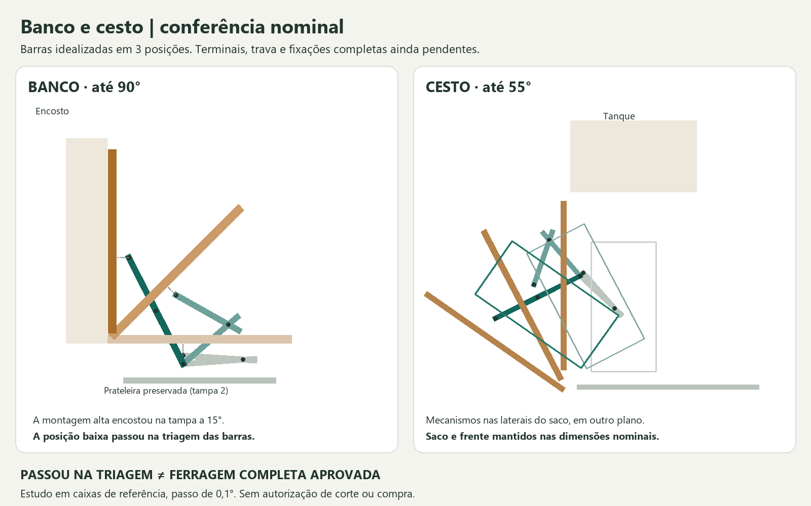

# Ferragens simples — resultado da conferência nominal

**Continuação25/10:** [P14:reações dos pivôs, fixações e energia](../../../P14/Reacoes_e_operacao/README.md). O torque/braço abaixo foi reproduzido;270 cenários acrescentam repartição lateral, esforços reversos nos suportes e excentricidades. O conjunto permanece condicionado a terminais/trava/pivôs reais. [P20:assento fechado](../../../P20/Assento_fechado/README.md) trata outro caminho de cargas, sem atribuir carga de pessoas aos articuladores.

Conversa de 23/10/2026. Apartamento não entregue; estudo independente do levantamento final. Preservados duas tampas presas, duas almofadas, frente do cesto, saco, gabaritos de objetos e prateleiras.

**Resultado:** há espaço promissor para articuladores mecânicos simples nos dois móveis. As barras idealizadas da família Bigfer passaram em posições determinadas, após rejeitar duas montagens no banco. A dobradiça piano cabe em comprimento, e um parafuso de articulação comercial cabe no espaço lateral do cesto. **Nenhum conjunto completo está liberado para compra/fabricação:** terminais, engate da trava, suportes e capacidade na aplicação ainda precisam ser confirmados.

## Pesquisa técnica pública — 26/10/2026

[Oito requisitos por produto](Pendencias_produtos.csv) separam evidência pública de resposta ainda necessária. Consulta via web; nenhuma mensagem enviada, compra ou ensaio. Os preços históricos abaixo não foram recotados nesta rodada.

- **Bigfer:** o [desenho oficial p.112](https://www.bigfer.com.br/wp-content/uploads/sites/6/2023/02/Catalogo-Produto-Sistemas-e-Articuladores-pg.-112.pdf) confirma os códigos e cotas gerais já utilizados. Não foram encontrados nessa página curso de liberação, distância certificada ao engatar ou capacidade na montagem. Não usar a furação do modelo vizinho 04.03.307 para os códigos brancos.
- **Mahler:** a [ficha Ref.54](https://mahlerinox.com/wp-content/uploads/2024/07/REF.54-2000x30-1.pdf) confirma espessura 0,8 mm, eixo interno Ø2 e fixação por parafuso/rebite. Não fornece dimensionamento da aplicação horizontal proposta. O apoio fixo e o eixo real continuam por detalhar.
- **Ômega:** a [página do OMPCR 10×20](https://www.paulo-omegafix.com.br/produtos/parafuso-de-corpo-retificado-iso-7379-ompcr-10x20-m8x1-25-kit-04-p%C3%A7s) informa SAE4140, classe 10.9 e dureza 40 ±2 HRC. Isso não determina resistência do suporte, vida da bucha nem proteção na lavanderia.

**Nova candidata para consulta, não selecionada:** bucha flangeada igus **GFM-1012-15**, material G. O [catálogo oficial, página impressa 107](https://www.igus.com/ContentData/Products/Downloads/iglide_G300_FM_USen.pdf) informa d1=10, d2=12, d3=18, b1=15 e b2=1 mm. A tabela indica alojamento de 12,000–12,018 mm, eixo de 9,964–10,000 mm e diâmetro interno após prensagem de 10,025–10,083 mm. O catálogo referencia alojamento de aço; **não há validação de prensagem direta na madeira do cesto**. Isso exige um alojamento definido, fixado ao conjunto, sem substituir a marcenaria por quadro metálico. Disponibilidade brasileira, tolerância do OMPCR, material do alojamento e compatibilidade com umidade permanecem pendentes.

A G1FM-1012-10, encontrada na [página de produto G1](https://www.igus.com/iglide-ibh/flange-bearings/product-details/iglide-g1-m?artnr=G1FM-1012-10), é outro material/comprimento. Não transferir suas propriedades para a GFM-1012-15. O diâmetro interno nominal comum de 10 mm, sozinho, não comprova ajuste.

**Decisão de projeto desta etapa:** continuar com o pivô como conjunto desmontável a detalhar. O corte deve identificar alojamento da bucha, ombro liso, faces de encosto, folga axial, retenção e apoio roscado. Não subtrair simplesmente 15 de 20 mm para declarar uma folga de montagem: faltam flange, arruelas/espaçadores, tolerâncias e alívio de raiz. O catálogo reduz a incerteza do componente; não fecha o suporte e sua ligação à madeira.

## Lista curta para priorizar custo

| Peça | O que foi conferido | Situação e custo |
|---|---|---|
| **Bigfer 04.03.185 / 04.03.183**, articulador com trava, direito/esquerdo, epóxi branco | Desenho oficial: duas cotas de 145,5 mm e envelope longitudinal de 324 mm; montagem idealizada de barras nas laterais | Melhor candidato simples para continuar. Preço do código exato não obtido. O fabricante vende em lote mínimo de 50 no portal: procurar revenda, não comprar lote |
| **Mahler Ref.54 nominal 2000 × 30 × 0,8 mm**, piano com furos | Desenho real: comprimento **1991 ± 1 mm**, largura 30,8 mm, pino Ø2 mm. Uma barra comporta segmentos de 971 e 825 mm, restando 195 mm antes do corte, no comprimento central | Comprimento atende; eixo, apoio fixo e acabamento sob a almofada ainda pendentes. Preço não obtido |
| **Ômega OMPCR 1020**, corpo liso Ø10 × 20, rosca M8 | Comprimento axial 7 + 20 + 13,25 = **40,25 mm**, contra faixa lateral de 52 mm | Envelope do parafuso cabe, sobrando 11,75 mm brutos. Oferta consultada: **R$84 por kit de quatro**, não por par; bucha, suporte e retenção ainda não incluídos |

Fontes: [Bigfer, modelo e catálogo](https://www.bigfer.com.br/articulador-com-trava/), [portal Bigfer com lote mínimo](https://portal.bigfer.com.br/articulador-com-trava-direito-epoxi-branco-1401), [Mahler Ref.54](https://mahlerinox.com/produto/ref-54-dobradica-piano-c-furos/), [Ômega, oferta do kit de quatro](https://www.paulo-omegafix.com.br/produtos/parafuso-de-corpo-retificado-iso-7379-ompcr-10x20-m8x1-25-kit-04-p%C3%A7s).

Encontrado também um [par de articuladores brancos com trava por R$22,90](https://www.tudonamao.net.br/kit-articulador-de-porta-c-trava-de-branco). O anúncio não identifica fabricante/código nem desenho. Portanto, **não atribuir esse preço ao Bigfer**, nem usar a alegação de 20 kg como capacidade técnica desta montagem. Serve como pista de revenda econômica, condicionada à identificação do produto. Preços sem frete e sem contratação.

## Banco: posições que passaram e montagens rejeitadas

A triagem usa o eixo **hipotético X100/Z423,1**, almofadas retiradas e as duas tampas originais. Os painéis passaram em 901 posições cada, de 0° a 90°, contra as caixas de referência e a superfície da mesa Berlin. O eixo não está confirmado para uma peça Mahler instalada.

Para as barras, foram usados 145,5 mm por braço, largura de 14,6 mm, reserva transversal de 28 mm e extensão conservadora de 35 mm além da articulação central. A distância final de 291 mm é uma hipótese cinemática a partir das cotas, **não um curso de travamento certificado**.

| Tampa | Ponto fixo X/Z | Ponto móvel X/Z, fechada | Faixa lateral Y reservada | Resultado das barras |
|---|---|---|---|---|
| Maior, 971 mm | 288,25 / 358 | 288,25 / 378 | 4148–4176, lado do setor do liquidificador | Sem interseção em 901 posições |
| Menor, 825 mm | 285,85 / 350 | 285,85 / 370 | 4732–4760, acima da prateleira da extensão | Sem interseção em 901 posições |

Coordenadas globais do inventário, em mm; **não são gabarito de furação**. As posições requerem o eixo do terminal móvel 22 mm e 30 mm abaixo da face inferior da tampa, respectivamente. É necessário comprovar que o terminal comercial ou uma adaptação econômica realiza esse afastamento. O ensaio não demonstrou que basta parafusar a peça original diretamente.

A primeira montagem, com ponto móvel em Z390, encontrou a própria tampa a **15°**. Outra, em Z370 junto ao setor do liquidificador, encontrou a jarra a **1,5°**. A posição Z378 eliminou essa interferência no modelo simplificado. A versão junto ao setor de potes foi preterida para não reservar ferragem sobre o percurso das prateleiras removíveis desse setor. A solução final de manutenção ainda exige verificar terminais e mãos.

Na tampa menor, o envelope das barras não desce de Z337,54; a prateleira termina em Z310. Logo, há **27,54 mm de separação vertical bruta nesse ensaio**, sem baixar a prateleira. Isso não é folga garantida do conjunto completo. Na tampa maior, não houve interseção com os gabaritos; as margens próximas à jarra precisam absorver tolerâncias reais.

**Dobradiça piano:** a faixa traseira do banco tem uma junta nominal de apenas 2 mm junto ao encosto. Não assumir que o nó da dobradiça e sua aba fixa cabem nessa junta. O encosto é uma reserva de volume, não um apoio resistente já definido. Preservar sua aparência exigirá detalhar apoio e rebaixo ocultos, além de conferir o contato sob as almofadas. O cálculo do comprimento da Ref.54 não resolve essas interfaces.

Previsão mínima estudada: um suporte por tampa, como hipótese geométrica. Quantidade definitiva, torção do painel e fixações dependem da capacidade e do ensaio; não converter automaticamente em lista de compra.

## Cesto: posição lateral sem reduzir o saco

Mantidos eixo ideal Y6440/Z120, frente 550 × 521 × 18, saco 400 × 200 × 400 e 55°. Dois articuladores são estudados, um por lado, nas faixas X4290–4318 e X4792–4820. Elas ficam fora do envelope lateral da armação e do saco.

Pontos do estudo: fixo **Y6429,67/Z440**; móvel fechado **Y6440/Z450**. As barras passaram em **551 posições por lado**, incluindo confronto com a frente e armação em movimento, tanque, painéis e reservas hidráulicas. O maior Z das barras foi 621,14 mm. A largura reservada de 28 mm ocupa parte dos 52 mm laterais; os 24 mm restantes são margem bruta, não espaço disponível depois dos terminais.

A ligação à armação precisa distribuir carga: o montante gabarito tem apenas 15 mm. Não considerar parafuso isolado nessa peça uma fixação resolvida. A armação e o saco devem continuar removíveis; o desenho final precisa mostrar a desconexão dos terminais e o acesso às ferramentas.

O braço efetivo calculado na parada é aproximadamente **290,54 mm**. Para o momento extremo nominal de 38,73 Nm, resulta **133,29 N de tração se um lado receber tudo**, ou 66,64 N por lado com divisão ideal. Esses valores excluem impacto, coeficiente de projeto e acessórios adicionais. Não validam a alegação comercial de “20 kg”. Confirmar também retenção contra fechamento e destravamento sem ultrapassar os 55°.

**Pivô:** o OMPCR 1020 substitui apenas o pino ideal como candidato de eixo liso. Precisa de bucha, apoio metálico e retenção que não aperte a parte girante. Não girar madeira diretamente na rosca. Os 40,25 mm são do parafuso sozinho; o conjunto montado e a retirada da chave ainda precisam ser verificados. Avaliar proteção contra corrosão na lavanderia; a variante anunciada em aço SAE4140 não equivale a inox.

## Alternativas que não entram como compra agora

- **FGVTN Slow Multi:** a implantação já estudada exigia espaço incompatível com a prateleira. Mantida a rejeição de baixá-la para acomodar o mecanismo.
- **Bigfer zincado anunciado como 546 mm:** não é o mesmo código/desenho do branco 04.03.185/183. Não transferir preço, cota ou capacidade entre eles.
- **Sugatsune L-100S, L-SL140 e L-270:** desenhos consultados como referência de suportes compactos, sem cotação nacional que justifique prioridade sobre o articulador simples. A carga axial não equivale diretamente ao peso da tampa. As montagens catalogadas não foram validadas nesta geometria.
- **Mahler Ref.52 300 × 38 × 1,5:** alternativa de segmentos mais espessos, com desenho disponível, porém sem preço e sem dimensionamento de quantidade. Não está demonstrado que custe menos que uma barra Ref.54.
- **Cinta/corrente isolada:** limita abertura, mas não cumpre sozinha a retenção aberta solicitada. Não substitui o conjunto de segurança funcional.

## Fechamento pendente, independente das chaves

1. Confirmar a geometria real dos terminais e da trava Bigfer: distância entre pivôs ao travar, curso para liberar, mão de montagem, largura total com rebites e capacidade em tração/compressão na aplicação.
2. Completar a dobradiça no banco: relação eixo–face, suporte fixo, rebaixo e fixações. Conferir visual com almofadas colocadas e removidas.
3. Completar pivôs e reforços do cesto, incluindo desmontagem. Validar operação cheia/vazia e carga das fixações em protótipo.
4. Cotar os códigos exatos com adaptações, montagem e frete; comparar o total instalado. Não há economia consolidada nesta etapa.

[Consulta técnica pronta para revisão, ainda não enviada](Consulta_tecnica.md). Os dados faltantes são do produto e da oficina, não medidas do apartamento. Não há nova escolha pessoal necessária agora.

## Evidências

- [Cálculo e triagem reproduzíveis](conferir.py) · [resultados e hipóteses](Resultados.json) · [gerador da figura](desenhar.py).
- [Catálogo oficial Bigfer, p.112](Fontes/Bigfer_112.pdf).
- [Desenho oficial Mahler Ref.54](Fontes/Mahler_54_2000.pdf) e [Ref.52](Fontes/Mahler_52_300x38.pdf).
- [Tabela oficial Ômega ISO7379](Fontes/Omega_7379.pdf).
- [Catálogo Sugatsune, páginas impressas 144–149](Fontes/Sugatsune_suportes.pdf).

Triagem por polígonos extrudidos e caixas de referência em passos de 0,1°, não colisão contínua de sólidos comerciais. Placas dos terminais, trava detalhada, fixações, tolerâncias, deformação e acesso das mãos não foram incluídos. Os limites são parte do resultado. CAD R45, fichas R14 e orçamento central permanecem sem essa substituição.
