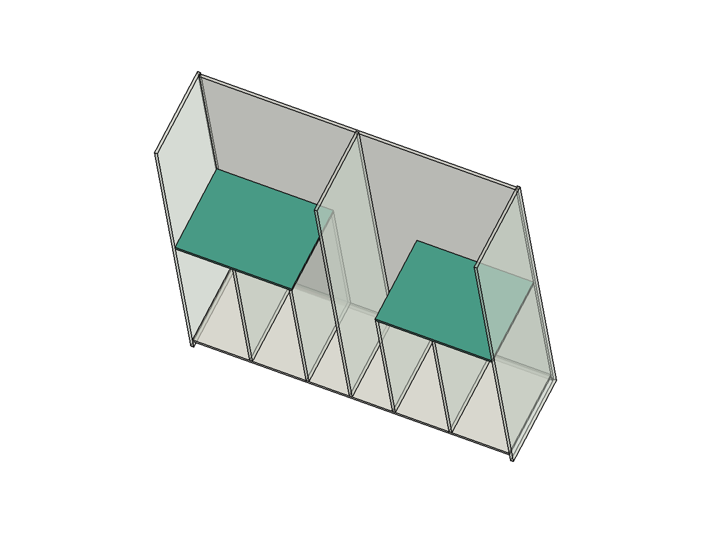

# Roupeiro P01: prateleiras, apoios nominais e varões

Detalhe movido do [README de cargas e ligações](README.md) em 25/10/2026, sem alteração de conteúdo. Estudo nominal e separado: não incorpora nada ao modelo nem libera carga de uso.

As seis sapateiras de 355 × 400 × 18 mm têm, na triagem biapoiada, **0,820 mm** no cenário diferido com reserva para 20 kg distribuídos, frente a 1,183 mm. Isso permite avançar o detalhamento, mas os conectores, cargas locais e caminho até o piso continuam separados da verificação da chapa.

Nas duas prateleiras de 705 × 550 mm (`Peca245`/`Peca246`), uma divisória interna fornece apoio de compressão de 18 × 550 mm, uma lateral encontra a extremidade da chapa e a outra ponta apenas toca o topo de outra divisória pela aresta. Sem crédito do fundo, isso produz **balanço de 341 mm** e trecho entre apoios de 364 mm. Com 10 kg distribuídos, a estimativa é 2,860 mm diferidos com reserva. Um peso de 5 kg na ponta longitudinal resulta em reação negativa de aproximadamente **44,2 N** na ligação lateral; é uma exigência de retenção.

**Solução desenvolvida:** alongar cada chapa 18 mm sobre a divisória existente. A direita começa 18 mm antes; a esquerda termina 18 mm depois. Resultado: **723 × 550 × 18 mm**, nas mesmas cotas Z1082–1100. Cada chapa ganha mais um apoio horizontal de **9.900 mm²**. O acréscimo ocorre sobre a espessura da divisória e não estreita os vãos úteis. Massa nominal adicional de cerca de 0,143 kg por chapa, a 800 kg/m³.

Abrir [estudo FreeCAD separado](P01_estudo_apoios_723.FCStd). São apenas as peças necessárias para entender os apoios; portas, gavetas e movimentos permanecem completos na fonte R50. Os quatro apoios horizontais foram conferidos por interseção de faces. A triagem dos volumes acrescentados contra as **113 geometrias visíveis P01 do inventário**, por chapa, não encontrou candidato com sobreposição volumétrica. Essa conferência não cobre ferramenta, usinagem ou tolerâncias de fabricação.

Uma proposta de ligação usa dois Minifix na extremidade junto à lateral e quatro Confirmat traseiros, com cavilhas de posicionamento; os apoios nas divisórias só comprimem. No sistema canônico, x = 0 na ponta estendida junto à divisória, y = 0 na frente da chapa:

| Ligação | Coordenadas nominais por chapa |
|---|---|
| Minifix na lateral | x = 723; y = 70 / 480; eixo no meio da espessura da chapa |
| Confirmat traseiros | x = 72 / 265 / 458 / 651; y = 550; eixo na meia espessura |
| Cavilhas traseiras de posicionamento | x = 168,5 / 361,5 / 554,5; y = 550; sem crédito de rigidez no cálculo |
| Apoios de compressão | Centros longitudinais x = 9 e 359; contato físico de 18 × 550 mm em cada divisória |

Espelhar a chapa esquerda com as origens correspondentes. A [orientação EPF para parafusos](https://mdf-info.eu/using-mdf/fixing/screwing) recomenda 70 mm dos cantos para entrada na aresta; os extremos traseiros estão a 72 mm. A sequência, brocas, ponta, bordas e profundidades ainda seguem a ferragem real e prova em retalho. A proposta **substitui**, após compatibilização, as linhas de cotação anteriores dessas peças; não somar todos os conectores como novos.

No modelo de placa com as juntas flexíveis condicionais, apoios de compressão sem tração e fundo/lateral usados como referência:

| Conteúdo na chapa proposta | Flecha no cenário diferido | Saldo para deformação da caixa após reserva de 0,20 mm |
|---|---:|---:|
| 5 kg distribuídos | 0,135 mm | 0,878 mm |
| 10 kg distribuídos | 0,198 mm | 0,815 mm |
| 20 kg distribuídos | 0,323 mm | 0,690 mm |
| 5 kg em área de 50 × 60 mm próxima da ponta/frente | 0,222 mm | 0,791 mm |

Referência escolhida: **364/300 = 1,213 mm**. O saldo é um orçamento de deformação a cumprir pelo fundo, divisórias, laterais e suas uniões; não tratá-los como imóveis no cálculo final. A solução de 705 mm com somente conectores traseiros, nas mesmas hipóteses, já excede essa referência com 5 kg distribuídos e a reserva. O apoio positivo novo melhora substancialmente o comportamento sem engrossar a chapa.

### Varões

Candidato de seção: tubo **Ø20 × 0,7 mm**, não o cilindro maciço representado no CAD. Comprimentos nominais: dois de 973 e dois de 332 mm. O [catálogo Häfele, página 69](https://www.hafeleindia.co.in/Catalogues/PDF/HotelAssortment2020.pdf) documenta tubo 801.01.702 e suportes candidatos; não fornece, no trecho consultado, capacidade da montagem em nosso MDF. Comprimento de corte depende dos encaixes.

| Caso com 20 kg de roupas | Flecha elástica | Reações verticais estáticas |
|---|---:|---|
| 973 mm, distribuído, dois terminais | 6,041 mm | 99,7 N por terminal |
| 973 mm, concentrado no centro, dois terminais | 9,607 mm | 99,7 N por terminal |
| 973 mm, distribuído, apoio central ideal contínuo | 0,157 mm | 37,4 / 124,6 / 37,4 N |
| 332 mm, distribuído, dois terminais | 0,237 mm | 98,6 N por terminal |

Incluído peso próprio do tubo. No varão longo, a tensão bruta da seção ideal é cerca de **122,5 MPa distribuída** e **243,1 MPa central**; não foi adotado limite de escoamento certificado nem tensão admissível. Referência de flecha do longo: 3,243 mm. A rigidez do tubo não valida os terminais e parafusos.

Com apoio central e carga concentrada em um quarto do comprimento, o modelo bilateral prevê reação de **−17,8 N** no terminal oposto. Se o encaixe apenas apoia, o tubo pode perder contato: esse resultado exige retenção ou recálculo unilateral, e não aprovação automática do apoio central.

O superior precisa de distância **82 mm entre face de montagem e eixo**; o inferior, 52 mm. A altura externa de 63 mm do candidato central não define essa cota. Esse encaixe e a reação transmitida ao maleiro podem ser resolvidos antes das chaves, mediante desenho do produto exato.
