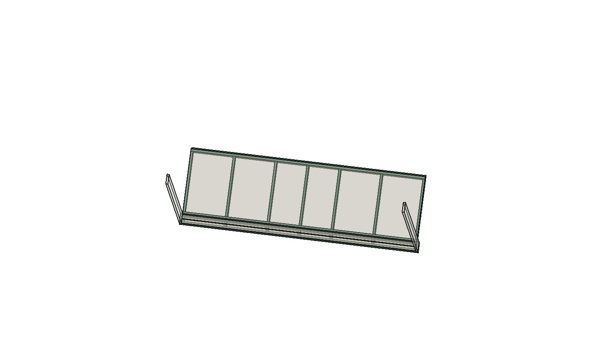

# Apoios de marcenaria do roupeiro até o piso

## Divisória central com P03/P02 acoplados — 25/10/2026

[Cálculo e desenho atuais](../../P03/README.md):1728 casos, incluindo painéisP02/P03 eP01 (base/frente, laterais, divisória e fundo) com juntas flexíveis e contatos de compressão. R52 preservada sem abrirCAD. Não substitui a avaliação do piso real ou o envelope de todo o conteúdoP01.

O caminho nominal da divisóriaP210 está alinhado: X6381–6399/Y3372–3922, péZ80 → base18 emZ62–80 → soco nominal62 → pisoZ0. Sob a pegada18×550 há18mm da longitudinal frontal,514 da travessa `Soco_transversal_4_caixa` e18 da longitudinal traseira:9900mm² contínuos geometricamente. A altura62 permanece nominal, dependente de ajuste/nivelamento/proteção no piso real.

No cenário principal (malas20kgP03, P02 com seu peso/portas mas sem conteúdo), o pé recebe até645,72N e a base sob seu centro desloca até0,050mm nas hipóteses centrais. A força inclui peso próprio e interação com as juntas do fundo; o corte vertical da divisória foi conferido. A média645,72/9900 =0,065MPa pressupõe contato integral; não é pressão máxima ou resistência admissível de MDF/vinílico/contrapiso.

Sem o soco, o modelo acoplado atinge grandes deslocamentos e transfere carga pelas juntas com o fundo: não é previsão linear válida ou alternativa comprovada. Rigidez do piso por área0,1–10N/mm³ (hipóteses) dá aproximadamente0,32–0,01mm sob a divisória. Folga0,2 sob a travessa central eleva a resposta a0,22; folga1 dá0,40 e essa travessa não encosta no cenário principal. Não creditar apoio só porque as peças se alinham na planta.

**Resolvido no estudo:** posição/continuidade nominal do caminho e suas solicitações condicionais. **Pendente:** nivelamento/contato sustentado, proteção da madeira, ligações de posicionamento do soco, resistências reais de juntas/piso e aparência frontal62 antes de incorporar. O maleiro continua sem capacidade20kg demonstrada; seis posições passantesC01 são candidatas, não fixadores dimensionados. [Resultados e conferências](../../P03/Verificacao_ligacao_P02_P03.json).

## Base do estudo do soco

25/10/2026, bloco noturno iniciado às 02:06. **Estudo separado da R51**, sem tubos. Desenvolve o caminho das prateleiras e divisórias até o piso, que não estava encerrado pela proposta de prateleiras de 723 mm.

Na geometria atual, a base `Peca209` fica entre Z62 e Z80 e as divisórias começam sobre ela. Não havia apoio positivo inventariado sob essas divisórias. A continuação frontal da base, que recebe os trilhos inferiores das portas, também estava marcada como apoio não calculado. O fundo começa em Z18 e não tem contato direto com o piso nominal.

## Solução nominal estudada

Um **soco de marcenaria sob a base**, dentro do espaço inferior já existente. A base permanece nas mesmas cotas e os compartimentos não perdem altura. As travessas coincidem com as divisórias, levando o peso por compressão; a região frontal também apoia a continuação dos trilhos.

| Parte | Proposta nominal |
|---|---|
| Quatro peças longitudinais | 1.964 × 18 × 62 mm, em Y3290–3308, 3354–3372, 3372–3390 e 3904–3922. As duas centrais são chapas independentes lado a lado, não uma viga composta de 36 |
| Sete alinhamentos transversais | Sob as cinco divisórias e junto às extremidades da base; cada um com trechos de 46 e 514 mm entre as peças longitudinais |
| Apoio do fundo | Calço contínuo nominal de 1.964 × 18 × 18 mm sob a face inferior do fundo em Z18 |
| Apoios das continuações laterais frontais | Duas peças de 18 × 82 × 62 mm, sob as partes laterais que começam em Z62 |
| Total | 21 peças; massa nominal adicional de 11,169 kg a 800 kg/m³ |

O soco frontal de 62 mm passa a ser visível onde hoje há um vazio no modelo; **a aparência deve ser revisada por Elias antes da incorporação**. A geometria não altera os vãos internos, as posições de portas/gavetas nem as cotas dos trilhos. Não é rodapé recuado: a implantação frontal sob o trilho foi escolhida para estudar o caminho de carga e não deve ser trocada por um recuo estético sem recalcular a base frontal.

O calço do fundo evita atribuir todo o peso do fundo de aproximadamente 2,10 m de altura às ligações laterais ou às prateleiras. Sua altura final depende do nível real, tolerâncias e método de apoio. As junções de posicionamento, prevenção de deslocamento e proteção da madeira junto ao piso continuam por detalhar. Não se selecionou automaticamente Confirmat para encontros de apenas 62 mm de altura.

## Conferências geométricas

No FreeCAD, **21 contatos horizontais de face** foram confirmados:

| Peça recebendo apoio | Área nominal |
|---|---:|
| Base principal | 135.468 mm² |
| Continuação frontal dos trilhos | 76.500 mm² |
| Fundo | 35.352 mm² |
| Continuações laterais frontais | 2.952 mm² |
| **Total nominal ao piso** | **250.272 mm²** |

As 21 peças não se sobrepõem entre si. A triagem contra as **1.178 geometrias efetivamente visíveis da R51** não encontrou interferência volumétrica. [Registro BREP](Verificacao_BREP.json). É uma conferência da geometria nominal; não prova contato real contínuo, nivelamento, compressão do acabamento ou capacidade de fixação.

## Base principal entre apoios

O maior espaçamento entre eixos das travessas principais é 355 mm. Foram comparados um modelo de viga e uma placa de célula de 355 × 532 × 17,7 mm, E diferido hipotético de 1.100 MPa, incluindo peso próprio e reserva de 0,20 mm.

| Carga da célula no modelo de placa | Flecha com reserva |
|---|---:|
| 20 kg distribuídos | 0,474 mm |
| 5 kg em área de 50 × 60 mm no centro | 0,409 mm |
| 10 kg na mesma área central | 0,586 mm |
| 5 kg em área de 50 × 60 mm junto ao canto | 0,238 mm |

Referência de projeto usada para essa comparação: 355/300 = **1,183 mm**. São cenários independentes, não limites de carga de cada compartimento que possam ser somados. A placa apoia por compressão; pontos que exigiam tração foram liberados no cálculo. Também foi conferida a aproximação da linha de contato entre os pontos discretos. A variação entre graus 12 e 16 ficou abaixo de 0,31% nos quatro casos.

A viga restrita a uma faixa de apenas 50 mm, sem espalhamento transversal, é muito mais deformável que a placa de duas direções. Seus resultados também estão preservados para explicar o efeito da hipótese; não se escolheu um limite apenas pela conta mais favorável.

## Apoio dos trilhos das portas

O soco reduz o vão transversal nominal da continuação frontal para cerca de **64 mm entre eixos de apoio**. Cada folha modelada tem 995 × 1.999 × 18 mm, massa nominal de madeira de 28,642 kg a 800 kg/m³. A massa real das ferragens não foi medida.

Como sensibilidade, foi aplicada a massa de uma folha inteira num único ponto local, com mais 0 ou 2 kg hipotéticos de ferragens, sem crédito da rigidez do trilho de alumínio. Para a parcela com +2 kg, as deformações calculadas são **0,323 / 0,162 / 0,065 mm** com larguras efetivas de 10 / 20 / 50 mm. Largura efetiva de contato e massa de ferragem são entradas a confirmar; não correspondem às dimensões externas das caixas dos carros.

Não foi adotada tolerância de desnível do RO62 nem liberada carga por comparação com esses números. Verificar o contato e a flexão local sob os carros reais, os quatro carros nas posições abertas/fechadas e o comportamento dos trilhos. Dowel ou parafuso vertical de posicionamento sob essa base precisa ser compatibilizado com os parafusos dos trilhos que entram por cima.

## Prateleiras 723 e deformação da caixa

A proposta anterior P01 tinha saldo de deformação para a caixa, mas fundo e laterais ainda eram referências fixas. Um novo submodelo liga uma prateleira 723 à estrutura e ao soco por faixas axiais de MDF de 100 mm, mantendo juntas flexíveis e apoios internos sem tração.

| Conteúdo na prateleira proposta | Flecha do submodelo com reserva |
|---|---:|
| 5 kg distribuídos | 0,443 mm |
| 10 kg distribuídos | 0,525 mm |
| 20 kg distribuídos | 0,688 mm |
| 5 kg em 50 × 60 mm junto à ponta/frente | 0,598 mm |

Referência escolhida: 364/300 = **1,213 mm**. Incluídos peso da prateleira e parcelas próprias das faixas de fundo/lateral/divisória, com comprimento até o apoio de piso. Há convergência por comparação entre graus 14 e 18.

**São requisitos de um modelo equivalente:** participação axial de 100 mm e rigidez diferida de 500 N/mm por ramo de contato/apoiamento, além dos 500 N/mm das juntas da prateleira. Não são propriedades de catálogo ou medições. A compressão perpendicular nas interfaces, os acoplamentos da caixa, todas as outras prateleiras/varões/gavetas/portas simultâneos e o piso real ainda não foram analisados como um conjunto tridimensional completo. O submodelo não libera 20 kg reais de uso.

## Piso e nivelamento

O arquivo de resultados inclui cenários de **massa total** de 200, 300, 400 e 500 kg e contato de 100%, 25% ou 5% da área nominal. São parâmetros para avaliar solicitações, sem definir conteúdo autorizado do roupeiro. Por exemplo, 400 kg totais correspondem a pressão média de **15,7 kPa** com toda a área apoiada, **62,7 kPa** com 25% e **313,5 kPa** com 5%.

Essas pressões não são resistências admissíveis do piso vinílico, contrapiso ou MDF. O contato real pode se concentrar nas irregularidades e nos calços. Confirmar método de nivelamento, resistência à compressão sustentada do acabamento, proteção da madeira e apoio efetivo depois do levantamento. A massa completa do móvel/conteúdo ainda deve ser reconciliada. Apoiar no piso também não substitui retenção e prevenção de tombamento.

## Arquivos e reprodução

- [Estudo FreeCAD R01 com 21 peças](P01_soco_sem_tubos_R01_ESTUDO.FCStd). O primeiro arquivo `P01_soco_sem_tubos_ESTUDO.FCStd`, de 18 peças, é histórico superado, sem os apoios do fundo e das continuações laterais; não adotar.
- [Peças e coordenadas globais do estudo](Pecas_soco_estudo.csv) e [resultados](Resultados.json).
- [Célula de placa com contato unilateral](Celula_placa_unilateral.json) e [prateleira–caixa–soco](Prateleiras_caixa_soco.json).
- [Conferência do cálculo básico](Verificacao_calculo.json) e [contatos/interferências BREP](Verificacao_BREP.json).

Executar `python calcular.py`, `python analisar_celula.py` e `python ligar_prateleiras_ao_soco.py`, com NumPy nas placas. O script CAD é `criar_estudo.py`; recusa substituir um documento aberto de mesmo nome. A R51 permanece intacta, assim como o estudo anterior de prateleiras 723.

## Próxima ação

**Continuação25/10:** [massas e equilíbrio simultâneo P01/P03/P02](../Massas_equilibrio/README.md). As21 peças do soco somam0,250272m²; incluindo as duas laterais originais que já chegam ao piso, a proposta tem23 regiões e0,270720m² nominais. A800, madeirasP01+P03+soco+723 dão315,9kg antes de acessórios/conteúdo. A nova análise inclui cenários acima de500kg; os antigos200–500kg continuam sendo parâmetros, sem representar massa máxima garantida ou capacidade do piso.

Detalhar posicionamento/uniões do soco com a base e sua montagem, completar a massa do roupeiro e envelopes dos carros/portas, depois acoplar os demais caminhos de carga. A diferença visual do soco permanece para revisão. Medidas reais, nível/piso, prova de junta e retenção não foram declarados concluídos.
