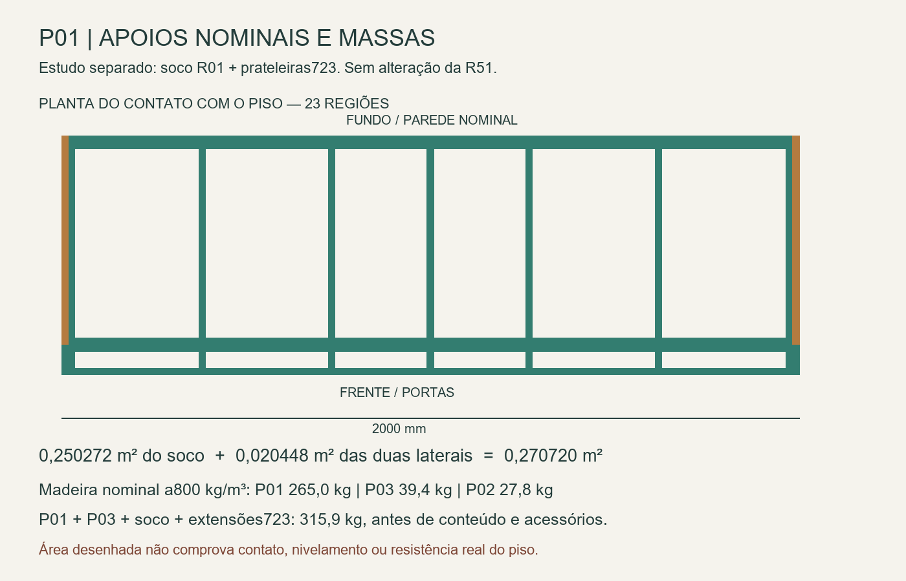

# P01 — massas simultâneas, piso e equilíbrio

25/10/2026. **O orçamento de massa precisa incluir as caixas superiores e o conteúdo simultâneo.** As47 madeiras visíveis do P01 somam265,0 kg na hipótese800 kg/m³, antes das ferragens. Com o P03, soco proposto e extensões723, a parcela conhecida passa a315,9 kg nessa mesma hipótese, sem conteúdo, espelho ou ferragens. São massas calculadas por volume nominal; não são pesagens.

R51 preservada. Este bloco reutiliza o [soco R01](../Apoios_ao_piso/README.md) e as prateleiras723 separadas; não cria uma nova revisão do CAD nem muda sua aparência ou movimentos.

## Inventário reconciliado

| Madeira nominal visível | Peças | Densidade650 | Densidade800 | Densidade900 |
|---|---:|---:|---:|---:|
| P01 inferior, portas e caixas das gavetas | 47 | 215,35 kg | 265,04 kg | 298,18 kg |
| P03 maleiro reto, incluindo portas | 7 | 32,01 kg | 39,40 kg | 44,33 kg |
| P02 canto superior emL | 10 | 22,62 kg | 27,84 kg | 31,32 kg |

Soco21 peças:11,169 kg a800; extensões das duas prateleiras705→723:0,285 kg. Os volumes BREP incluem os recortes efetivamente modelados. Não há margem uniforme de espessura nem desconto adicional por revestimento: os números precisam ser substituídos pela composição real do painel na consolidação de peso.

Foram excluídos ferragens, varões, gabaritos, eixos e auxiliares ocultos. No P02, contam as frentes usinadas visíveis, sem duplicar os painéis-base e os cilindros ocultos dos canecos. Um STEP metálico com volume não permite inferir a massa do produto comercial. A lista inteira de inclusões e exclusões está em [Geometria_R51.json](Geometria_R51.json).

Os quatro grupos de gaveta ainda têm texto `Ferragem` citandoMOVENTO500, enquanto a seleção documental éFGVTN500. [Quatro correções textuais propostas](Correcoes_metadados_propostas.json) deixam essa diferença explícita para a futura consolidação, sem alterar a fonte, a geometria ou o curso de estudo. Não usar o texto antigo como confirmação comercial de curso ou capacidade.

O espelho lateralPeca275 está fora do móduloP01, como reserva500×1800×5. A hipótese2500 kg/m³ daria11,25 kg de vidro; o cálculo compara ausência/presença dessa parcela, sem declarar material real, adesivo ou instalação. A ferragem extra0/10 kg é outra sensibilidade, com CG hipotético explícito, e não orçamento fechado.

## Caixas superiores e área de apoio

Há **oito contatos de face emZ2132** entre P01 e P03/P02. P03 encontra a lateral esquerda/continuação frontal, a divisória central e a travessa frontal; P02 encontra a lateral direita/continuação frontal e a travessa. Isso comprova contato nominal, não a distribuição das cargas ou capacidade da travessa. O fundoP01 termina emZ2114 e não foi transformado em apoio direto de caixa emZ2132.

Os cenários tratam P01+P03 como um corpo rigidamente ligado e comparam P02 independente com P02 totalmente ligado. Essa comparação não limita todas as possíveis reações de uma ligação real: a interface pode transmitir também torção, forças horizontais e pares. O balanço do retorno emL precisa de cálculo próprio e juntas demonstradas. Portas doP02/P03 permanecem na pose atual neste bloco.

O soco acrescenta0,250272 m² de apoio nominal. As duas laterais originaisP206/P207 já chegam ao piso e acrescentam0,020448 m². **Área total nominal da proposta:0,270720 m², em23 regiões sem sobreposição.** O relatório anterior calculava as21 peças acrescentadas; essa soma não incluía as duas laterais já existentes. Contato real, calços, inclinação e compressão do acabamento continuam desconhecidos.

## Cargas simultâneas e movimentos

São4608 combinações aritméticas: três densidades, P02 ligado/independente, vidro ausente/presente, massa adicional0/10 kg, três níveis de conteúdo,16 combinações das quatro gavetas e quatro posições extremas das duas portasP01. [Resultados compactos](Resultados.json) guardam colunas/linhas e72 envelopes. As gavetas usam o curso nominal500 conferido na fonte e deslocamento global−Y; as portas deslizam965 em sentidos opostos. A fonte não foi animada.

| Conteúdo hipotético | Nível1 | Nível2 |
|---|---:|---:|
| Seis sapateiras, total | 30 kg | 60 kg |
| Duas prateleiras723, total | 20 kg | 40 kg |
| Dois varões altos, total | 20 kg | 40 kg |
| Dois varões baixos, total | 10 kg | 20 kg |
| Quatro gavetas, total | 20 kg | 40 kg |
| P03, total | 10 kg | 20 kg |
| P02, quando ligado | 10 kg | 20 kg |

Nível0 vazio; nível1 soma110 kg semP02 ou120 comP02; nível2 soma220/240 kg. Esses valores permitem investigar simultaneidade. **Não são cargas autorizadas por compartimento.** Nas gavetas, o conteúdo é concentrado numa posição frontal hipotética; roupas nos varões têm CG nominal definido no código. Não se modelaram pessoas apoiadas, escalada, impacto, vibração nem redistribuição das roupas.

As combinações de portas/gavetas são envelopes matemáticos. Algumas podem ser bloqueadas fisicamente pelas portas; não representam4608 montagens operáveis ou ensaios de colisão. O equilíbrio global também não prova a flexão de todas as chapas e juntas sob conteúdo simultâneo.

## Resultado e limites práticos

No exemplo a800, P01+P03+soco+723 sem conteúdo/ferragens/espelho pesa315,9 kg e pressiona nominalmente a área total em média11,44 kPa. No exemplo a900, P02 totalmente ligado, vidro hipotético, massa adicional10 kg e conteúdo nível2, a massa chega a648,0 kg, média23,47 kPa. Com só25%/5% da área efetivamente apoiada, essa média da parcela de contato subiria a93,89/469,44 kPa. Nenhum desses números é resistência admissível de vinil, contrapiso, MDF ou estrutura do edifício.

Os cenários anteriores de200–500 kg eram parâmetros, não estimativa fechada:500 kg não cobre automaticamente todos os cenários desta rodada. Não aumentar simplesmente a carga autorizada porque o modelo matemático suporta uma massa maior.

Os momentos gravitacionais calculados permanecem estabilizantes no retângulo de apoio dos casos analisados, inclusive com as quatro gavetas estendidas. Isso depende do conjunto rígido e dos contatos pressupostos; não dispensa retenção antitombamento. A força horizontal equivalente registrada no JSON apenas zera um momento desse corpo rígido a2440 de altura. Não inclui deslizamento, ruptura, efeito dinâmico ou teste normativo e não é limite de força seguro.

Três exemplos também têm modelo de corpo rígido sobre leito uniforme por área, unilateral em compressão, com equilíbrio e amostragem48/96. No cenário648 kg, a pressão máxima amostrada desse **leito ideal** é29,01 kPa, não a concentração real junto aos calços. O modelo distribui resultantes pelas23 regiões para comparar caminhos; não comprova rigidez da caixa nem contato contínuo do piso. Não dimensionar calços ou acabamento por esse máximo idealizado.

## Próximas perguntas exatas

**Caminho superior desenvolvido depois deste inventário:** [estudo P01/P03](../Caminho_superior_P03/README.md) demonstra contato traseiro sem reduzir vãos, mas não encerra a base18 no modelo reduzido. O acréscimo nominal0,850kg desse novo estudo não está somado aos cenários acima, que mantêm a geometria-baseR51.

1. **Projeto/oficina:** quais ligações fazem P03 e o retornoP02 descarregarem emP01, incluindo torção e carga na travessa superior frontal? Demonstrar baseP03, apoio da lateral direitaP03 e os caminhos até as laterais/divisórias inferiores; os oito contatos não fecham o cálculo.
2. **Produto:** qual a massa efetiva dos quatro pares FGVTN500 com travas, dos sistemasRO62/perfis, varões/suportes, conectores, vidro/adesivo e demais acessórios? Dar massa do conjunto instalado e seu desenho; não converter volume de gabarito em peso comercial.
3. **Projeto:** acoplar as cargas simultâneas às chapas, juntas e reação das divisórias; os cálculos locais anteriores permanecem parciais. Definir retenção antitombamento sem tubos e com acesso de montagem.
4. **Elias:** revisar o soco frontal visível e as necessidades de armazenamento antes de incorporar. Não houve concessão de vão nem alteração de movimentos nesta rodada.
5. **Após as chaves, responsável técnico/oficina:** conferir piso/nível/parede, contatos e método de nivelamento/proteção. Qual a compressão sustentada admissível e o detalhamento de apoio para o acabamento real? A carga da estrutura do edifício não se resolve dividindo o peso apenas pela área de madeira em contato.

Sem contatos enviados a terceiros ou ensaios físicos. Reproduzir com `python calcular.py`; [extrair.py](extrair.py) é somente leitura no FreeCAD. [Verificação](Verificacao.json) confere massas, equilíbrios, monotonicidade dos movimentos, áreas, contatos, hashes e fonteR51; não valida dados físicos ausentes.
