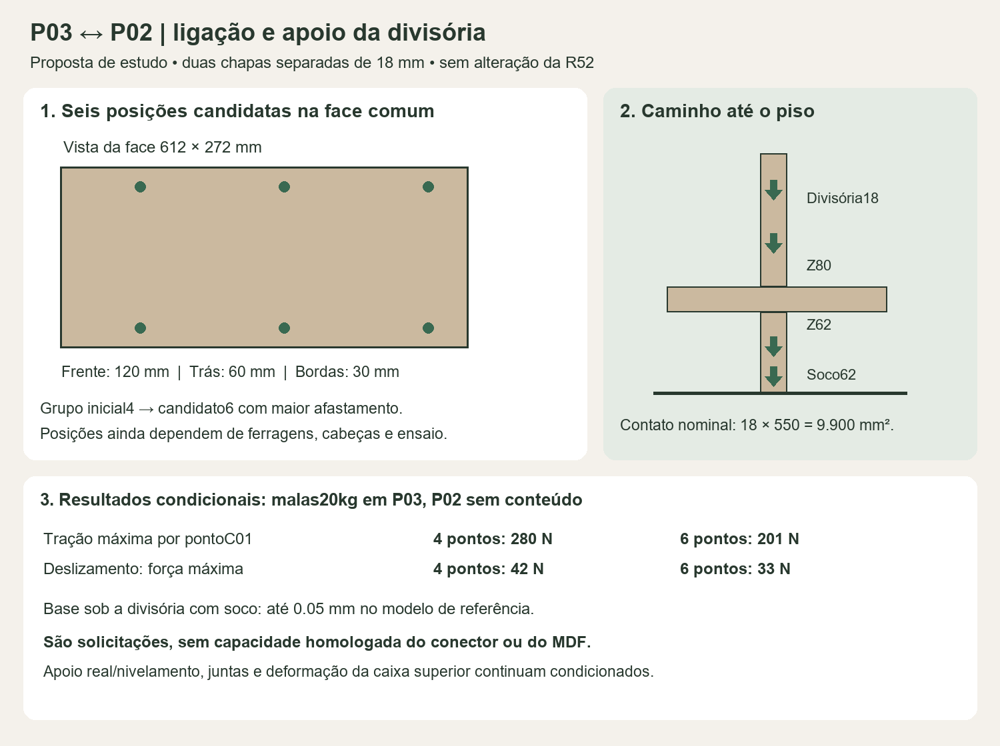

# P03 — maleiro para duas malas de bordo

**Estado em 25/10/2026:** A é a direção escolhida por Elias: duas portas 672×306×18, Arenza liso. Autorização de aplicar **se atender**, ainda condicionada. Nenhuma fabricação/capacidade 20kg demonstrada ou alteração na R52. 20kg significam as duas malas completas, incluindo suas carcaças e bagagens.

## Ligação P03–P02 e divisória até o piso

**Resultado:** o soco alinhado sob a divisória cria um caminho nominal por compressão até o piso. Para C01, seis posições mais afastadas reduzem a solicitação por ponto e são o candidato a desenvolver. Isso ainda não resolve a deformação da caixa superior nem comprova o produto/fixação. Não adotar seis conectores como quantidade homologada.

### C01: duas chapas 18, ligação passante candidata

Face comum entre Peca259/P03 e Lateral Apoio Principal/P02: 612×272, plano X6740. As duas peças físicas 18 totalizam 36; não são uma chapa de duas cores. Não usar Confirmat 50 aqui: ultrapassa essa espessura. A família Confirmat 7×50+cavilha 8×30 continua candidata para encontros apropriados de topo/aresta das caixas, sem atribuir a mesma capacidade à ligação de face C01.

Comparação central: malas 20kg em P03; P02 sem conteúdo, mas com sua madeira/faixas e duas portas 2kg; P03 com duas portas 4kg. Incluem-se portas fechadas/abertas e quatro distribuições das malas. Rigidez por ponto C01=500N/mm é **hipótese**, não propriedade publicada do conector.

| Grupo de estudo | Tração máxima por ponto | Cisalhamento máximo por ponto |
|---|---:|---:|
| Quatro posições anteriores, altura entre linhas 152 | 279,59N | 42,00N |
| Seis posições com maior afastamento, altura 212 | 200,98N | 32,88N |

Máximos não necessariamente simultâneos; sem majoração/impacto. São solicitações de cálculo, não capacidades ou carga de uso. A tração para separar as faces governa a comparação; não basta dividir o peso por seis. Não se contou atrito do aperto. Contato normal só de compressão, parafusos transmitem cisalhamento e abertura.

**Seis eixos candidatos**, sem CNC: X6740; combinações Y3430/3646/3862 com Z2180/2392. Primeira linha 120 atrás da frente da face, última 60 antes do fundo; 30 às bordas superior/inferior. Afastar da frente é intenção de compatibilização, **não comprovação** de folga das dobradiças/cabeças/ferramenta. Conferir os corpos reais e reforços/furos existentes antes de usar essas posições.

Família candidata: [luvaM4 Häfele](https://www.hafele.si/en/product/threaded-sleeve-with-m4-internal-thread-steel/P-00861539/) e parafusos/cabeças correspondentes. Furo 5 publicado; 267.00.914: comprimento 25/conjunto 31–36; 267.00.916: 30/36–40. Duas chapas 18±0,3 somam 35,4–36,6: **medir**, um SKU não cobre ambos extremos. Fonte 25/10/2026; disponibilidade local, cabeças/parafusos, aperto, engajamento e capacidade MDF pendentes. A ficha acessada continha aviso de produto, sem resistência de junta. Rosca/diâmetro não comprovam capacidade.

[Solicitações por conector/caso](Ligacao_C01_solicitacoes.csv),8064 linhas, distinguem configurações/poses/conteúdo e triagem linear. [Consulta técnica preparada, não enviada](Consulta_ligacao_C01.txt). Necessário confirmar o conjunto completo e ensaiar tração/cisalhamento combinados, abertura/escorregamento, esmagamento sob cabeças e comportamento sustentado na chapa efetiva. Não definir aperto ou resistência por densidade hipotética.

### Divisória: carga atravessa a base antes do piso

Geometria nominal atual: divisória P210 em X6381–6399/Y3372–3922, base inferior Z80; base P209 em Z62–80. O soco proposto permanece separado do CAD, com altura nominal 62 e alinhamento sob a divisória. O contato completo 18×550=**9900 mm²** é formado por três peças: 18 da longitudinal frontal, 514 da travessa `Soco_transversal_4_caixa` e 18 da longitudinal traseira. Não há pilar terminando no vazio nessa proposta.

Com as hipóteses centrais e P02 sem conteúdo, o pé da divisória recebe até **645,72N**, incluindo seu peso e a transferência pelas juntas com o fundo. O deslocamento da base no ponto sob o centro da divisória fica até **0,050mm**, ou cerca 0,054 com P02 carregado nos casos adicionais. 645,72/9900 dá 0,065MPa de média **se** toda a área atuar; não é pressão máxima nem resistência admissível de MDF, vinílico ou contrapiso.

O resultado depende do apoio efetivo. Com piso por área variado 0,1–10N/mm³, a resposta central fica aproximadamente 0,01–0,32mm. Uma folga 0,2 sob a travessa central aumenta para 0,22; com folga 1,0, a resposta chega 0,40 e essa travessa não encosta nos casos principais. A carga passa por outras peças/juntas. **Prever ajuste/nivelamento que dê contato real**, além de proteção da madeira e posicionamento do soco; não aceitar a altura 62 como medida de corte final antes do levantamento.

Sem soco, a base sob a divisória chega matematicamente a 7,80mm no cenário principal e grande parte da carga segue pelas juntas com o fundo. O conjunto superior excede a hipótese linear: isso é alerta, não previsão física ou caminho validado. O soco preserva as cotas/vãos internos, mas sua aparência frontal 62 permanece para revisão antes da incorporação. [Detalhe e estudo de apoios](../P01/Apoios_ao_piso/README.md).

### Caixa superior e limites que permanecem

No candidato de seis posições, base 18, soco nominal e P02 sem conteúdo, o máximo absoluto da base P03 varia **8,05→8,30→8,46mm** ao refinar as malhas. São deslocamentos incluindo apoios, não só flecha relativa da chapa. A tração máxima por ponto varia 201→187→171N: não há convergência local de resistência demonstrada; 201 é a maior amostra desse grupo, não limite garantido. Na comparação base 25+apoio traseiro+seis posições, a resposta central P03 cai para 5,19mm. Nenhuma dessas contas comprova as juntas de 1/2mm das portas ou seleciona 25mm.

Os cenários adicionais com 20kg no centro/ponta de P02 investigam a transferência inversa; alguns ultrapassam amplamente pequenos deslocamentos, incluindo P02. Não são recomendação de 20kg no retorno nem esforços finais para dimensionar conectores. O acoplamento não transforma P02 em apoio rígido nem autoriza somar os estudos antigos. Para encerrar: fixar o uso/carga P02, comprovar juntas/C01 e deformação/alinhamento da caixa, validar corpos de ferragens/manuseio e somente então integrar CAD/fichas.

### Modelo e conferência

**18×96=1728 casos:**16 combinações P03×três conteúdos P02 (zero/20 centro/20 ponta)×duas poses P02. Base/topo L contínuos, 506100 mm² cada; fundos sem junta fictícia na aresta. P01 tem base/frente separadas, laterais/divisória/fundo em cascas, juntas e contatos de compressão. **Fundo P01 inteiro assumido:** não cabe na chapa 2750×1850; fornecimento/emenda estrutural e sua rigidez pendentes. Receptores superiores em seções planas; extensões frontais equivalentes. Sem flambagem, retenção ou envelope de todo P01 carregado.

MDF isotrópico, E1100 diferido hipotético, 17,7 resistente/18,3 massa, rho800, ν0,30; portas P03 4kg/P02 2kg e rigidezes de juntas/piso são hipóteses. Excluídos prateleiras/gavetas/varões, conteúdo restante P01 e peso das extensões laterais. Sem impacto/fluência medida. Triagem linear interna, não aceitação do produto.

Conferidos: equilíbrio global, cortes P02/divisória, CSV e área/CG/rotação rígida da chapa L. Resíduos globais≤1,63e−5Nmm/P02≤4,73e−5Nmm/divisória≤8,3e−9N. Último refinamento altera deslocamento P03 em 1,95% e tração 8,36%: sensibilidade local pendente. Hash R52 preservado sem abrir CAD.

[Resultados](Ligacao_P02_P03.json) · [conferência e geometria](Verificacao_ligacao_P02_P03.json). Reprodução: `python -B ferramentas/roupeiro/ligar_P02_P03.py` e `python -B ferramentas/roupeiro/conferir_ligacao_P02_P03.py`. NumPy/Pillow; cálculo com um thread BLAS por padrão.

### Etapa anterior: caixa P03 isolada dos painéis P02

[464 casos anteriores](Caixa_20kg.json) · [CSV](Caixa_20kg_juntas.csv) · [conferência](Verificacao_caixa_20kg.json) · [prancha](Caixa_20kg.png). Prolongar base/topo 18 atrás (1314×612→1314×630) cria face com fundo, mantendo envelope 1350×650×308/vão 1314×612×272. R52 e A sem prolongamento só têm aresta. Apoio traseiro P01 exige elevar o fundo 18 e calço inferior.

Resultados anteriores não têm as mesmas condições do modelo acoplado. Longarina frontal 18×80 cruza reservas de guia/retenção P01; redução numérica não valida montagem. Coordenadas/conflitos no JSON; não recortar ou invadir roupas para apagar reservas.

Caixa fechada: 32 estações no CSV, exclui C01/P01/dobradiças. Base 25 comparada: 1314×630×25, fundo 1314×265×18, vão 265/sobra 15 para mala 250; parafuso inferior do calço fica 12 acima da base, contra 19. Reavaliar ferragens/acesso. 24,7 resistente/25,3 para massa, E2100 imediato/1050 diferido hipotético; não cria caixa interna 15. Scripts: `calcular_caixa_P03.py` e `conferir_caixa_P03.py`.

## Chapa e acabamento

**Regra de Elias em 25/10/2026:** mesma chapa física, mesmo padrão nas duas faces. Duas peças separadas podem combinar externa 18 no padrão do projeto e interna 15 BrancoTX; identificar ambas e conferir 33mm/ligações/cargas. Não presumir caixa dupla. No P03 atual não há caixa interna 15 contínua; o estudo mantém Arenza nas duas faces de cada peça única.

Base de produto: MDFBP Greenplac convencional 18 para ambiente seco, ArenzaColore/Lizze, liso areia/fendi. Confirmar SKU/substrato/lote e bordas. Chapa 2750×1850 publicada 63,2kg: folha 672×306 equivale a 2,554kg brutos; mantida hipótese 4kg acabados por porta. 15mm não foi adotado: caneco mínimo 13 deixaria 2 nominais. HR18 tem outra textura/massa, sem ganho comprovado. Fontes: [Arenza](https://greenplac.com.br/products/mdf-arenza-linha-colore) e [requisitos Greenplac](https://download.greenplac.com.br/download/qualidade-requisitos-normativos-e-cuidados.pdf).

[Mapa das sete peças](Chapa_P03.json) · [prancha](Chapa_P03.png) · [consulta técnica, não enviada](Consulta_chapas.txt). Reprodução: `python -B ferramentas/roupeiro/especificar_chapa_P03.py`. O mapa 18 representa a base de estudo anterior à comparação 25, não corte final.

## Portas e dobradiças: direção A

Duas folhas 672×306×18, sem montante central. Juntas 2 nas laterais/centro e 1 acima/abaixo. Fechadas: esquerda X5392–6064; direita 6066–6738; Y3290–3308; Z2133–2439. Para manter profundidade externa 650, recuar 20 a frente das laterais/base/topo para Y3310. Não é troca só de portas. O contato frontal inferior com P01 diminui de 1314×82 para 1314×62mm.

**Conjunto candidato:** três 71B3550 + três calços 173H7100 + três limitadores 70T3553 por folha; total 6 de cada e 24 parafusos candidatos 3,5×15 (609.1500). Não é quantidade homologada para esta folha baixa/larga.

| Item | Referência confirmada | Pendência |
|---|---|---|
| 71B3550 | CLIP top BLUMOTION110°, caneco aparafusado, amortecimento desativável | Aplicação 672×306 e capacidade do grupo |
| 173H7100 | Distância 0, altura 8,5, aço, furação 37/32, parafuso Ø3,5 ou 4 | Cabeça/piloto/penetração e regulagens no MDF real |
| 70T3553 | Limitador 110→86°, em todas as dobradiças; instalar fechada antes do calço | Corpo, encaixe e batente físico |
| Centros atuais | Canecos 52/153/254 desde base da folha, extremos 202; calços 35/136/237 desde base interna 18, furos±16 | Corpos, ferramenta e fixação; comparação 25 muda afastamento inferior |
| Caneco | Ø35, K5, eixo 22,5 da borda, profundidade mínima 13 publicada | Pele nominal 5 se usinado 13; fresa/desvios/pilotos não definidos |

[Catálogo 76](https://publications.blum.com/2024/catalogue/en/76/) · [planejamento 77](https://publications.blum.com/2024/catalogue/en/77/) · [calço 152](https://publications.blum.com/2024/catalogue/en/152/) · [montagem dos limitadores](https://ea.blum.com/en/opening-angle-stops-for-110-and-107-hinges/). FD18/K5 dá folga mínima tabelada 0,8, mais 0,4 para ajuste+2; não substitui a varredura do conjunto.

O [guia de quantidade](https://ea.blum.com/en/number-of-hinges/) abrange 600 e extensão até 650 com adicional; 672 excede ambos. O [gráfico 718](https://publications.blum.com/2024/catalogue/en/718/) e as [condições 710](https://publications.blum.com/2024/catalogue/en/710/) não homologam MDF/folha baixa por equivalência de densidade. A fixação deve ser escolhida para o substrato real. Não adotar quatro por intuição, nem inferir superioridade de INSERTA71B3590 sem outro gabarito/evidência.

Porta 4kg: 39,227N verticais e 13,180Nm pelo braço 336. Com extremos 202, par equivalente 65,248N; não é esforço por parafuso ou capacidade. No protótipo conferir fixação, abertura/fechamento, alinhamento e batente. Desativar BLUMOTION regula amortecimento, não resistência.

[Detalhe atual das dobradiças](Dobradicas_A.png) · [dossiê](Dobradicas_A.json) · [consulta não enviada](Consulta_dobradicas.txt). Reprodução: `avaliar_dobradicas_A.py`, em `ferramentas/roupeiro/`. Centros antigos 79/227 e extremos 148 de `Detalhamento_portas.json` são comparação anterior, substituídos neste estudo prioritário pelos três centros acima.

## Passagem das malas e verificações geométricas

| Verificação nominal A, base 18 | Resultado |
|---|---|
| Uma folha 86°, outra fechada | Corredor reto 602,42; mala 550 deixa 52,42 totais |
| Ambas 86° | Corredor 1202,83; duas larguras 550+intervalo 20 deixam 82,83 totais |
| Altura entre madeiras | 272; mala 250 deixa 22. Base 25 comparada deixa 265/15 |
| Avanço da folha 86° | 656,69 ao quarto, em Z2133–2439 |
| Abertura parcial de uma folha |80°: 533,78; 84°: 579,43. Meta 570 atendida na primeira amostra 83,5° |
| Entrada |16 trajetórias: 550×250 e envelope 570×260, profundidades 350/380; sem tocar madeiras/frentes selecionadas |

Corpos das dobradiças, mãos, malas reais e tolerâncias estão excluídos. Exigir **570×260 efetivos** para a referência 550×250; é meta de projeto, não ensaio de pega. Não aplicar os 16 resultados diretamente à base 25 sem nova conferência de ferragens/altura.

Frentes: 13 pares/389077 combinações 0–86°/passo 0,5°, separação mínima amostrada 1,835. Sem recuo: seis encontros; com recuo: nenhum nos 22 painéis selecionados. Quatro barras conferidas em seis poses nativas, erro 1,08e−12. Não cobre todos os sólidos/STEP ou tolerâncias reais.

[Detalhe](Detalhamento_portas.png) · [dados](Detalhamento_portas.json) · [abertura A](Abertura_e_dobradicas_A.png) · [comparação](Comparacao_portas.png). Scripts: `detalhar_portas_maleiro.py`, `avaliar_abertura_A.py`, `avaliar_alternativa_650.py`. Os 72 cortes são só equilíbrio rígido. B650 com faixas/revestimentos fica secundária; também depende da proporção baixa e altera o interior.

Envelopes 550×350/380×250 incluindo saliências/expansor fechado, duas deitadas com 550 na largura. Referências: [Varro](https://samsonite.com.br/products/mala-pequena-varro-preta),2,6kg vazia; [C-Lite](https://samsonite.com.br/products/mala-pequena-c-lite-preta),1,9kg, envelope reorientado 55/25/38. Confirmar malas reais com rodas/alças; 10kg não fixa medidas.

Três envelopes cabem girando 550 para profundidade; acesso/30kg pendentes. Quatro não cabem nesse arranjo. Reserva frontal 32 é meta, não dimensão de dobradiça. Meta: duas malas; grande no baú da cama.

A caixa vigente de correr tem vão 1314×632×272/abertura lateral≈642. Reservas 20/4 sugerem altura 248; não são perfis reais RM025/RM023 nem reprovação do produto. Folha 237 não é altura de entrada. Basculante não desenvolvido.

[Arranjos](Malas_no_maleiro.png) · [hipóteses](Estudo_malas.json). Reprodução: `python -B ferramentas/roupeiro/estudar_malas.py`. A geometria vem dos dados salvos da [caixa superior](../Proximas_decisoes/P01_P03/README.md). As [reservas de correr](../../02_Modelo_3D/Componentes/Estudos/Correr_R14_2026-10-14/README.md) continuam hipotéticas. Nenhuma consulta foi enviada, compra feita ou alteração aplicada ao CAD neste estudo.
