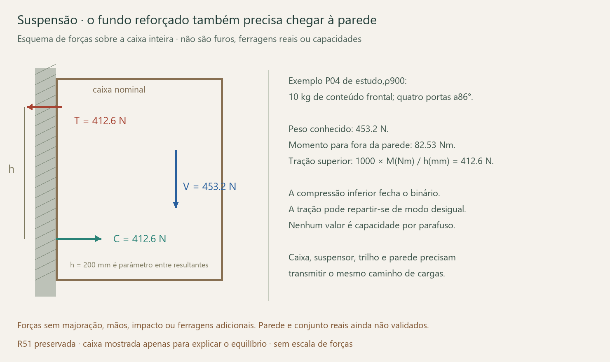

# P04/P15 — suspensão da caixa inteira e portas abertas

**Vigente 25/10/2026:** [P04: acesso e validação nominal](../../Aereos_suspensao/P04_validacao.json) · [desenho](../../Aereos_suspensao/P04_acesso_e_suspensao.png) · [conferência independente](../../Aereos_suspensao/P04_verificacao_validacao.json). Quatro acessos resolvidos no estudo com chave SW4 curta; suspensão candidata revista, 765 equilíbrios 3D/1530 vetores e seis casos de qualificação. R52 intacta; produto/juntas ainda sem ensaio físico.

## P04 — acesso e caminho da carga vigentes

**Preparação física para laboratório:** Elias, 25/10/2026: “Preparar para marcenaria/laboratório”. [Pacote de quatro páginas](../../Aereos_suspensao/P04_ensaios_laboratorio.pdf) · [retalhos T0](../../Aereos_suspensao/P04_retalhos_T0.csv) · [ficha vazia](../../Aereos_suspensao/P04_registro_laboratorio.csv) · [conferência do pacote](../../Aereos_suspensao/P04_verificacao_preparacao.json).

**Retomada 26/10:** Elias: “Ainda não; deixar o roteiro pronto”, sobre disponibilidade de oficina/material. Pacote reconferido: 4 páginas, 5 retalhos, 8 conjuntos Minifix e 15 registros vazios. Separar também 2 calços 173H7100, Allen SW4 Wera 80×22 e 1 Bigfer candidata. A oficina deve registrar chapa/espessura/fita, ferragens e ferramenta reais; depois conferir os 4 acessos com inserção, giro, retirada/reencaixe, folga mínima, contatos/danos e foto identificada por ID. Repetir com fundo/calços/suporte presentes, sem carga. Resultado T0 não comprova resistência; T1–T3 exigem protocolo próprio. Nenhuma execução física registrada.

Começar pelo T0 sem carga: cinco retalhos, recorte interno 200/externo 218×230×308, folga 7 e vão 272; oito Minifix reproduzem a montagem local e os quatro acessos críticos. Primeiro montar base/divisor/tampo em z; depois encaixar a lateral em u. Calços fixos mantidos, portas ausentes. Dimensões acabadas nominais, não corte bruto/CNC; material/fita/gabaritos/pilotos e instrumento reais devem ser conferidos pela oficina. O recorte não demonstra resistência da caixa 1800.

As 15 linhas de registro continuam **NAO_EXECUTADO**, com medições e replicação vazias. T1: juntas; T2: seis vetores de serviço do suporte; T3: caixa inteira. Laboratório define protocolo, replicação, cargas de prova/ciclos e critérios antes de aplicar carga. Nenhum contato externo, compra ou ensaio foi realizado. [Dados de preparação](../../Aereos_suspensao/P04_preparacao_ensaios.json). Gerador requer ReportLab/NumPy, disponíveis no Python embutido; conferência usa NumPy/pypdf.

Elias, 25/10/2026: “20 kg / 10 kg / 10 kg” na ordem P17/P04/P12, “Desenvolver os fundos inteiros” e “Base limpa, sem cabeças ou tampinhas aparentes”. No P04: 10 kg de edredom, fundo 1764×308×18, duas faces BrancoTX e fita inferior Arenza, conforme [premissas](../../Aereos_suspensao/Lote_B_premissas.json). Conjunto≈36,15–46,21 kg antes das ferragens; 24 Minifix e 36 Confirmat candidatos no mapa reconciliado, sem compra ou capacidade demonstrada.

**Quatro acessos:** corpo [Häfele 262.26.034](https://www.hafele.com.de/en/product/connector-housing-haefele-minifix-15-zinc-alloy-without-rim/26226034/) aceita SW4. A [Wera 950PKS,05133154001](https://www.weratools.com/en-ca/tools/950-pks-l-key-metric-chrome-plated) tem 4 mm e braços 80/22. Usar braço curto reto no caneco e longo como alavanca, cursos de até 60°, retirar e reencaixar 60°; curso final conforme travamento/instrução, sem torque inventado. Caixa antes das portas/dobradicas; manutenção com portas desclipadas, calços fixos mantidos. Sem mover divisória, abrir pela face inferior ou mudar B34.

Conferência exterior: perfil/dobra envolvido por 10 mm, janela−35…35°,71 orientações por acesso. Guarda 0,6982 mm cobre o intervalo entre ângulos; inserção/retirada envolvida continuamente, sem prescrever profundidade real do encaixe. O envelope tem 3,30 mm até o divisor, incluindo guarda. Reservados 30×30×20 para dedos. Oito calços R52 e os dois suportes candidatos entraram na verificação. Conferir retalho/chave/caneco reais antes da usinagem; não é ergonomia medida ou ensaio de ferragem.

**Suspensão:** Bigfer 04.02.058 no canto esquerdo original colide com Apoio OpostoR002. Proposta: face livre u25 desse divisor 18 e lateral direita u1764. Assentos u65,5/1723,5, Z250; apoio inferior hipotético Z90, braço 160. Preserva madeira/vãos; envelopes≈60 mL/par, sem deslocar fundo. O lado esquerdo passa a introduzir carga no divisor/fundo: não reutilizar o modelo do lote A só entre laterais. Dois suportes são hipótese de qualificação, sem suficiência demonstrada.

Nos cenários 10 kg, máximos separados por suporte: V283,64 N, T515,78 N, R586,26 N. Usar os [seis vetores controladores](../../Aereos_suspensao/P04_casos_qualificacao.csv), sem combinar máximos de casos diferentes. Partilha 0/50/100 é sensibilidade, não rigidez real. Contatos inferiores recalculados em 3D; fundo/laterais coplanares não garantem Z90/área 1080 mm². Parede/fixadores, centro de contato, retenção e massa/CG de ferragens continuam pendentes. Cada 1 kg extra em v200 acrescenta 9,807 N/1,961 Nm e 12,258 N à tração total para esse braço.

**Ligações:** Confirmat 7×50 candidato [Häfele 264.43.600](https://www.hafele.com/us/en/product/countersunk-connector-haefele-confirmat-countersunk-head-for-drill-hole-5-mm-sw4/26443600/), SW4, furo 5 publicado. Não define sozinho passagem/escareamento, piloto no MDFBP ou torque. Caracterizar retenção axial base/divisor, grupos laterais/traseiros e caixa inteira. K1000N/mm por posição da memória local permanece requisito hipotético; 25,6 N/ponto e 1,523 mm históricos não cobrem automaticamente a nova suspensão no divisor. Não somar rigidez de uma mesma ligação duas vezes.

[Roteiro para produto/oficina](../../Aereos_suspensao/P04_roteiro_validacao.txt): retalho de acesso, curvas de junta, corpos de prova e caixa completa em dispositivo rígido. Nenhuma consulta enviada, carga de prova normativa ou ensaio executado. Não atribuir capacidade ao equilíbrio. Reproduzir `python -B ferramentas/aereos/validar_p04.py` e `python -B ferramentas/aereos/conferir_p04.py`.

## Memória global anterior — P04/P15

[Lote A — P15](../../Aereos_suspensao/README.md) conserva 696 casos próprios. A memória abaixo preserva 660 casos históricos; os novos P04 têm a implantação e limites acima.

25/10/2026 · continuação do plano, sem tubos. **A demanda global de suspensão agora inclui caixa, portas em quatro barras e conteúdo.** Os resultados são solicitações estáticas a fornecer ao projetista da suspensão; não constituem capacidade da parede, do móvel ou de uma ferragem. R51 e seus controles permaneceram intactos.

O cálculo de flecha das bases continua nos [estudos de marcenaria sem tubos](../../Ligacoes_sem_tubos/README.md). Este bloco fecha outra conta: conteúdo → caixa → resultantes de suspensão → parede. A força num parafuso interno da base não é a mesma força no grupo que sustenta o móvel inteiro.

## Geometria e massa usadas

- **P04:** caixa 1800×230×308, base 1764×212, quatro portas 306 de altura. Foram usados os sólidos atuais com canecos descontados e as quatro divisórias 18 separadas. A pequena faixa de proposta visível entrou apenas na massa, sem crédito de apoio resistente.
- **P15:** caixa 835×330×580, base 799×312, duas portas 414,5×578. A variante de estudo acrescenta a segunda camada 18, laterais 598 e fundo 598; topo interno da base e armazenamento continuam preservados como no estudo separado.
- **P04 de estudo:** substitui somente o fundo 272 pelo fundo 308 na massa global; faces/dimensões da caixa e demais peças mantidas.

Comparadas densidades650/800/900 kg/m³. Como hipótese de massa, os volumes nominais 18 do BREP foram escalados por 18,3/18, aproximando a tolerância de espessura usada no primeiro estudo. Não é medida real, dimensão de corte ou produto escolhido. Acabamento, adesivo, suspensores, conectores e dobradiças ainda precisam de massas/posições reais e reconciliação para evitar duplicar camadas.

| Caso a ρ900, conteúdo nominal incluído | Geometria atual | Variante de estudo |
|---|---:|---:|
| P04 com 10 kg de conteúdo | 45,163 kg | 46,209 kg |
| P15 com 20 kg de conteúdo | 49,521 kg | 54,533 kg |

O reforço P15 acrescenta aproximadamente 5,012 kg nessa hipótese. Melhorar a rigidez da base aumenta a carga suspensa; essa carga adicional não pode desaparecer da conta da parede.

## Portas: reutilização do movimento existente

Não foram substituídas as dobradiças por uma rotação simples em torno de um pino. As três planilhas de quatro barras e expressões das seis folhas foram copiadas para um documento temporário próprio, sem copiar o modelo inteiro. Foram calculados 87 estados por folha, 0–86° em passos de 1°. Os centros fechados conferiram com os sólidos atuais; os controladores originais continuaram em 0° e o documento temporário foi fechado.

A distância máxima amostrada do centro da porta à face traseira foi 457,345 mm no P04 e 543,521 mm no P15. Foram combinadas aberturas independentes 0/86°, estado 45° e extremos amostrados de centro de massa. **86° é o curso de estudo existente, não um batente físico comprovado**, e a amostragem não certifica um envelope contínuo nem colisões da ferragem.

P04 tem meta 10 kg total escolhida por Elias em 25/10/2026; 5/2,5/2,5 nos três trechos permanece apenas cenário do estudo, sem distribuição pessoal definida. P15 usa cenário 20 kg total. Centros na faixa frontal/perto das extremidades são sensibilidades, sem capacidade demonstrada ou substituição da verificação local da base.

## Resultantes na parede

Para a gravidade conhecida:

`V(N) = soma(m(kg) × g)`; `M(Nm) = soma(m × g × v(mm) /1000)`; `T(N) = 1000 × M(Nm) / h(mm)`.

V é a força vertical total; M é o momento de tombamento para fora da parede; T é a tração total superior equilibrada pela compressão inferior. **h é a distância entre resultantes do binário**, não uma furação já definida. Foram comparadosh100/200/272 no P04 eh200/400/544 no P15; verificar se o produto e a caixa conseguem realizar a geometria escolhida.

O plano de reação foi tomado na face traseira nominal da caixa. Revestimento, folga ou afastamento real não foram medidos. Se o sistema introduzir um afastamento e em metros, o momento em Nm cresce V×e; recalcular a geometria, sem afastar o móvel silenciosamente para encaixar uma ferragem.

Dois grupos superiores recebem V conforme o centro de massa lateral, com vão entre resultantes de 100% ou 80% da largura da base. As posições são parâmetros de equilíbrio, sem centros de broca. A partilha de T entre lados depende da rigidez e do caminho dentro da caixa; foram comparados 100/0,50/50 e 0/100. Em cada lado, a compressão inferior correspondente fecha o binário. Esse modelo pressupõe capacidade de transmitir torção entre lados; não prova que as juntas reais já o façam.

| Variante de estudo, ρ900 | Portas | Conteúdo | V total | M | T total para h indicado |
|---|---|---|---:|---:|---:|
| P04, h200 | Fechadas | 10 kg distribuídos | 453,157 N | 55,992 Nm | 279,960 N |
| P04, h200 | Todas 86° | 10 kg distribuídos | 453,157 N | 74,582 Nm | 372,910 N |
| P04, h200 | Todas 86° | 10 kg frontais | 453,157 N | 82,525 Nm | 412,627 N |
| P15, h400 | Fechadas | 20 kg distribuídos | 534,787 N | 92,596 Nm | 231,491 N |
| P15, h400 | Ambas 86° | 20 kg distribuídos | 534,787 N | 108,178 Nm | 270,445 N |
| P15, h400 | Ambas 86° | 20 kg frontais | 534,787 N | 133,871 Nm | 334,678 N |

São forças sem majoração, mãos, puxões, choques ou massas de ferragens ainda ausentes. Não são limites admissíveis. Aumentar h reduz T, mas não dispensa resistência das peças, compressão na parede, acesso e geometria do suspensor.

No conjunto amostrado, com vão 80% e toda a tração num lado, as maiores resultantes num grupo superior são aproximadamente **500,79 N no P04, h200**, e **504,66 N no P15, h400**. Cada valor vem de um caso identificado no JSON, combinando seu cortante e tração; não se somaram máximos incompatíveis de casos diferentes. Para h100 no P04 e h200 no P15, os correspondentes envelopes chegam 872,68 e 768,58 N. O grupo não equivale a um parafuso: distribuição entre fixadores, efeito de alavanca, bordas, material e interação cortante/tração exigem projeto próprio.

## O que precisa ser resolvido com produto/oficina

1. **Suspensor completo:** qual código, desenho, faixa de ajuste, caminho de fixação à madeira 18, espaço ocupado por dentro e por trás, distância efetiva h e vão horizontal entre grupos? A comparação anterior da [suspensão](../../Inventario_dimensional/Inventario/Ferragens_fixas.md) continua válida: não inserir o SAH215 como se existisse a reserva posterior 16 mm, que a caixa não tem. Este cálculo não escolheu outro conjunto.
2. **Capacidade combinada:** o fabricante admite os vetores simultâneos V/T, a excentricidade e o esquema de instalação deste móvel? Informar forças, posições e caso; não comparar apenas o peso total com dois números emkg de catálogo. Exigir também retenção contra desengate e fixação do trilho, se houver.
3. **Caixa até o suspensor:** mostrar como base, fundo, tampo, laterais e divisórias recebem os grupos calculados. Demonstrar torção quando um lado recebe a retenção maior, tração nas juntas e compressão inferior. Os estudos de rigidez das juntas não são resistência publicada.
4. **Massa completa:** pesar/identificar componentes fixos e móveis e seus centros; usar as trajetórias próprias dos braços de dobradiça. Uma massa adicional 1 kg aumenta V em 9,807 N e M em 9,807×v(m) Nm; seu acréscimo a T depende de h. Não pôr toda a ferragem no centro da porta.
5. **Parede e trilho:** antes do corte final, identificar substrato, espessura, revestimento, instalações e condição real. Escolher ancoragem conforme esses dados e o conjunto de forças; **nenhuma bucha ou profundidade foi inventada**. Substrato é dependência do imóvel; desenho do suspensor, fixação na caixa e protótipo podem avançar antes das chaves.

Preservar profundidade, armazenamento, posição, acabamento e portas. Qualquer solução que exija afastar a caixa, ocupar vãos ou alterar faces precisa de estudo separado; nenhum quadro metálico foi usado para contornar a preferência sem tubos. Nenhuma compra, consulta externa ou fabricação foi executada.

## Evidências e reprodução

[CG e trajetórias extraídas](Geometria_e_portas_R51.json) · [660 casos globais e 72 envelopes paramétricos](Resultados.json) · [cálculo](calcular.py) · [verificação](Verificacao.json).

Identificada [correção textual de metadado](Metadado_a_reconciliar.json): o campo de movimento da porta vizinha ainda cita441,75 de largura, enquanto a peça atual mede440,25. O cálculo usa o sólido atual. Correção preparada para consolidação, sem alterar formas ou controles nesta etapa.

Executar `extrair.py` no FreeCAD com R51 aberta e folhas fechadas; a etapa das planilhas pode levar alguns minutos. O script cria e fecha somente seu documento temporário. Depois `python calcular.py` e `python verificar.py`. As etapas numéricas reutilizam as trajetórias salvas e não precisam reabrir o projeto. Conferidos massa constante durante a abertura, centros fechados, altura invariável das folhas, equilíbrio e escala 1/h, SHA256/CRC da R51. Zero ensaios físicos e nenhuma capacidade real liberada.

**Continuidade mais rápida:** [motor de cinemática fora do FreeCAD](../../../ferramentas/cinematica/README.md), validado com estas 522 poses e seis complementares R12. Usar nos próximos estudos; não repetir a extração pesada de planilhas para consultar outra abertura das mesmas folhas.
