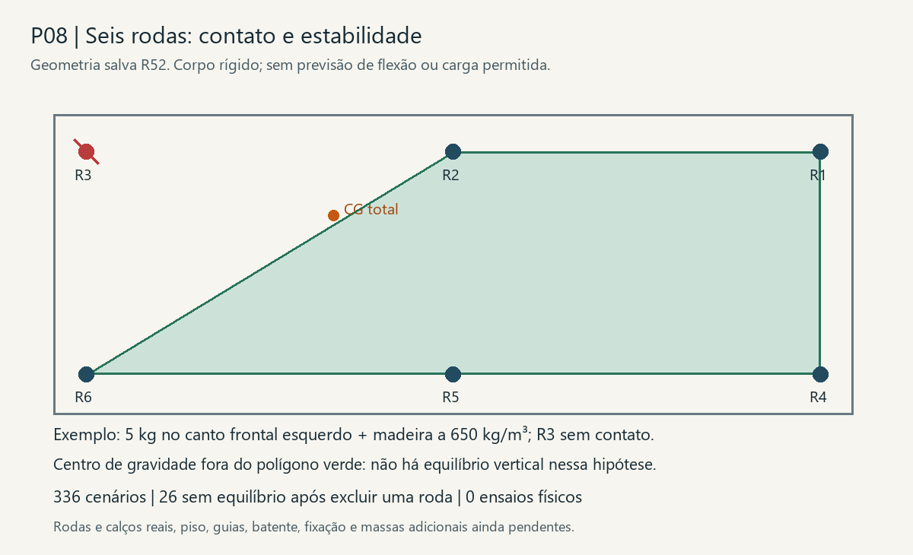

# P08 — reações dos rodízios e perda de contato

26/10/2026 · **336 cenários nominais; 26 sem equilíbrio após excluir um contato de canto.** Com os seis contatos disponíveis, os 48 cenários de carga admitem equilíbrio. Isso não demonstra que todas as rodas encostem, que dividam igualmente o peso ou que a gaveta resista. Zero ensaios; R52 preservada.

## Geometria e massa conhecidas

Mantida a [seleção de seis rodízios fixos de 38 mm e espaçadores de 1 mm](../../03_Ambientes/Cozinha/Rodizios_gaveta/Selecao.md). Lidos somente a base geométrica salva e o hash do modelo vigente, sem abrir FreeCAD. As seis peças de madeira são prismas cujo volume coincide com a caixa envolvente; seus centros foram calculados geometricamente. Rodas, calços, fixadores e objetos não receberam densidade de madeira.

| Item | Valor nominal |
|---|---|
| Contatos no piso, coordenadas globais | X 1724 / 2285,5 / 2847; Y 6528 / 6868; Z 0 |
| Distância entre extremos | 1123 × 340 mm |
| Madeira: frente, fundo e quatro paredes | 17,224344 litros |
| Massa a 650 / 800 / 900 kg/m³ | 11,196 / 13,779 / 15,502 kg |
| Centro da madeira X/Y/Z | 2285,5 / 6677,841 / 69,841 mm |

Os pontos são os centros inferiores das rodas idealizadas. A chapa e o eixo reais ainda precisam de medição. Massa de ferragens, calços, acabamento adicional e objetos continua ausente; não interpretar a massa de madeira como peso acabado. A frente adicional desloca o centro para a frente em relação ao meio do vão útil.

## Método e resultado

Sensibilidades de conteúdo **0, 5, 10 e 20 kg**, sem definir carga de uso: centro e quatro cantos do vão útil. A carga pontual em um canto é uma hipótese, não a posição demonstrada do centro de massa de produtos de limpeza. Cada combinação foi calculada com todos os contatos e com cada uma das seis rodas excluída separadamente: 48 combinações × 7 conjuntos = 336.

O modelo impõe soma de forças verticais e dois momentos, com reações não negativas. Como seis reações não se determinam por três equações, foram enumeradas as soluções extremas de equilíbrio com até três apoios ativos. Os mínimos e máximos de cada roda estão no [CSV](Reacoes.csv); as distribuições simultâneas que geram esses limites estão na [memória](Apoios.json). **Não somar os máximos individuais nem tratá-los como uma distribuição simultânea.** A rigidez do fundo, das rodas e do piso é necessária para prever a divisão efetiva.

Exemplo a 800 kg/m³, madeira + 10 kg no centro: peso conhecido 233,197 N. A fileira frontal precisa receber 121,438 N e a traseira 111,759 N. A roda central frontal pode, no limite de equilíbrio, receber os 121,438 N; dividir o total por seis daria apenas 38,866 N. Isso demonstra por que a divisão igual não é justificável sem rigidez/contato, não que a roda efetivamente receberá o máximo.

A maior reação individual encontrada é 277,733 N, dentro das hipóteses calculadas. Não comparar esse resultado diretamente com os 40 kg por roda do anúncio: capacidade dinâmica, fixação, madeira, piso, impactos e massas faltantes não foram qualificados.

**Perda de contato:** 26 cenários tornam-se inviáveis quando uma roda de canto é excluída. Exemplo da figura: madeira a 650 kg/m³, 5 kg no canto frontal esquerdo e R3 sem contato. O centro total fica fora do polígono dos apoios restantes. A gaveta teria de inclinar até recuperar contato ou encontrar outra restrição; o modelo não calcula esse movimento. Excluir uma roda não equivale a simular uma irregularidade específica do piso. As guias continuam sem função de apoio vertical.

## Caminho das cargas e próximas verificações

Conteúdo → fundo de 18 mm → chapa/espaçador integral → garfo/eixo → roda → piso. Frente e paredes transferem peso ao fundo pelas juntas; estas ainda precisam ser especificadas e verificadas. No contato vertical ideal, a chapa recebe compressão. Fixadores também precisam controlar deslocamento, desprendimento na retirada e esforços horizontais; não foram dimensionados pela reação vertical dividida por dois furos.

1. **Oficina:** pesar gaveta acabada e objetos; medir as seis alturas completas, confirmar contato e coplanaridade. Registrar reações ou contatos com configuração identificada, sem preencher resultados previstos como medições.
2. **Produto e fundo:** conferir gabarito real, piloto, profundidade útil no fundo de 18 mm e apoio integral do espaçador. Verificar flexão do fundo e rigidez das juntas antes de atribuir repartição aos seis rodízios.
3. **Guias e batente:** detalhar retenção lateral, remoção e parada usando força de operação e velocidade efetivas. Este estudo não valida esforço de puxar, impacto no batente ou pessoa apoiada na gaveta.
4. **Piso:** a geometria nominal vale para translação sobre um plano horizontal. Medir irregularidades e proteção do vinílico no local; ensaio de bancada pode anteceder as chaves. Não compensar automaticamente com mais rodas ou alterar o kit escolhido.

## Reprodução e conferência

Na raiz: `python -B ferramentas/rodizios/calcular_apoios.py`, `python -B ferramentas/rodizios/conferir_apoios.py` e `python -B ferramentas/rodizios/desenhar_apoios.py`.

[Verificação independente](Verificacao.json): 1292 distribuições extremas conferidas por forças/momentos diretos; viabilidade dos 336 casos conferida separadamente pelo polígono convexo; totais por fileira confrontados com a fórmula de alavanca. Equilíbrio é condição necessária, não resistência demonstrada.
