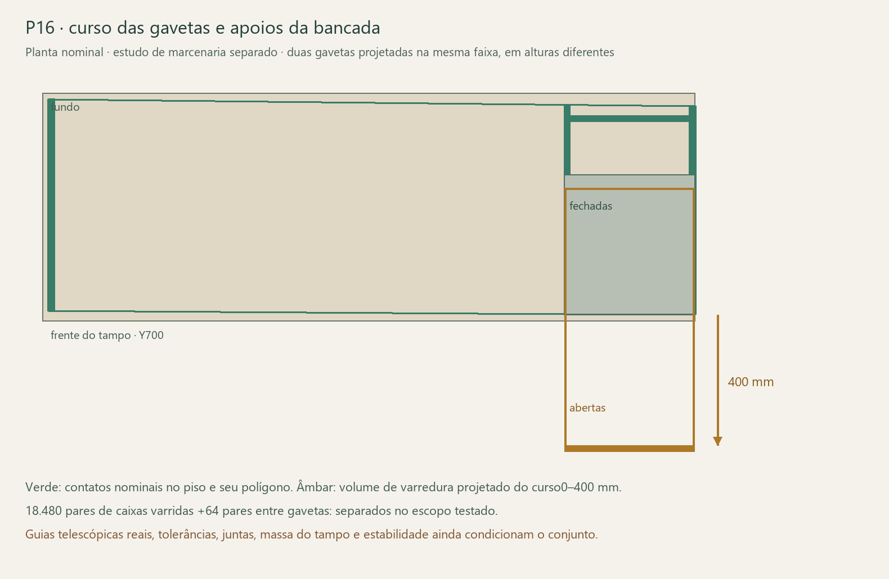

# P16 — movimento das gavetas e estabilidade da bancada

25/10/2026 · avançoT05/T02 sobre a [proposta de marcenaria da bancada](../../Bancada/README.md). **O curso nominal das gavetas cabe na proposta; a estabilidade exige ligação positiva e definição da massa real do tampo.** Análise separada, sem incorporar os painéis, alterar a R51 ou perder movimentos/armazenamento.

## Curso contínuo, sem alterar controladores

As duas gavetas percorrem400 mm em+Y global. Foram copiadas as12 peças de madeira e quatro travas e confrontados seus volumes de varredura com1.155 formas fixas: geometria visível da R51, retirando somente os apoios substituídos no estudo, e os cinco painéis propostos. **18.480 pares de caixas varridas ficaram separados.** Outros64 pares entre as duas gavetas também ficaram separados, inclusive com extensões independentes entre0 e400 mm.

Como as caixas varridas não se interceptam, esta é uma exclusão contínua conservadora para as formas incluídas; não depende de só olhar0/50/100%. Não se fizeram animações ou alterações no documento original. A frente sai deY682–700 paraY1082–1100; os vãos, frentes e o sentido de abertura continuam iguais.

**Escopo das guias:** os oito sólidos STEP das MOVENTO permanecem estáticos na modelagem atual e não representam o telescópio animável. Foram excluídos deste teste de curso; não podem ser usados como obstáculo rígido inteiro para simular a ferragem aberta. Engate da trava, telescópio real, furação, tolerâncias, deformação, mãos e retirada da gaveta ainda precisam de conferência própria. As sobreposições históricas0,125–0,175 mm fundo/guia continuam pendentes; não foram apagadas ou chamadas de resolvidas.

## Massa e dados atuais

As seis peças de madeira de cada gaveta foram extraídas dos sólidos com seus rasgos e cortes. Aρ800 hipotético, são3,354 kg na inferior e3,250 kg na superior, antes de travas, partes móveis das guias, acabamento efetivo e conteúdo. Não são pesagens.

A superior mantém a correçãoR49: laterais74 mm; traseira/dianteira interna47 mm;7 mm sob o tampo. Foi identificado um campo desatualizado:`Gaveta009.AlturaParedeSobreFundo` continua53 mm, embora a geometria seja47. A [correção de metadado](Correcao_metadado_preparada.json) está preparada para a próxima consolidação; R51 não foi modificada. O vão estimado54 mm é outra grandeza e não deve ser substituído por47 indiscriminadamente.

Os cenários seguintes aplicam **massa de conteúdo**, separada da madeira. Não representam carga útil liberada pela MOVENTO nem autorizam usar uma classificação comercial da guia como capacidade da bancada inteira. Peças fixas e móveis da ferragem precisam ser identificadas e pesadas; massas desconhecidas não viraram zero real.

## Dois caminhos diferentes de estabilidade

1. **Bancada toda ligada:** tampo, apoio esquerdo, travessa, pedestal e caixa trabalhando como um corpo rígido. O polígono de apoio usa as faces inferiores dos painéis propostos, sem os dois pés antigos.
2. **Pedestal independente:** laterais ampliadas, posterior do pedestal e três painéis fixos atuais do gaveteiro; sem creditá-lo como se já recebesse o peso e o travamento de toda a bancada.

Esta separação demonstra por que simples contato tampo–pedestal não prova o segundo caminho. As juntas e a retenção devem transmitir os esforços necessários para realizar o primeiro. Não se creditou fixação à parede, ao piso ou a outro móvel.

O cálculo testa o centro de massa e o momento restaurador em todas as arestas do polígono de apoio. Considera1296 combinações de densidade650/800/900, extensões independentes0/200/400, conteúdos0/5/10/20 kg nas combinações registradas e posição do conteúdo. Interior nominalY307–666: centro distribuídoY486,5 ou centro de uma faixa frontal50 mm emY641. Com o curso400, esses centros vão paraY886,5 e1041.

O tampo30 ainda tem constituição desconhecida. Por isso foram testados créditos de massa0/50/100% do paralelepípedo maciço, sem retirar o tampo da geometria ou selecionar composição. Aρ650,100% representa27,3 kg; é hipótese favorável de peso, não massa garantida. Equipamentos sobre a mesa não foram usados como contrapeso presumido.

## Resultados que orientam o fechamento

Aρ650, duas gavetas totalmente abertas, madeira própria incluída e sem massas de ferragens adicionais:

| Conjunto e crédito de peso do tampo | Conteúdo por gaveta | Posição | Menor momento restaurador |
|---|---:|---|---:|
| Bancada ligada;sem creditar peso do tampo | 5 kg | Faixa frontal | +51,154 Nm |
| Bancada ligada;100% do tampo maciço | 10 kg | Centro | +133,509 Nm |
| Bancada ligada;100% do tampo maciço | 20 kg | Centro | +93,256 Nm |
| Bancada ligada;100% do tampo maciço | 20 kg | Faixa frontal | +32,653 Nm |
| Bancada ligada;sem creditar peso do tampo | 20 kg | Centro | +5,831 Nm |
| Bancada ligada;sem creditar peso do tampo | 20 kg | Faixa frontal | **−54,774 Nm** |
| Pedestal independente | 10 kg | Faixa frontal | **−21,347 Nm** |
| Pedestal independente | 5 kg | Faixa frontal | +14,055 Nm |
| Pedestal independente | 20 kg | Faixa frontal | **−92,151 Nm** |

Sinal negativo significa que o centro de massa está fora do polígono nominal: aquele cenário não tem equilíbrio apenas por compressão no piso. Sinal positivo é somente condição de equilíbrio do corpo rígido, sem fator de segurança, resistência de juntas ou ensaio. Não é etiqueta de carga de uso.

No último cenário, uma retenção equivalente na linha traseiraY40, contra a frenteY680, precisaria aproximadamente **144 N** só para equilibrar a estática vertical. A distância640 mm é desta hipótese; uma ligação real noutra posição exige recalcular. Não é especificação de parafuso nem autorização para acrescentar lastro/ancoragem. O caminho pode ser pela união de marcenaria, mas precisa ser demonstrado.

Também foi calculada a força horizontal teórica em+Y na altura750 que esgotaria o momento frontal. No caso favorável do tampo maciço,20 kg por gaveta na frente deixam apenas43,54 N nesse modelo. Sem creditar peso do tampo e com20 kg centrais, o valor cai a7,77 N. São sensibilidades geométricas, não esforços normativos ou admissíveis: atrito, escorregamento, torção, deformação e instalação real não foram validados. Casos já instáveis recebem limite0 no resumo, sem interpretar razão negativa como força física disponível.

## Próximas operações independentes das chaves

**Continuação25/10:** [interface guia–fundo localizada](../Interface_guia_fundo/README.md). Separadas18 regiões de volume positivo:16 sob o fundo e duas junto aos furos traseiros direitos. Quatro furosØ6×10/eixo11 conferidos contra a receita do desenhoG2; o mesmo padrão4+5 também aparece na referência configurada. Causa/aceitabilidade e configuração individual400 continuam pendentes, agora com mapa e pergunta específica; não foram cortados fundos ou ampliados furos.

- **Tampo:** confirmar composição, peso por área e centro de massa reais, preservando espessura30 e acabamento. A massa necessária à estabilidade não pode ser deduzida só da caixa sólida do CAD, assim como sua rigidez não pode.
- **Uniões:** detalhar tampo–pedestal e pedestal–travessa/caixa para impedir separação e transmitir os esforços; comprovar caminho até o apoio esquerdo. Contato BREP e rigidez equivalente de cálculo não substituem fixadores reais. Não contornar a preferência sem tubos com outro quadro metálico.
- **Gavetas:** identificar massas fixas/móveis das guias, trava e variante exata; fechar altura/furação de montagem e o pequeno conflito fundo/guia com o desenho oficial. Manter frentes, curso, útil e folgas aprovados.
- **Uso/protótipo:** definir carga pretendida de cada gaveta e verificar combinação de gavetas abertas, carga excêntrica e esforços horizontais pelo responsável. Nenhum ensaio físico foi executado. Nivelamento, piso definitivo e eventual ancoragem real dependem do levantamento; produto, juntas e protótipo podem avançar agora.

Não adotar silenciosamente a proposta dos cinco painéis: ela altera aparência e espaço sob o gaveteiro e continua separada para revisão de Elias. A bancada atual da R51 e os movimentos permanecem intactos.

## Evidências e reprodução

[Geometria atual](Geometria_R51.json) · [conferência contínua de curso](Conferencia_movimento.json) · [1296 cenários de equilíbrio](Estabilidade.json) · [verificação](Verificacao.json) · [correção nominal preparada](Correcao_metadado_preparada.json).

No FreeCAD com a R51 aberta e gavetas fechadas, executar`extrair.py` e`conferir_movimento.py` por`runpy.run_path`, sem mover controles. Depois`python calcular_estabilidade.py`, `python verificar.py` e`python desenhar.py`. Verificadas972 identidades/monotonicidades independentes, disjunção contínua das caixas, hash/CRC e entradas dos cálculos. Não há resistência de juntas, capacidade de guia, ensaio normativo ou carga real liberados por esta etapa.
