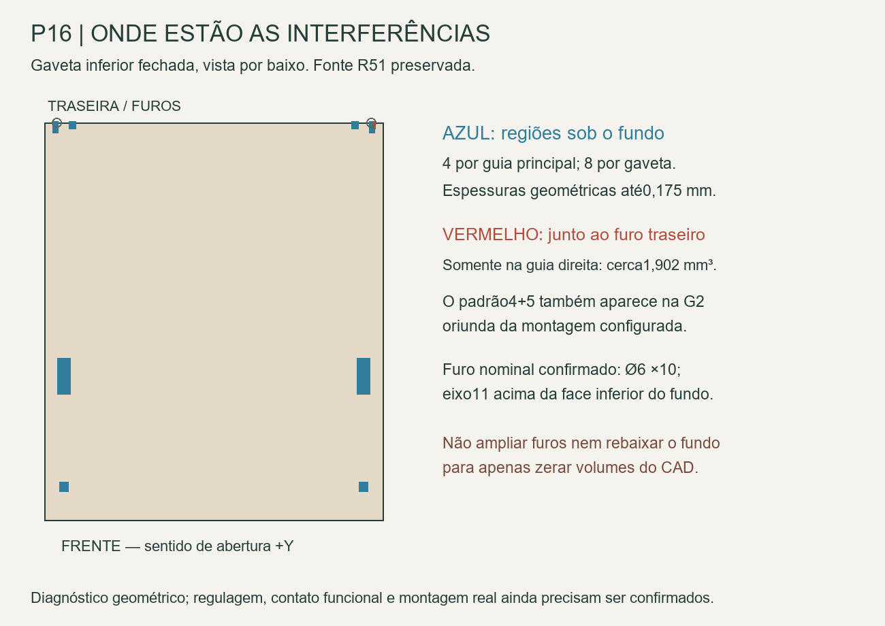

# P16 — interface do fundo com as guias

25/10/2026. **As cotas nominais dos furos foram conferidas; as interferências foram localizadas, sem cortar ou deslocar nada.** Há regiões sob o fundo e uma região distinta junto ao furo traseiro direito. O mesmo padrão aparece na montagem G2 proveniente do configurador, por isso não foi atribuído automaticamente a erro exclusivo da parametrização P16.

Este avanço complementa o [curso e estabilidade P16](../Gavetas_estabilidade/README.md). Não repete a varredura já concluída nem transforma guia STEP estática em telescópio animável. R51 completa, frentes, capacidade de armazenamento e movimentos preservados.

## Localização que faltava

O diagnóstico antigo usava também a caixa do resultado composto da interseção, que podia incluir contatos de superfície. Aqui foram separados **somente os sólidos com volume positivo**, com caixa ótima e validade próprias.

| Por gaveta | Guia esquerda | Guia direita |
|---|---:|---:|
| Regiões sob o fundo | 4 | 4 |
| Volume dessas regiões | 52,130 mm³ | 52,130 mm³ |
| Região junto ao furo traseiro | 0 | 1,902 mm³ |
| Volume positivo total | 52,130 mm³ | 54,032 mm³ |

As duas gavetas apresentam o mesmo padrão 4+5: 18 componentes no total, em quatro dos oito pares fundo–guia testados. Os quatro componentes adicionais das guias estabilizadoras não intersectam o fundo nessa pose.

Sob o fundo, os componentes têm espessuras verticais 0,125/0,135/0,175 mm e aparecem em apoios/projeções localizados. O maior componente de cada lado tem 39,815 mm³, em uma região de 10×32,785×0,135. Na inferior, a face inferior do fundo está em Z529; na superior, Z633.

A região do furo direito é diferente: na inferior ocupa aproximadamente X4656,916–4657,318/Y292–296,992/Z539,505–540,705. A superior tem as mesmas coordenadas XY e+104 em Z. A extensão Z1,2 dessa região curva não é uma “folga negativa” plana de 1,2 mm. Não generalizar o antigo intervalo 0,125–0,175 para esse encontro.

## Furos e referência oficial

Os quatro furos P16 têm **Ø6, profundidade 10, eixo 11 acima da face inferior do fundo e 12 a partir da borda lateral do fundo**; com encaixe 5 no rasgo, isso corresponde a 7 da face interna da lateral. Foram extraídas as superfícies cilíndricas reais no CAD, sem inferir a partir da caixa envolvente.

Esses valores coincidem com a receita do desenho configurado G2, página 4. O documento personalizado e seus prints ficam somente no acervo local. Para consulta pública, usar o [mapa das interseções](Mapa_intersecoes.png) e as [medidas extraídas](Referencia_G2_e_furos_P16.json). A referência G2 é NL500; a caixa P16 é uma proposta comum NL400, não configuração individual homologada. As páginas 2/3 confirmam o rasgo 5, fundo 15 e recuo 12 da referência; não se alterou a construção para eliminar o encontro.

A [orientação oficial de montagem Blum](https://ea.blum.com/en/building-a-movento-drawer/) também distingue dimensões da caixa, recuo e engate. Não foi usada para atribuir tolerância de interferência ou capacidade de carga. A busca localizou catálogo atual Blum com o furo Ø6×10; sua transferência integral pela navegação foi recusada por tamanho, sem tratar trecho de busca como prova completa de uma configuração P16.

Foi feita uma nova comparação **das regiões**, não só do volume antigo: G2 apresenta quatro componentes de um lado e cinco do outro, inclusive a região de 1,902 mm³ no furo. A soma dos sólidos positivos é 52,130033/54,032335 mm³, próxima dos 52,130038/54,032390 do P16. No composto direito G2, a integração global difere cerca 0,0025 mm³ da soma dos sólidos; ambos os números foram preservados, sem “corrigir” a fonte ou atribuir causa física a essa diferença numérica.

## O que ficou resolvido e o que falta

**Conferido:** localização das 18 regiões, distinção entre apoio inferior e furo, cotas dos quatro furos e presença do mesmo padrão na referência configurada G2. Isso permite formular uma pergunta específica; não comprova que a sobreposição seja tolerância aceitável, deformação prevista, regulagem neutra ou defeito do STEP.

**Pergunta para produto/oficina, pronta e não enviada:** “No conjuntoMOVENTO400 com as travas selecionadas e a caixaP16, quais são as posições de referência e regulagem do engate/apoios noSTEP? As quatro regiões inferiores de0,125–0,175 e a região traseira direita localizada no mapa representam contatos funcionais do modelo exportado? Confirmar a furação nominalØ6×10/eixo11 e a configuração individual400 antes de qualquer usinagem adicional. O mesmo padrão4+5 aparece na montagemG2 configurada anexa.”

Pedir também desenho de fixação/altura de cada guia, parafusos e tolerâncias da configuração real. O nível de regulagem pode alterar a caixa e suas folgas; não aplicar uma translação arbitrária de 0,175 para fazer o volume desaparecer. Mantêm-se a correção R49 da folga superior 7 mm e o espelhamento da trava direita, já encerrados.

Nenhuma montagem física foi ensaiada e nenhuma fabricação foi liberada. [Interseções](Intersecoes_localizadas.json), [referência G2 e furos P16](Referencia_G2_e_furos_P16.json), [classificação e hashes](Diagnostico.json) e [verificação](Verificacao.json). Extrações somente leitura no FreeCAD: `extrair.py`, `conferir_referencia.py`; classificação/diagrama: `python analisar.py`.
