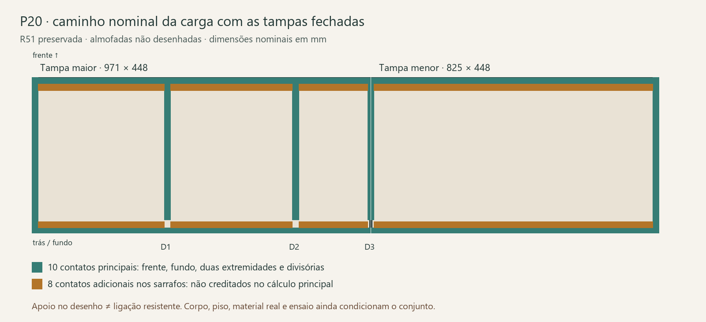

# Banco P20 — tampas fechadas e caminho até o piso

**Agenda 27/10, preparada em 26/10:** [kit de oficina](Roteiro_banco_cesto.md) com desenho, corte axial a completar e formulário vazio. Compra definitiva/montagem dependem de produto, suporte/terminais e ligações; busca dos códigos exatos Mahler/Bigfer sem oferta de varejo fechada. [Preços e evidência](../../Banco_e_cesto/Cesto_simples/Precos_e_conjunto_R01.md); sem novo cálculo ou ensaio.

**T04 — margens de engate, 26/10:** [sensibilidade conjunta](../../Banco_e_cesto/Cesto_simples/Conferencia/Resultado.md#margens-geométricas-de-engate--t04-26102026): 36 casos, 12 inversões conferidas. Engate hipotético de 290 mm com erro radial de 1 mm por terminal não é garantido até a parada existente; 291 mm não deixa reserva para variação. Dados reais da trava continuam pendentes. Não deslocar pontos ou ampliar abertura para absorver o erro; verificar produto e implantação antes dos furos.

**Pesquisa pública, 26/10:** [fichas Bigfer/Mahler reconferidas](../../Banco_e_cesto/Cesto_simples/Conferencia/Resultado.md). Não foram obtidos curso certificado de liberação nem dimensionamento da montagem horizontal. Consulta técnica refinada; pontos de furação continuam condicionais.

## Tampa aberta e montagem — 26/10/2026

[Resumo visual](Montagem_aberta.png) · [memória](Montagem_aberta.json) · [reações](Reacoes_abertas.csv) · [distância e ângulo da trava](Trava_distancia_angulo.csv) · [interfaces de montagem](Interfaces_montagem.csv) · [conferência independente](Verificacao_montagem_aberta.json).

Na parada nominal de 90°, **o articulador trabalha em compressão**, enquanto o cesto P14 exige tração. O cálculo inclui o peso da tampa e a posição lateral do articulador; a piano foi representada por dois grupos equivalentes nas extremidades da sua linha. Não são forças por parafuso nem uma distribuição comprovada ao longo da dobradiça.

| Cenário de madeira a ρ900, sem almofadas/metais | Tampa maior | Tampa menor |
|---|---:|---:|
| Massa hipotética do envelope | 7,830 kg | 6,653 kg |
| Compressão no articulador a 90° | 7,628 N | 6,473 N |
| Reação vertical total da piano sobre a tampa | 70,146 N | 59,482 N |
| Apoio lateral em relação ao centro da tampa | −74,5 mm | −390,5 mm |
| Força tangencial ideal para iniciar abertura pela frente | 38,548 N | 32,752 N |
| Energia gravitacional entre fechada e 90° | 18,360 J | 15,599 J |

O pequeno esforço estático a 90° não cobre puxões, fechamento, impacto, torção ou falha de engate. A força manual é teórica, sem atrito nem mecanismo dobrado; a pega real precisa ser definida. A energia não foi convertida em força de impacto. Seis equilíbrios, 42 poses de operação e dez sensibilidades de distância foram conferidos; massas e eixo reais podem mudar os resultados.

**Sequência nominal de montagem:** primeiro construir e conferir o apoio fixo da piano ligado ao corpo; montar uma seção de teste com a dobradiça real; medir eixo, folgas e cabeças; só depois montar a tampa, os terminais e a trava, com apoio externo durante a montagem. Conferir cada tampa separadamente, as duas juntas e o acesso para destravar. Almofadas retiradas durante abertura; conferir a acomodação da ferragem com elas colocadas.

**Três interfaces ainda exigem desenho/produto:**

1. Piano: a Ref.54 tem comprimento 1991 ± 1, largura aberta 30,8 e chapa 0,8 no desenho arquivado. Os segmentos 971/825 deixam pelo menos 194 mm antes de serra e acerto das pontas. Isso não define o nó, a relação eixo–face, parafusos ou apoio. O eixo X100/Z423,1 continua hipótese; a junta 2 mm junto ao encosto não é prova de instalação. O encosto desenhado é reserva, não madeira resistente já especificada.
2. Terminais: os eixos móveis do estudo ficam 22/30 mm abaixo da face inferior das tampas. O produto deve realizar esses afastamentos e distribuir a força na chapa, mantendo jarra, prateleiras, ferramenta e retirada dos objetos. Nenhuma adaptação foi aplicada ao CAD.
3. Trava: 291 mm é o limite de duas barras ideais 145,5, não distância de engate comprovada. Se o engate real fosse 288 mm, ocorreria perto de 88,70°; em 290 mm, 89,57°. Confirmar curso/modo de liberação e resistência em compressão antes de definir o batente. O modelo não oferece extensão reta adicional além de 291 mm.

Fontes relidas: [Mahler Ref.54](../../Banco_e_cesto/Cesto_simples/Conferencia/Fontes/Mahler_54_2000.pdf) e [Bigfer p.112](../../Banco_e_cesto/Cesto_simples/Conferencia/Fontes/Bigfer_112.pdf). São desenhos arquivados, sem dados novos de capacidade. Geometria das duas tampas reconciliada com a base R52 salva, sem abrir CAD.

Reproduzir na raiz: `python -B ferramentas/aereos/detalhar_banco_aberto.py` e `python -B ferramentas/aereos/conferir_banco_aberto.py`. Teste físico e montagem comercial continuam pendentes; o assento fechado segue abaixo.

25/10/2026 · leitura da R51 completa, sem alterar peças, cores, armazenamento ou movimentos. Continuação do [primeiro ciclo de cargas](../../Cargas_e_ligacoes/README.md) e da [conferência dos mecanismos simples](../../Banco_e_cesto/Cesto_simples/Conferencia/Resultado.md).

**As tampas podem ser estudadas sobre os apoios de madeira existentes, sem acrescentar tubos. A nova análise trata o assento fechado; não libera o banco para pessoas.** O requisito histórico de três pessoas de 80 kg é cenário de projeto, não capacidade comprovada nem carga de ensaio normativo. As ferragens de abertura continuam sendo outra verificação.

## O que o modelo atual realmente apoia

São **18 contatos de face** entre tampas e corpo: 12 na maior, 6 na menor. Destes, 10 pertencem às paredes/extremidades/divisórias e 8 aos sarrafos de madeira 18×126. A amostra de nove contatos do primeiro ciclo era selecionada, não o inventário completo; a conferência R45 já registrava os 18 e foi reutilizada como comparação. A extremidade direita `Peca406AtualR31` também apoia a tampa menor.

O cálculo principal **não credita os sarrafos**: suas ligações ainda precisam de demonstração. Eles entram somente numa comparação adicional. Não se atribuiu carga de pessoa à piano ou aos articuladores: com o banco fechado, o caminho é tampa → paredes/divisórias → apoios inferiores → piso.

A leitura BREP encontrou 42 interfaces internas de face nas 21 peças selecionadas do corpo resistente. Há sete regiões nominais no piso, somando 0,100764 m². Isso descreve geometria; não comprova distribuição no piso real nem resistência das juntas.

- Frente, lateral esquerda e extremidade direita chegam ao nívelZ0.
- Fundo começa em Z18 e tem o calço `Ref_Apoio_B04R31` até o piso.
- Primeira divisória termina em Z80 e encontra diretamente `Ref_Apoio_B01R31`.
- Divisórias seguintes terminam em Z100 sobre a base 18; os apoios B02/B03 chegam ao Z82 sob essa base. A compressão atravessa a base; não é uma divisória suspensa apenas por parafusos.
- As divisórias começam em X140; o fundo termina em X118. Existe separação de 22 mm entre eles. Não inventar uma união traseira direta ou contar com ela para travamento lateral.

## Constituição e hipóteses da chapa

O envelope visível das tampas continua **448×971×20 e 448×825×20 mm**. A direção histórica de compensado estrutural 18 com acabamento contido nos 20 é preservada como requisito de fornecimento. O cálculo usa **núcleo mínimo 17,1 mm**, sem creditar acabamento na rigidez. Não se tratou a caixa 20 do CAD como 20 mm de madeira estrutural.

Ritz de placa fina, ν=0,30 e **E isotrópico equivalente 5500 MPa** são hipóteses de comparação. O fornecedor deve informar rigidez nas duas direções, cisalhamento/torção, orientação e composição reais. Dois valores de MOE publicados para um compensado não bastam para atribuir automaticamente esta matriz isotrópica. A verificação final deve usar a ortotropia do painel escolhido.

Contatos permitem apenas compressão e podem se separar. Linhas discretas ficam no centro das faces nominais, sem engaste. Os apoios do corpo são rígidos nesta etapa; acrescentou-se **reserva de 0,20 mm** para seu assentamento, que é requisito a comprovar. Desnível/tolerância podem mudar quais apoios encostam. Massa própria é uma aproximação do volume acabado×900 kg/m³, sem pesagem ou composição real.

## Resultados da triagem

Massas aplicadas em regiões 200×200 mm, herdadas do estudo anterior. Sem atribuir à almofada distribuição adicional. E equivalente 5500; valores abaixo incluem a reserva de 0,20 mm do corpo.

| Cenário | Flecha + reserva |
|---|---:|
| Maior: 80 kg no centro do setor dos potes | 0,609 mm |
| Maior: 80 kg próximos à frente desse setor | 0,460 mm |
| Maior: duas regiões de 80 kg | 0,519 mm |
| Menor: 80 kg no centro | 1,014 mm |
| Menor: 80 kg próximos à frente | 0,705 mm |

São posições determinadas, não busca de todos os carregamentos possíveis. Referência interna: 2 mm, herdada do pré-dimensionamento; não é limite de norma citado nem certificado. O comportamento da placa em duas direções explica diferenças em relação à antiga viga-faixa 200 mm.

**Sensibilidade que impede substituir por MDF sem verificar:** no centro da tampa menor, E equivalente 2200 dá aproximadamente 2,236 mm com a reserva; E2750 dá 1,829 mm. Esses números são hipóteses, não propriedades atribuídas ao produto real. No cenário frontal menor, creditar os sarrafos perfeitamente apoiados reduz 0,705 para 0,558 mm, mas exige fechar suas juntas; isso não justifica retirar peças do projeto.

No caso simultâneo de duas regiões 80 na maior e uma 80 central na menor, a primeira divisória recebe aproximadamente 839 N. Limitar seu caminho de apoio a 0,20 mm exige rigidez equivalente de grupo próxima de 4197 N/mm. Não dividir esse número por parafusos nem chamá-lo de capacidade. O [arquivo do caminho de cargas](Caminho_e_massas.json) contém todas as reações e requisitos de grupo; corpo, base transversal, apoios inferiores e contato real ainda precisam de verificação.

## A massa global precisa ser atualizada

O orçamento histórico de 60 kg de carga permanente não pode ser mantido como limite garantido. Foram separados 27 volumes conhecidos: 21 do caminho resistente, quatro painéis adicionais/prateleiras/divisória e duas tampas. A sensibilidade por densidade e as exclusões estão no [levantamento de massas](Caminho_e_massas.json). Almofadas, ferragens e objetos guardados têm massas próprias a acrescentar, sem usar a densidade da madeira para esses itens. Recalcular também estabilidade e esforços globais com essa lista real, sem reaproveitar a antiga aprovação numérica do pórtico.

| Densidade uniforme hipotética nos 27 volumes | Massa aproximada |
|---|---:|
| 650 kg/m³ | 55,436 kg |
| 800 kg/m³ | 68,229 kg |
| 900 kg/m³ | 76,757 kg |

Não são três produtos selecionados nem massa medida. O envelope acabado das tampas precisa ser decomposto nas camadas reais para evitar somar acabamento duas vezes. O [histórico R02](../../../03_Ambientes/Sala_e_jantar/Retirada_ponta/Materiais_ligacoes_trava_R02.html) fornece a origem do requisito de núcleo 17,1/E5500; pórtico e bandeja descritos naquela página não são a montagem vigente.

## Dados exatos para fechar, sem esperar o apartamento

1. **Fornecedor do painel:** qual produto/lote, número e direção das lâminas, espessura mínima do núcleo e composição do acabamento nos 20 mm? Quais D11/D22/D12/D66 ou propriedades Ex/Ey/Gxy/νxy correspondem à espessura e condição de umidade escolhidas? Quais resistências de cálculo e critérios de obtenção, em vez de apenas MOR médio?
2. **Oficina:** como garantir coplanaridade dos 10 apoios principais, apoio contínuo sob a base nas divisórias 2/3, calço do fundo e contato nivelado dos sete apoios inferiores? Como medir e registrar a deformação de cada caminho de grupo e o esquadro da caixa sem creditá-los como rígidos por conveniência?
3. **Ligações e uso:** fechar contenção lateral/racking e juntas dos sarrafos, confrontando a posição dos fixadores com jarra, potes e prateleiras removíveis. O padrão M6 antigo teve interferências identificadas; não é lista de furação liberada. Não acrescentar metal como contorno da decisão sem tubos.
4. **Ferragens:** manter as [perguntas de Bigfer, piano e pivô](../../Banco_e_cesto/Cesto_simples/Conferencia/Consulta_tecnica.md). O resultado do assento fechado não valida terminais, retenção aberta ou capacidade de articulação.
5. **Protótipo:** executar o [roteiro conjunto banco/cesto](Roteiro_banco_cesto.md) somente após definição do conjunto e plano de ensaio pelo responsável. Nenhum ensaio físico foi executado nesta etapa.

## Evidências e reprodução

[Geometria e contatos](Geometria_R51.json) · [resultados e convergência](Resultados.json) · [verificação](Verificacao.json) · [extração FreeCAD](extrair.py) · [cálculo](calcular.py) · [fechamento e massas](fechar.py).

No FreeCAD com a R51 aberta, executar `extrair.py` com `runpy.run_path`. Depois, com Python/NumPy/Pillow: `python calcular.py`, `python fechar.py` e `python desenhar.py`. Convergência dos cinco cenários principais com graus 14/18 e conferência de forças/momentos, contato unilateral e linhas intermediárias. A soma de reações não comprova resistência local, fadiga, impacto, esmagamento, fixadores, estabilidade ou desempenho do produto real. R51 não foi salva nem modificada por estes scripts.
