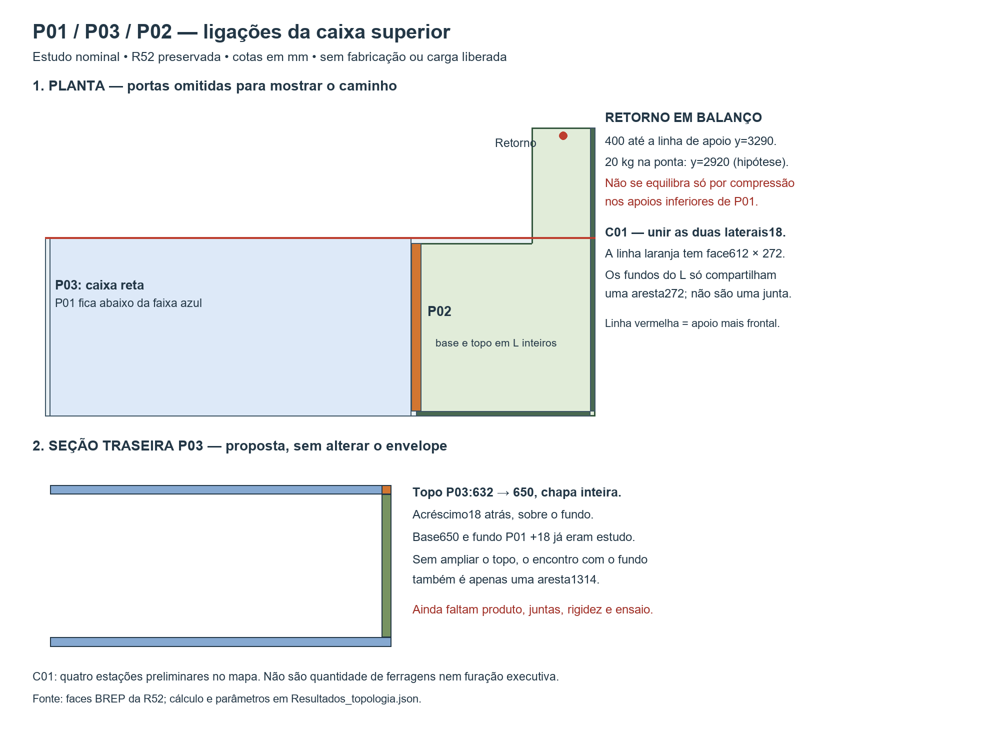

# P01/P03 — equilíbrio da caixa completa e ligações compartilhadas

## Decisões de uso P02 — agenda 27/10

Preparado em 26/10/2026. **Sem resposta registrada; nenhuma opção adotada.** Escolher requisitos de uso não comprova capacidade do móvel. O projeto só volta ao dimensionamento quando houver uso definido e dados reais de material/juntas; não repetir as varreduras existentes para tentar escolher por Elias.

| Pergunta fechada | Opção A | Opção B | Consequência que precisa ficar explícita |
|---|---|---|---|
| U1 — Qual conteúdo quer priorizar no P02? | Roupa de cama/volumes leves de uso eventual | Caixas/objetos densos e uso frequente | B exige atender concentrações e acesso repetido; A não significa peso nulo. As duas malas de10kg são requisito do P03, não carga automaticamente transferida para P02 |
| U2 — Qual massa total de conteúdo quer solicitar como requisito inicial? | Até10kg no P02 inteiro | Até20kg no P02 inteiro | Valores incluem recipientes e conteúdo, além do peso próprio/ferragens tratado pelo projeto. Nenhum dos dois foi demonstrado como capacidade. Se os itens pesarem mais, suspender esta escolha e pesar/inventariar antes de definir outro requisito |
| U3 — Aceita restringir objetos mais pesados à região apoiada, deixando a ponta do retorno para volumes leves? | Sim; aceita uma organização com zonas identificadas | Não; quer liberdade para colocar o conteúdo também na ponta | A reduz liberdade de armazenamento, mas não elimina ligação positiva e ensaio. B mantém o caso de ponta como requisito; os20kg na ponta já investigados não ficaram demonstrados |
| U4 — Se a solução exigir mudança visível ou perda de vão para atender ao uso, qual caminho deve ser apresentado primeiro? | Preservar vãos/aparência e rever a carga/organização | Apresentar uma alternativa de detalhe com perda de vão/custo quantificados para nova decisão | B autoriza somente preparar comparação; não autoriza aplicar reforço, reduzir móvel ou modificar CAD |

**Como registrar a resposta depois:** U1=__; U2=__; U3=__; U4=__; data/fonte=__. Até lá, manter pendência de uso/carga. Não rotular10kg como alternativa segura e20kg como alternativa insegura: falta demonstração do conjunto em ambos os casos.

**O que não cabe a Elias dimensionar:** tipo/quantidade de fixador, rigidez C01, apoio ao piso, ensaio da chapa e corte do fundo P01. Projeto/oficina precisam apresentar produto, montagem e resultado; usuário decide uso e concessões. Não reabrir as duas portas independentes e a quina fixa do P02 nem a preferência A do P03 já registrada. No P01, permanecem fundo inteiro/fornecimento, juntas, soco e nivelamento; no P03, deformação e ferragens. [Bloqueios técnicos vigentes](../../P03/README.md).

**P03/P02/piso:** [1728 casos acoplados](../../P03/README.md). C01:seis posições passantes candidatas;201N tração/33N cisalhamento na hipótese central. Divisória→base18→soco62:9900mm² nominais, base≈0,05mm. Produto/ensaioMDF, nivelamento, juntas e deformação superior pendentes;20kg não demonstrados. R52 preservada sem abrirCAD.

25/10/2026. **P02 agora também está individualizado: o retorno exige uma ligação positiva no caso de carga concentrada investigado.** Foi preparada a topologia nominal P01/P03/P02, com proposta separada de topo P03 inteiro mais profundo. Não é dimensionamento das juntas, cálculo de flecha ou liberação de fabricação. A etapa anterior de equilíbrio P03 continua documentada abaixo e não deve ser confundida com este novo corte.

A R52 foi aberta em processo separado FreeCADCmd, apenas para leitura; hash preservado. Nenhum documento da GUI foi acessado. R52 e todos os estudos anteriores permanecem intactos. Soco e alongamentos continuam propostas separadas, sem tubos e sem integração automática.

## Topologia vigente de estudo e resultado novo

**Novo requisito P03:** [duas malas de bordo e comparação da abertura](../../P03/README.md). Alternativas672 ×306 ou650 ×306, ambas com recuo20 nas laterais/base/topo, passaram nas amostragens de frentes/duas malas550 ×350 ×250. B650 usa três dobradiças candidatas/calço3, revestimentos/faixas (+4,95kg de madeira fixa a800) e novas uniões por face.72 cortes de equilíbrio separado P03→P01 incluem conteúdos0/20/30kg e portas abertas, sem provar resistência ou caixa P02 acoplada. Aplicação autorizada se atender; proporção baixa, ferragens, fixações e caixa ainda pendentes. Não somar resultados antigos como se a geometria fosse a mesma.

**Mockup de abertura P02:** [quatro situações — fechado, só A, só B e ambas abertas](Abertura_armario_L.png). Duas portas independentes, quina fixa e curso ilustrativo86°, a partir das vistas CAD do canto simplesR04 ainda vigente nas portas P02. Azul/âmbar apenas identificam as folhas; acabamento geral amadeirado. Imagem gerada com a ferramenta integrada `image_gen`, conferida visualmente; não substitui geometria, verificação de colisões ou validação do limitador. [Prompt e referências](Abertura_armario_L_prompt.txt). Não houve abertura ou alteração do FreeCAD para criar este mockup.

| Frente | Evidência nova | Direção de projeto |
|---|---|---|
| P02 individualizado | Dez madeiras, incluindo duas folhas, conferidas por volume, centro e caixa contra o inventário anterior; oito painéis estáticos | Base e topo em L inteiros; fundos, apoios terminais e suas uniões próprios. Portas não contraventam a caixa |
| Retorno | Avança 400 à frente da linha mínima de apoio P01, Y3290; região de uso investigada em X7275/Y2920 | Não contar esse trecho como apoiado pela lateral P01, que só começa em Y3372; continuação frontal começa em Y3290 |
| Ligação C01 | Face comum Peca259 ↔ LateralApoioPrincipal, X6740, 612 × 272; duas chapas18 encostadas | Desenvolver uma união positiva face a face, capaz de transferir esforços entre P02 e P03. Não contar base/topo/fundo P02 contra a mesma lateral como juntas independentes adicionais |
| Canto dos fundos P02 | Peca255 ↔ Peca256 compartilham apenas a aresta vertical272, sem área de face | Não prever Confirmat direto nessa aresta. Cada fundo deve ligar-se à base/topo L inteiros; eventual detalhe adicional precisa de desenho próprio |
| Topo e fundo P03 | Peca263 ↔ Peca261: só aresta1314 na R52 e no estudo traseiro anterior | Nova hipótese: substituir o topo inteiro1314 × 632 × 18 por1314 × 650 × 18. Acrescenta18 para trás, criando face23652mm² sobre o fundo, sem ampliar envelope externo ou reduzir o vão |
| Faixas da quina P02 | Cada faixa tem folga2 para base e topo; entre si existe face5508mm² | Desenhar fixação à caixa que atravesse a folga, com acesso; não usar as faixas como pilares ou caminho de carga |

O novo topo não é uma tira18 colada. A hipótese `caixa_fechada_ESTUDO` reaproveita fundo P01 +18 de altura e base P03 +18 de profundidade do estudo anterior, acrescentando a troca do topo inteiro. O acréscimo do topo é425736mm³, ou0,341kg à densidade hipotética800; conjunto das três mudanças1,190kg. Não existe alteração na R52 nem autorização para incorporar essa alternativa. A análise geométrica nova cobre os22 painéis selecionados: nenhuma sobreposição positiva; ferragens, outros objetos do apartamento, transporte e acesso de ferramenta ainda precisam de conferência.

### O caso que exige transferência entre caixas

Foram avaliados81 cortes: três geometrias × densidades hipotéticas650/800/900 × conteúdos0/10/20kg por caixa × três posições de conteúdo P02. P03 usa conteúdo em faixa frontal, CGY3320. P02 compara centro da área L, posição anteriorY3300 e pontaY2920. Folhas na pose salva, sem ferragens presumidas.

- Em nove casos (20kg na ponta, nas três densidades e três geometrias), **não existe equilíbrio só com compressão nos contatos P02–P01**. O certificado é geométrico: o CG fica à frente de todos esses contatos.
- Exemplo800: madeira P02 27,841kg, CGY3491,580; com20kg na ponta, massa47,841kg e CGY3252,630. O apoio mais frontal começa emY3290. Falta uma ação resistente equivalente de pelo menos17,532Nm em relação àquela linha. Não é o momento de cada parafuso nem um envelope completo da junta.
- Os limites da condição frontal, mantendo essa pose e desprezando ferragens, seriam12,324/15,168/17,064kg na ponta para650/800/900. **São fronteiras matemáticas da hipótese, não cargas permitidas.**
- O corte agregado P02+P03 tem distribuição compressiva possível nos81 casos quando se admite uma ligação positiva entre as caixas. Isso é condição necessária; não demonstra equilíbrio de cada painel, comportamento da ligação C01, rigidez ou resistência do conjunto.

No corte local do retorno emY3290, o exemplo800 com20kg na ponta exige262,497N e87,344Nm, incluindo as madeiras situadas à frente. Se, como hipótese de caminho, todo o momento fosse transmitido por um par axial entre os planos médios do topo/base separados290, o par seria301,185N. Isso não seleciona número de parafusos, capacidade ou rigidez composta. O modelo anterior usava apenas a posição P02Y3300: ele não abrangia este caso de ponta.

### Montagem a desenvolver e dados para encerrá-la

1. Montar P03 e P02 em bancada, preservando para suas uniões ocultas a estratégia já escolhida nas fichas R14: **Confirmat7×50 + cavilhaØ8×30**. Não extrapolar essa estratégia para qualquer orientação: a aresta fundo–fundo não a recebe, e7×50 atravessaria a espessura total36 de uma ligação face a face.
2. Em P02, unir base/topo a cada fundo e apoio terminal; ligar Peca255 à lateral principal e Peca256 ao apoio da portaB. A ação de caixa exige transmissão efetiva de cisalhamento e separação nessas juntas, não apenas apoio vertical. Fixar as faixas da quina sem atribuir-lhes papel estrutural.
3. Desenvolver C01 entre as duas laterais. Foram reservadas **quatro estações preliminares**, eixoX, deX6722 a6758: combinações deY3370/3862 eZ2210/2362, com60 às bordas da face útil. São posições de estudo, não quatro fixadores dimensionados nem furação. Conferir dobradiças, ferramentas e fechamento antes de reservar qualquer volume de usinagem.
4. Para C01, comparar somente a família4×30 já usada em outros encontros face a face (penetração nominal12 na segunda chapa, sobra6; capacidade ausente) e um conjunto passante próprio para36mm (produto e desenho ainda ausentes). Não usar atrito de aperto como resistência presumida nem escolher comprimento de conjunto sem ficha. Confirmat50 não é alternativa face a face.
5. Descer as ações simultâneas até os receptores reais de P01: travessa frontal, divisória, laterais e fundo proposto. O efeito do acoplamento pode tracionar/solicitar juntas de P03/P01; não creditar simplesmente a massa vizinha como lastro sem ligação até a base e retenção.

**Próxima evidência exigida:** código/substrato real da chapa; desenho e curva/capacidade do grupo Confirmat+cavilha em união de topo/aresta nas orientações propostas; produto C01, espessura de aperto, furos, tolerâncias e comportamento em cisalhamento/abertura; desenho dos grupos e acesso; então modelo compatível de painéis/juntas e verificação de deformação, estabilidade e resistência. Se curvas não estiverem publicadas, preparar ensaio de junta na chapa real. Não inventar rigidez para aproveitar os certificados estáticos. O fundo P01 inteiro/emenda e os apoios inferiores continuam condições próprias.

Dados novos: [geometria por painel](Geometria_P02_individual.json), [mapa de juntas](Mapa_juntas.csv), [81 casos e parâmetros](Resultados_topologia.json) e [verificação independente](Verificacao_topologia.json). Scripts em `ferramentas/roupeiro/`: `extrair_caixa_superior.py` (FreeCADCmd, somente leitura), `analisar_caixa_superior.py` e `verificar_caixa_superior.py` (Python comNumPy/Pillow). Conferidos153 certificados de equilíbrio e nove certificados de inviabilidade, além de nove cortes locais por volumes analíticos. A conferência valida geometria/aritmética, não capacidade.

**Conferência:** hashR52 preservado. A execução completa anterior foi interrompida sem resultado; não está aprovada. A base de comparação hoje existe, mas não foi criada/ajustada neste estudo. Antes de integrarCAD, concluir as verificações exigidas. A matriz usa `organizar_entregas.py --somente-roupeiro`, preservando os demais17 móveis.

## Etapa anterior — consulta, sem nova varredura

O estudo anterior tratava P03 por painéis e P02 como resultante agregada; não individualizava flexão/uniões do retorno. As três topologias eram R52 sem soco, soco sem traseiro e soco com fundo P01+18/base P03+18. Geometrias e hipóteses estão em [Geometria_interfaces.json](Geometria_interfaces.json) e [Interfaces_nominais.json](Interfaces_nominais.json); os54 cortes e12 equilíbrios em [Resultados_caixa.json](Resultados_caixa.json). O peso de todo o roupeiro não está contido nesse submodelo:38 madeiras inferiores, ferragens, conteúdos e espelho exigem o inventário global.

Os [envelopes superiores](Envelopes_superiores.csv) mostram que o novo contato traseiro não garante alívio frontal; soco muda o caminho inferior, não o apoio superior. Limites por receptor não podem ser somados entre cenários. O acoplamento P02/P03 só vale com ligação positiva demonstrada.

Os12 [exemplos de ligação](Ligacoes_exemplos.csv) são soluções algébricas de norma mínima, normalizadas com1000mm; não representam rigidez, capacidade, partilha prevista nem quantidade de parafusos. O autoequilíbrio não nulo mostra que equilíbrio sozinho não determina envelope finito de esforços de junta: faltam curvas reais e compatibilidade. Contatos apenas normais não fecham as três topologias; isso exige especificar juntas, sem inferir falha física a partir desse modelo incompleto.

**Correção preservada:** o apoio traseiro do topo P03 emY3922–3940 era concessão hipotética; na R52 topo632 encontra fundo apenas em aresta1314. O estudo topo650 cria face, alterando massa/CG; não herda automaticamente os37,058Nm do argumento anterior. Os dados do P03 acoplado prevalecem sobre a antiga caixa isolada. Para deformação/resistência, obter chapa e lei de juntas, demonstrar fundo inteiro ou emenda, nivelamento, piso e retenção. Não presumir caixa rígida nem acrescentar molas sem fonte.

## Reprodução e verificação

- `extrair_interfaces.py`: executado peloFreeCADCmd1.1.4, somente leitura. Confere volume, CG eBBox dos14 corpos retangulares com inventárioR51; fonteR52 eR51 com hashes preservados. O log registra avisos de cache/preferências do processo emsandbox; o JSON e a conferência de hashes confirmam a extração.
- `python calcular_caixa.py`: requerNumPy; cerca de1segundo nesta execução. Não lê/escreve modeloCAD.
- `python verificar_caixa.py`: lê os resultados sem importar o resolvedor; soma forças e momentos globais por corpo, verifica compressões, peso, cortes compartilhados e o contraexemplo de autoequilíbrio.
- [Verificacao_caixa.json](Verificacao_caixa.json):12 casos por corpo,54 cortes; maior resíduo4,7×10⁻¹²N e3,1×10⁻⁸Nmm. Esses resíduos verificam a aritmética do modelo, não suas propriedades físicas ausentes.

Fontes preservadas: [caminho traseiro anterior](../../P01/Caminho_superior_P03/README.md), [soco e apoios](../../P01/Apoios_ao_piso/README.md), [massa/equilíbrio global](../../P01/Massas_equilibrio/README.md). Dados desta entrega: [Geometria_interfaces.json](Geometria_interfaces.json), [Interfaces_nominais.json](Interfaces_nominais.json), [Resultados_caixa.json](Resultados_caixa.json). Nenhum ensaio de carga ou autorização de fabricação foi produzido.
