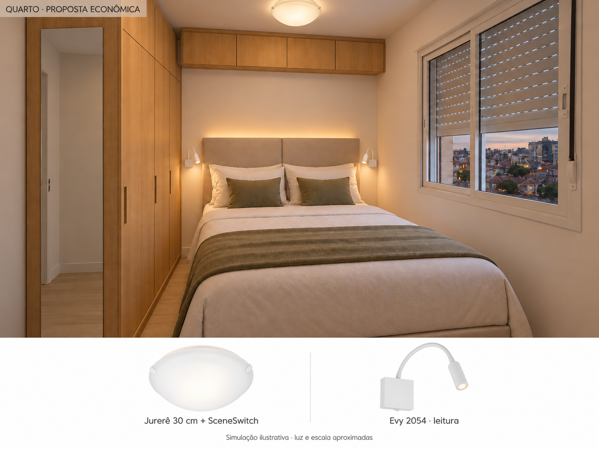
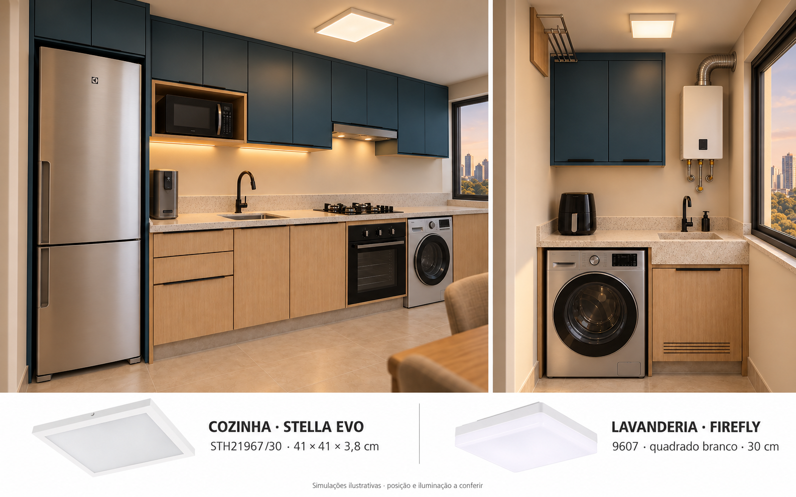
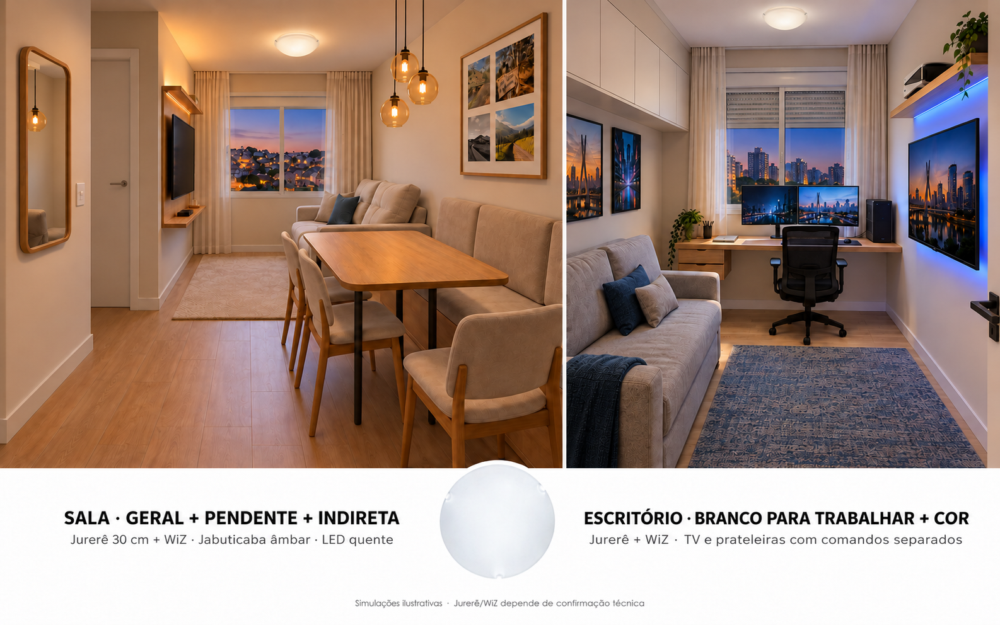
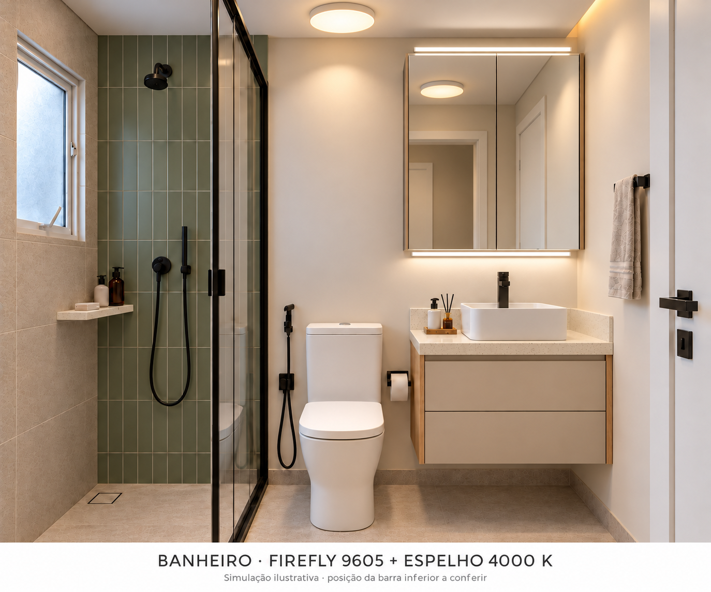

# Luminárias nos ambientes

24/10/2026. Simulações feitas com as referências do projeto. Formato, escala, reflexos e intensidade da luz são aproximados; as imagens não comprovam encaixe ou desempenho luminoso.

## Quarto: proposta econômica

Elias escolheu três níveis de brilho pelo interruptor comum. O Liny de cerca de R$500 foi retirado. Jurerê branco30cm + duas Philips SceneSwitch branco-quente: referência de R$109,88, sem frete e instalação. As arandelas Evy e a indireta da cabeceira continuam separadas. Confirmar SKU, disponibilidade, encaixe e manual das lâmpadas.

## Cozinha e lavanderia

Stella EVO STH21967/30 na cozinha; Galaxy Firefly9607 quadrado na lavanderia. Propostas para escolha, com luz3000K. Posições dependem da abertura dos armários e das sombras do varal.

## Sala e escritório

Sala com luz geral, pendente âmbar e LED quente acima da prateleira da TV. Escritório com geral branca e cores de apoio, preservando comandos separados. Jurerê/WiZ depende de compatibilidade física e térmica.

## Banheiro

**Desatualizada em 30/10/2026:** a parede da janela ainda está clara; gabinete e papeleira também são anteriores. Usar apenas como comparação histórica de iluminação. [Imagens atuais e prompts](../../ferramentas/moodboard/README.md).

Firefly9605 redondo no teto; duas barras horizontais4000K no espelho. Teto e indireta3000K. Posição da barra inferior depende da torneira e da montagem real.

Os móveis e eletros secundários dos renders anteriores podem diferir do CAD atual. As imagens não alteram o projeto técnico. [Revisão econômica CB02](../../03_Ambientes/Iluminacao/Fechamento_custo_beneficio/Revisao_quarto_CB02.md) · [Composição de componentes](../../03_Ambientes/Iluminacao/Fechamento_custo_beneficio/Composicao_CB02.json).
