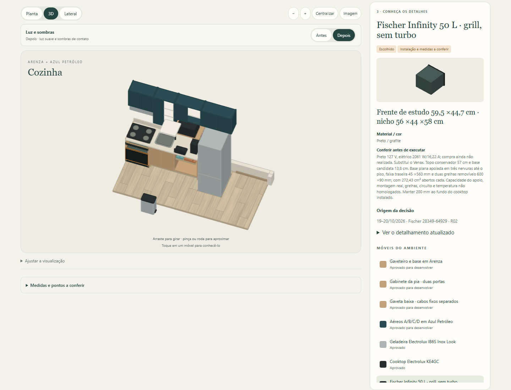
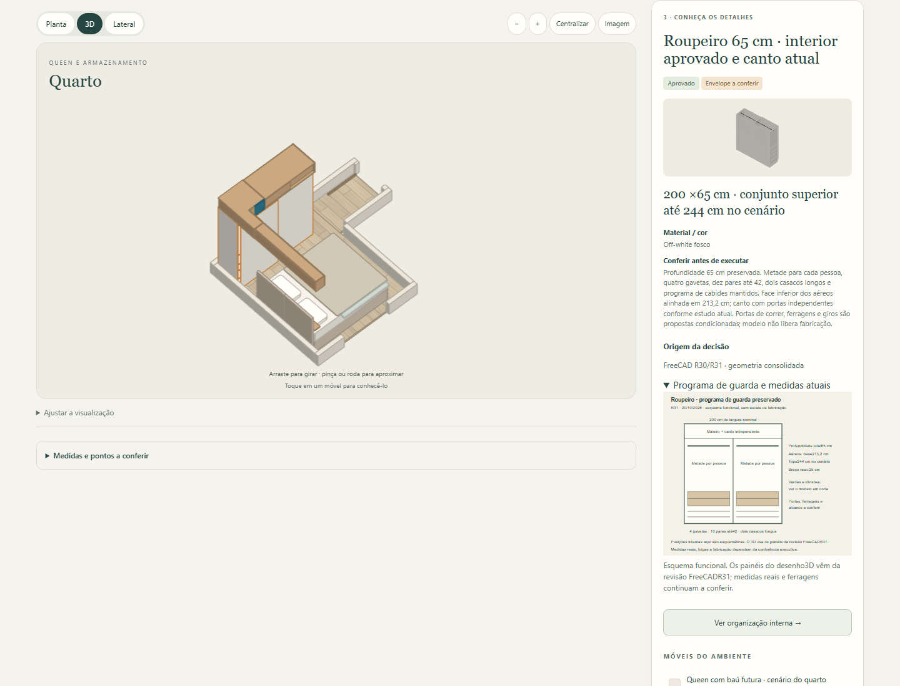
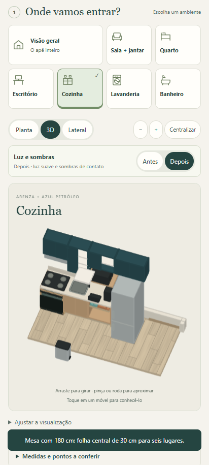

# Site R11 — consolidação com o FreeCAD R31

20/10/2026 · [Site](https://queiroz-labs.github.io/guedala-park/) · [HTML autônomo](../Guedala_Park_Interativo.html) · [Modelo de origem](../../../02_Modelo_3D/Componentes/Consolidacao/Consolidacao_R31_README.md).

Móveis fixos atualizados a partir de 327 peças do FreeCAD R31, com o mesmo espelhamento do apartamento. Inclui módulo do Fischer com apoio e grelhas, armários e interiores atuais, cabeceira, banco de estudo e apoios do cesto. Fichas e escolhas incorporam Fischer sem turbo, KE4GC/GN, cama atual de viúvo e queen futura, inventário, ciclismo, iluminação do banheiro e TV com aplicativos na própria TV.

**Banco: preferência registrada, reversão adiada.** Elias não gostou da bandeja pela lateral e quer retomar depois a guarda convencional abrindo o baú. Pediu apenas anotar. A representação atual é estudo a revisar; não foi criada a geometria da futura reversão.

O esquema funcional do roupeiro foi atualizado. Os detalhes do forno e do banco podem ser consultados nas fichas. Medidas e instalações pendentes continuam identificadas. Sofás, mesa, cadeiras e outros estados de uso mantêm representação ilustrativa; a exportação não replica todos os mecanismos do CAD.

[Conferência no navegador](Verificacao_site_R11.json): 21 combinações ambiente/vista, computador 1440 × 1100, celular 412 × 915, fichas, controles, movimento existente da folha, imagem do roupeiro, abas e cópia HTML reaberta. Sem erro de execução, dependência externa ou transbordamento horizontal nesses cenários. Não substitui teste físico no telefone. O teste de iluminação também passou, preservando o modo anterior e contatos acompanhando os móveis.

As quinas do CAD são desenhadas sem expor as diagonais internas da tesselação. A publicação usa somente os cinco arquivos permitidos de `.site`; modelos, fontes e documentos não são incluídos no artefato Pages.

